# Implicit state machines

Audited base: `9984463675b77b9fe630f156f6328a4805ebc0b6` (`feat(loom): verified child re-entry, read join and D2 tier (WV-S1 P5c1) (#405)` on `main`).

Search covered `packages/*` (loom, Fabric, AgentSOP, gateway, weft, gauge, tapestry), `checks/`, and the lifecycle contracts (`VISION.md`, `CONTRACT.md`, `GLOSSARY.md`, `AGENTS.md`, `packages/weave/src/sites/CONTRACT.md`, workstream and context-budget contracts). Benchmarks and presentation tokens were scanned for status lifecycles and did not add a finding. Quotes below are the file text at that SHA.

Already explicit, so not findings: `transitionProcess` (`packages/weave/src/operating-process.ts`), `transitionWorkstream`, and `DECIDE1_RULES` (`packages/weave/src/decide1.ts`). Those are guarded switches or a frozen rule table. The items below are lifecycles still encoded as status strings, flag products, null-vs-array, or ordered `if` chains, where an explicit machine removes an illegal combination, closes a transition, or makes replay, cancellation, or a review pin exhaustive.

Sizes: **S** one module and its tests, no durable schema change; **M** a few modules, moving tests, maybe a record version; **L** journal migration or a new port.

## 1. Dispatch cancellation is not a journal state

**Location.** `cancellation`, `dispatchIntent`, `shouldAsk`, `isResumable`, `RESUMABLE` in `packages/weave/src/dispatch.ts`. Spec in `packages/weave/src/sites/CONTRACT.md`. Tests `dispatch.test.ts` cases 13 and 38.

**Before.** A decision id moves open, then claimed, then presented, then a journaled decision. Abort is a side return. `cancellation` builds `paused` / `cancelled` with a null receipt and does not append or emit. `dispatchIntent` returns that object on abort before present, after present, and after the port call. The journal is left as it was: a presented intent stays presented, and `release` in the `finally` of `attemptIntent` retires the attempt.

The same reason string means two different lifecycles. A stage observation with reason `cancelled` is re-asked on resume (`shouldAsk`). A dispatch decision with reason `cancelled` is not in `RESUMABLE`, so `isResumable` is false and `MemoryDispatchJournal.terminal` would treat an appended cancel as closed. Today the function never appends, so that closed state is only latent. The caller observes a decision the journal does not hold. The next call observes the claim, and if the intent was presented it settlement-reads. Two observers of one abort do not share a state.

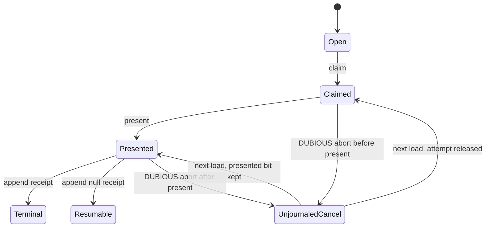

`UnjournaledCancel` is a return value. It is not a place the journal can be.

**Evidence.**

```2084:2100:packages/weave/src/dispatch.ts
/** A local abort: unappended `paused / cancelled`; it never proves a presented effect did not happen. */
function cancellation(request: DispatchRequest, checkpoint: DispatchCheckpoint, entry: number): DispatchDecision {
  const decider = checkpoint.child === null ? lastDecider(checkpoint) : childDecider(checkpoint);
  return {
    schema: 'dispatch.decision@6',
    decision_id: checkpoint.decision_id,
    entry,
    state_revision: checkpoint.state_revision,
    decided_by: decider.decided_by,
    choice: decider.choice,
    status: 'paused',
    reason: 'cancelled',
    rule_table: DECIDE1_RULE_TABLE,
    decide1: traceFields(gateTrace(request, checkpoint, 'cancelled')),
    child: checkpoint.child,
    intent: checkpoint.intent,
    receipt: null,
```

```2271:2284:packages/weave/src/dispatch.ts
  if (signal?.aborted) return cancellation(request, checkpoint, entry);
  if (!journal.present(request.request_id, attempt)) return yielded(request, journal);
  let raw: unknown = null;
  try {
    // The spawn port and child intents get a detached copy, so nothing a port does can reach a record.
    raw =
      intent.kind === 'spawn'
        ? await ports.spawn!(clone(intent), signal)
        : await ports.dispatch('child' in intent ? clone(intent) : intent, signal);
  } catch {
    // Never put an injected exception in evidence; the receipt is null.
    raw = null;
  }
  if (signal?.aborted) return cancellation(request, checkpoint, entry);
```

```177:181:packages/weave/src/sites/CONTRACT.md
Merged P3a's single-use attempts, `present()` compare-and-set and settlement
precedence are preserved: elapsed time cannot retire an attempt, unresolved
settlements remain nonterminal `dispatch_unconfirmed`, and only an append
winner emits. A same-id concurrent loser reports the journal's owner without
appending a second entry. Durable-journal follow-up #397 remains separate.
```

`shouldAsk` (`dispatch.ts:1965-1968`) re-asks a stage whose reason is `cancelled`. `isResumable` (`dispatch.ts:1970-1971`) accepts only `decision_unavailable`, `budget`, and `dispatch_unconfirmed` (`dispatch.ts:346`). Case 13 (`dispatch.test.ts:877`) and case 38 (`dispatch.test.ts:2344`) pin "writes nothing". [Issue #397](https://github.com/CrowBe/weave/issues/397) is the open durable-journal follow-up named on the contract line above. [#405](https://github.com/CrowBe/weave/pull/405) is the audited commit; it kept this cancel shape for child re-entry.

**After.** One slot phase, and cancel is a transition into it.

```ts
type Cancel =
  | { readonly phase: 'cancelled_before_present' } // resumable, no effect claimed
  | { readonly phase: 'presented_unsettled'; readonly attempt: string }; // must settlement-read

function onAbort(slot: Slot, signal: AbortSignal): Slot {
  if (!signal.aborted) return slot;
  switch (slot.phase) {
    case 'claimed':
      return { ...slot, phase: 'cancelled_before_present' };
    case 'presented':
      return { phase: 'presented_unsettled', intent: slot.intent, attempt: slot.attempt };
    default:
      return slot;
  }
}
```

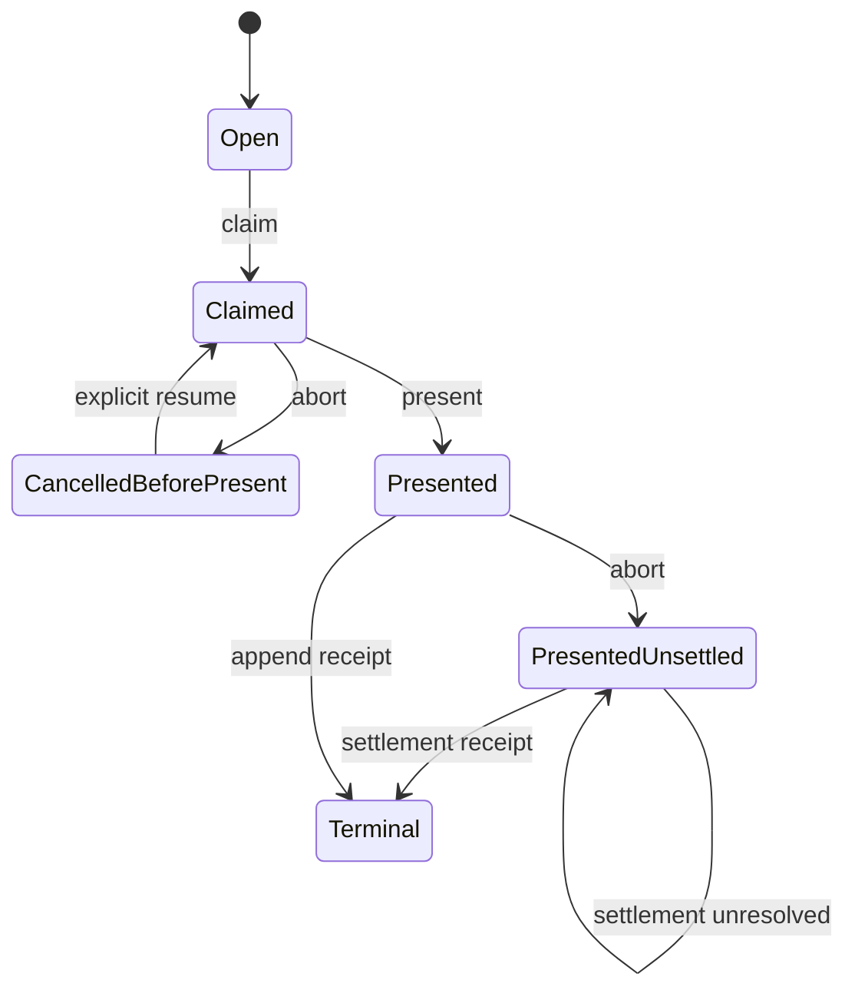

**Improvement.** A caller cannot observe `paused` / `cancelled` unless that phase is what `load` returns. Post-present abort cannot be mistaken for "the effect did not happen" and cannot be re-asked as a fresh stage. `shouldAsk` and `isResumable` become one exhaustive switch on the phase. Enforcement: extend cases 13 and 38 so the returned decision deep-equals the journaled phase, and a pure `transitionDispatch` of that phase replays it. A `checks/` scan is the wrong tool; the switch's `never` default is the lint.

**Cost and risk.** M. Touches `dispatch.ts`, `sites/CONTRACT.md`, `dispatch.test.ts`, `dispatch-child.test.ts`. Journal schema gains a cancel phase. In-memory journals need no migration. A future durable journal ([#397](https://github.com/CrowBe/weave/issues/397)) must store the phase in the same record as `presented`. Callers that treated the unappended object as durable start seeing a record. Pre-present cancel stays effect-free.

**Fit.** This is the P5c2 cancel-journal work, sequenced with [#397](https://github.com/CrowBe/weave/issues/397). [#405](https://github.com/CrowBe/weave/pull/405) has landed; child abort should use the same phase, not a second path. Independent of P5c3 budget custody. Land the slot type in finding 5 first or in the same change.

## 2. `yielded` rewrites a claimed resumable receipt

**Location.** `yielded`, `receiptResult`, `MemoryDispatchJournal.terminal` in `packages/weave/src/dispatch.ts`. Child and root both use `yielded` (`decideChild`, `decideDispatch`, `settle`, `recoverAttempt`).

**Before.** `terminal` is "latest decision exists and is not resumable". A paused `budget` or `dispatch_unconfirmed` decision leaves the slot claimed. `yielded` returns that latest decision only when it is absent from the resumable set or the checkpoint has no intent. When the latest decision is resumable and the intent is claimed, `yielded` ignores it and calls `transitionDispatch` with a null receipt and entry `decisions.length + 1`. `receiptResult` maps a null receipt to `paused` / `dispatch_unconfirmed` for every dispatch plan.

A stored `budget` pause therefore becomes, for the compare-and-set loser, a different decision: new entry, null receipt, reason `dispatch_unconfirmed`. A stored `dispatch_unconfirmed` happens to match the synthesized reason. The comment's third clause (return the latest resumable pause) runs only when the checkpoint has no intent, which is a pre-claim stage pause, not a post-claim receipt.

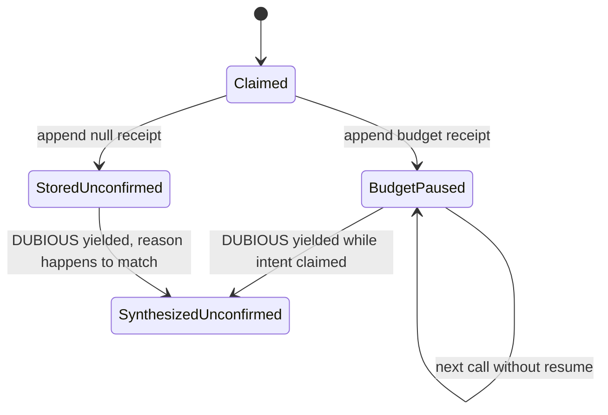

**Evidence.**

```2143:2163:packages/weave/src/dispatch.ts
/**
 * Another writer won the decision's compare-and-set, or holds its claimed intent's live attempt.
 * Fail closed on our own plan and report what the journal holds: a terminal decision, else the
 * unconfirmed replay of a claimed intent, else the latest resumable pause. Nothing is written.
 */
function yielded(request: DispatchRequest, journal: DispatchJournal): DispatchDecision {
  const loaded = journal.load(request.request_id);
  assertEntry(request, loaded);
  // A losing child validates the winner under the winner's frozen terms, not its own snapshot.
  const owner =
    request.child === undefined || loaded.checkpoint?.child_terms == null
      ? request
      : { ...request, terms: loaded.checkpoint.child_terms };
  if (request.child !== undefined) verifySaved(owner, loaded.decisions, journal);
  const latest = loaded.decisions.at(-1);
  const claimed = loaded.checkpoint !== null && loaded.checkpoint.intent !== null;
  if (latest !== undefined && (!isResumable(latest) || !claimed)) return clone(latest);
  if (loaded.checkpoint === null || !claimed)
    throw new Error('the journal refused this decision without recording its owner');
  const evidence = request.child === undefined ? undefined : liveEvidence(journal, owner, loaded.checkpoint.child);
  return transitionDispatch(owner, loaded.checkpoint, null, loaded.decisions.length + 1, evidence);
```

```1769:1774:packages/weave/src/dispatch.ts
function receiptResult(
  plan: Plan,
  receipt: DispatchReceipt | null,
): { readonly status: DispatchDecision['status']; readonly reason: DispatchReason } {
  if (plan.kind !== 'dispatch') throw new Error('only a dispatch plan takes a receipt');
  if (receipt === null) return { status: 'paused', reason: 'dispatch_unconfirmed' };
```

```382:385:packages/weave/src/dispatch.ts
  private terminal(decision_id: string): boolean {
    const latest = this.entries.filter((entry) => entry.decision_id === decision_id).at(-1);
    return latest !== undefined && !isResumable(latest);
  }
```

Case 12 (`dispatch.test.ts:818-851`) pins the loser of a race that has not appended a receipt yet: reason `dispatch_unconfirmed`. It does not pin a loser who runs after a `budget` receipt is already the latest entry. `recoverAttempt` (`dispatch.ts:2236-2240`) calls `yielded` when the settlement read is null, including after the winner has appended a refusal the settlement port does not echo.

**After.** Observation is a pure function of the slot. A stored decision is returned as stored.

```ts
function observe(slot: Slot): DispatchDecision {
  switch (slot.phase) {
    case 'terminal':
    case 'resumable':
      return slot.decision;
    case 'claimed':
    case 'presented':
      return unconfirmed(slot); // no decision stored
    default: {
      const _never: never = slot;
      return _never;
    }
  }
}
```

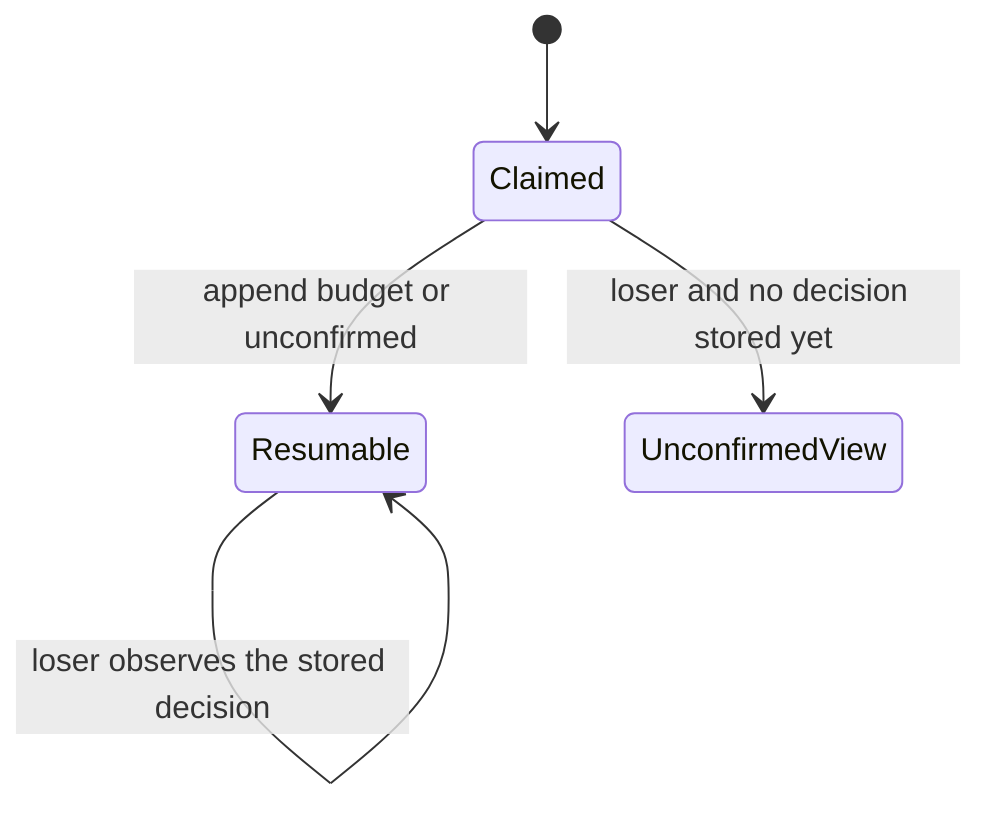

**Improvement.** A loser cannot report `dispatch_unconfirmed` when the journal's latest entry is `budget`. Entry numbers in the return value cannot run ahead of `load().decisions`. Enforcement: a behavioral test that appends a `budget` receipt, then runs a second caller whose settlement port returns null, and asserts deep equality with the stored entry. The `never` default keeps a new resumable reason from falling through to the null-receipt mapping.

**Cost and risk.** S. `yielded` and the tests that assert loser reasons. No schema change. Risk is a test that encoded the synthesized reason for a post-receipt race; case 12's pre-receipt loser stays `dispatch_unconfirmed`.

**Fit.** Standalone on the current journal. Do it before or with finding 5 so the new slot type's `observe` is the only implementation. Independent of [#397](https://github.com/CrowBe/weave/issues/397) and P5c3. The function is on the [#405](https://github.com/CrowBe/weave/pull/405) child path; no need to wait on further P5c1 work.

## 3. Action settlement is a product of `state`, `reconciled`, and `cancel_requested`

**Location.** `ActionState` at `packages/weave/src/types.ts:589` and `ActionRecord` at `packages/weave/src/types.ts:603-621`. Fold in `applyAccepted` (`packages/weave/src/state.ts`). Guards in `validateCancel` / `validateResult` / `validateReconciled` (`packages/weave/src/validation.ts`). Weft projection in `packages/weave/src/weft.ts`. Pinned by `M1-T12` (`packages/weave/test/m1.test.ts`).

**Before.** The folded record is one string plus booleans. `action.result` from `running` sets `state` to `succeeded`, `failed`, or `uncertain` and moves the reservation to spent. `action.reconciled` sets `reconciled` and, only for `succeeded`, runs `integrateSuccess`. It does not store a failed or still-uncertain settlement, and it does not change `state`. `M1-T12` then requires `state === 'uncertain'` and `reconciled === true` after a post-commit throw that did publish: success is visible on `state.publication`, not on the action. The same action shape is what a reconcile-to-failed and a reconcile-to-uncertain produce for an operation with no side effect.

`validateCancel` accepts any known action. The fold sets `cancel_requested` on every state and moves to `cancelled` only from `pending`. `succeeded` + `cancel_requested` is reachable. Weft emits `thread.transition` `cancelled` for every accepted cancel request, including one that left the action running or succeeded.

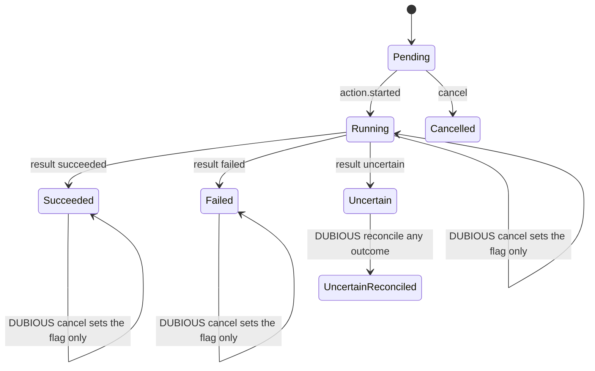

Illegal combinations the type also allows, and the fold does not use: `reconciled` with `pending` or `running`; `failure` set on `succeeded`; `finished_at` set on `pending`.

**Evidence.**

```405:435:packages/weave/src/state.ts
    case 'action.reconciled': {
      const p = observation.payload as ActionReconciledPayload;
      const record = state.actions[p.action_id];
      if (!record) {
        throw new Error(`reconciliation for unknown action ${p.action_id} passed validation`);
      }
      record.reconciled = true;
      if (p.outcome.outcome === 'succeeded') {
        integrateSuccess(state, record, p.outcome.output, observation.seq);
      }
      return;
    }
    case 'recovery.attempted': {
      state.recovery.spent += 1;
      return;
    }
    case 'recovery.exhausted':
      return;
    case 'action.cancel_requested': {
      const { action_id } = observation.payload as { action_id: string };
      const record = state.actions[action_id];
      if (record) {
        record.cancel_requested = true;
        if (record.state === 'pending') {
          record.state = 'cancelled';
          record.finished_at = observation.seq;
          state.budget.actions.reserved -= record.reservation.actions;
          state.budget.judgments.reserved -= record.reservation.judgments;
        }
      }
      return;
```

```151:155:packages/weave/src/validation.ts
    case 'action.cancel_requested':
      if (!isNonEmptyString(payload['action_id']) || !state.actions[payload['action_id']]) {
        return rejected('cancel names an unknown action');
      }
      return isNonEmptyString(payload['reason']) ? ACCEPTED : rejected('cancel requires a reason');
```

```192:210:packages/weave/src/weft.ts
      case 'action.cancel_requested': {
        const { action_id } = observation.payload as { action_id: ActionId };
        const action = state.actions[action_id];
        if (!action) {
          break;
        }
        // Each accepted cancel request is its own record: an operator may repeat one.
        this.send(
          seq,
          this.id(`thread:${action_id}:cancelled:${seq}`),
          'thread.transition',
          action_id,
          null,
          [{ rel: 'cancels', record_id: this.id(`thread:${action_id}:opened`) }],
          cite(),
          { transition: 'cancelled' },
        );
        if (action.state === 'cancelled' && action.finished_at === seq) {
          this.transition(seq, action, 'cancelled');
```

`M1-T12` (`packages/weave/test/m1.test.ts:352-355`) asserts the post-reconcile action stays `uncertain` with `reconciled === true` while `state.publication` is set. `validateResult` (`validation.ts:416-418`) allows a result only from `running`. `validateReconciled` (`validation.ts:444-448`) allows any outcome from an unreconciled `uncertain` action, including another `uncertain`.

**After.** The settlement is the phase. `M1-T12`'s fact (the finish was uncertain, reconciliation then succeeded) becomes a constructor, not a boolean glued to `uncertain`.

```ts
type ActionPhase =
  | { readonly phase: 'pending'; readonly cancel: 'none' | 'requested' }
  | { readonly phase: 'running'; readonly cancel: 'none' | 'requested'; readonly started_at: Seq }
  | { readonly phase: 'succeeded'; readonly finished_at: Seq }
  | { readonly phase: 'failed'; readonly finished_at: Seq; readonly failure: string }
  | { readonly phase: 'uncertain'; readonly finished_at: Seq; readonly reason: string }
  | { readonly phase: 'reconciled'; readonly from: 'uncertain'; readonly outcome: 'succeeded' | 'failed' | 'uncertain' }
  | { readonly phase: 'cancelled'; readonly from: 'pending'; readonly finished_at: Seq };

function apply(phase: ActionPhase, event: ActionEvent): ActionPhase {
  if (phase.phase === 'uncertain' && event.type === 'reconciled')
    return { phase: 'reconciled', from: 'uncertain', outcome: event.outcome };
  if (phase.phase === 'pending' && event.type === 'cancel')
    return { phase: 'cancelled', from: 'pending', finished_at: event.at };
  if (event.type === 'cancel') throw new Error('cancel is refused from this phase');
  throw new Error('unhandled');
}
```

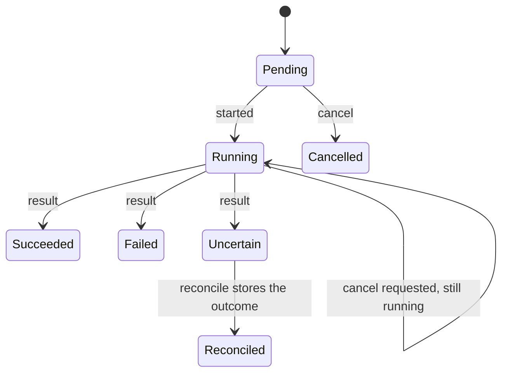

**Improvement.** Reconcile-to-failed is distinguishable from reconcile-to-succeeded and from open `uncertain` without looking at a side structure. Cancel of a terminal action is rejected by `validateCancel` and emits no Weft `cancelled` transition. `succeeded` + `cancel_requested` and `reconciled` + `running` cannot be represented. Enforcement: rewrite `M1-T12` to expect `reconciled` / `succeeded` plus the publication; add a case that reconcile-to-failed leaves no publication and is not `uncertain`; add a case that cancel of `succeeded` is rejected. Fold and Weft switch on `ActionPhase` with a `never` default.

**Cost and risk.** M. `types.ts`, `state.ts`, `validation.ts`, `weft.ts`, `views.ts` (in-flight is `pending`, `running`, or `uncertain`), and the M1 tests. Replay of existing observation logs can derive the phase; the observations already carry the reconcile outcome. Snapshots that stored the flat record need a versioned fold, not a second interpretation of `uncertain && reconciled`. Readers of `state === 'uncertain' && reconciled` change with the tests.

**Fit.** Standalone. No dependency on P5c1, [#397](https://github.com/CrowBe/weave/issues/397), or P5c3. Do not fold this into the dispatch slot; it is the runtime action log.

## 4. Host invocation transitions are guarded only for `uncertain` and `reconcile`

**Location.** `InvocationStatus`, `InvocationRecord`, `validateTransition`, `writeInvocation` in `packages/agentfabric/src/store.ts`. In-memory `OpenInvocation.phase` plus `committed` and `cancel_requested` in `packages/agentfabric/src/host.ts` (`advancePublish`, `finishStep`, `reconcilePublication`).

**Before.** The durable record is a status string plus an optional outcome, optional reconciliation, a cancel flag, and an optional CLI generation. `isInvocation` accepts `running`, `committed`, `stopped`, or `uncertain` with an outcome that need not match: `committed` with `outcome: null`, `running` with `succeeded`, `committed` with `failed` all pass the status list. Reconciliation, when present, is constrained to committed+succeeded or stopped+failed.

`validateTransition` returns before any status check unless the op is `uncertain` or `reconcile`. `start` replaces a non-CLI record in place (`applyStart`); only a previous `cli_generation` that fails `supersedes` is rejected. `result` replaces the record outright. `writeInvocation` is `op: 'result'`, and `requestCancel` uses it to stamp `cancel_requested` onto any unreconciled record, including `committed`. `reconcilePublication` uses the same op to move a legacy `stopped` record to `committed` when a publication exists. That repair is a real transition hiding in an unguarded write.

In memory, `phase` is `held | running | before_commit | after_commit | done` while `committed` and `outcome` are independent nulls. `advancePublish` acts on `after_commit` only when `committed` is set, so `after_commit` with a null publication is a stuck no-op. Shell work and publish work share the string, so a shell record can sit in `before_commit`, which `advance` ignores.

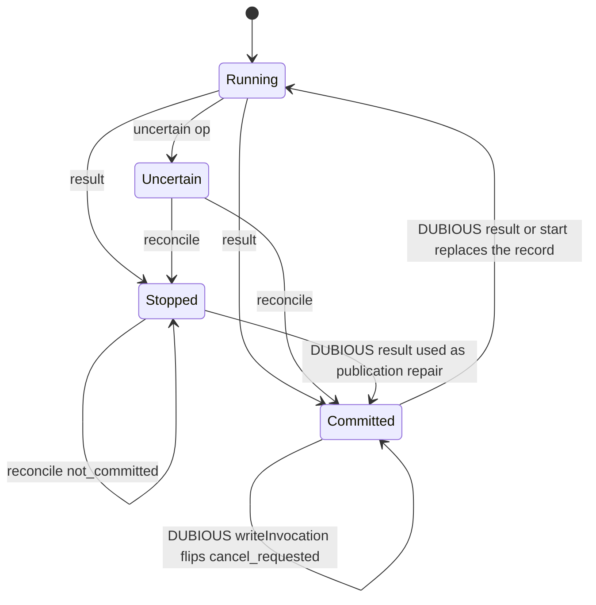

**Evidence.**

```450:453:packages/agentfabric/src/store.ts
  writeInvocation(record: InvocationRecord): void {
    this.mutate({ op: 'result', record });
    this.save();
  }
```

```684:706:packages/agentfabric/src/store.ts
      ) {
        throw new Error('invalid host store CLI generation evidence transition');
      }
    }
    if (mutation.op !== 'uncertain' && mutation.op !== 'reconcile') return;
    const previous = this.invocations.get(mutation.record.invocation_id);
    // A stopped record may only gain not_committed evidence; its terminal outcome is unchanged.
    const stoppedEvidence =
      mutation.op === 'reconcile' &&
      previous?.status === 'stopped' &&
      mutation.record.status === 'stopped' &&
      mutation.record.reconciliation?.resolution === 'not_committed' &&
      stableStringify(previous.outcome) === stableStringify(mutation.record.outcome);
    if (
      !previous ||
      previous.binding_digest !== mutation.record.binding_digest ||
      previous.action_id !== mutation.record.action_id ||
      previous.operation !== mutation.record.operation ||
      previous.reconciliation ||
      (previous.status !== 'running' && previous.status !== 'uncertain' && !stoppedEvidence)
    ) {
      throw new Error(`invalid host store ${mutation.op} transition`);
    }
```

```106:119:packages/agentfabric/src/host.ts
  phase: 'held' | 'running' | 'before_commit' | 'after_commit' | 'done';
  cancel_requested: boolean;
  /** Aborted by requestCancel. Shell runs observe it and kill the child. */
  readonly abort: AbortController;
  shellArgv: readonly string[];
  shellStdin: string;
  shellEnv: Record<string, string>;
  shellSecrets: string[];
  shellEnvAllow: readonly string[];
  shellTimeout: number;
  shellCwdRef: string;
  resolve: (outcome: InvocationOutcome) => void;
  committed: PublicationRecord | null;
  outcome: InvocationOutcome | null;
```

`advancePublish` (`host.ts:1452-1456`) finishes a cancel only in `before_commit` when `cancel_requested && !committed`. `host.ts:1477` enters the success path only for `after_commit` with a publication. `reconcilePublication` (`host.ts:1149-1156`) persists `stopped` to `committed` through `persistInvocationResult`. `isInvocation` lists the four statuses at `store.ts:1594`.

**After.** Durable ops are the transitions. The publication repair is a named one. The in-memory phase carries the publication in the variant that needs it.

```ts
type InvocationPhase =
  | { readonly phase: 'running'; readonly outcome: null; readonly cancel: boolean }
  | { readonly phase: 'committed'; readonly outcome: Succeeded; readonly cancel: boolean }
  | { readonly phase: 'stopped'; readonly outcome: Failed; readonly cancel: boolean; readonly reconciliation?: NotCommitted }
  | { readonly phase: 'uncertain'; readonly outcome: Uncertain; readonly reconciliation?: never };

type OpenPhase =
  | { readonly phase: 'held' | 'running' | 'before_commit' }
  | { readonly phase: 'after_commit'; readonly committed: PublicationRecord }
  | { readonly phase: 'done'; readonly outcome: InvocationOutcome };

function transition(prev: InvocationPhase | undefined, op: InvocationOp): InvocationPhase {
  switch (op.type) {
    case 'repair_publication':
      if (prev?.phase !== 'stopped') throw new Error('repair requires stopped');
      return { phase: 'committed', outcome: op.outcome, cancel: prev.cancel };
    case 'result':
      if (prev?.phase !== 'running') throw new Error('result requires running');
      return op.next;
    default:
      throw new Error('unhandled');
  }
}
```

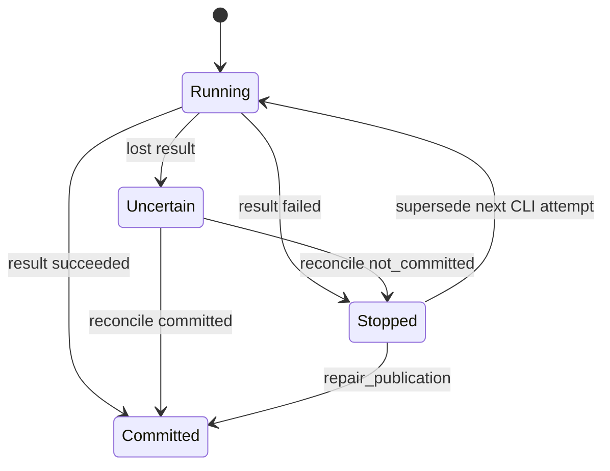

**Improvement.** Replay rejects a `result` or `start` that rewinds `committed` to `running`. Cancel on a committed record is either a legal `mark_cancel` transition that cannot change status, or it is rejected. `after_commit` without a publication cannot be constructed, so `advancePublish` cannot fall through. Enforcement: store tests that each illegal op throws on replay of a two-line journal; a host test that `after_commit` is only built with a `PublicationRecord`. Exhaustive switch in `validateTransition`.

**Cost and risk.** M. `store.ts`, `host.ts`, `cli-*.test.ts`, `uncertain.test.ts`, `store.test.ts`. Existing journals that repaired `stopped` to `committed` via `op: 'result'` must keep that as `repair_publication` or the replayer must accept the historical op as that transition only. Do not reject those lines as corruption. In-memory phase is not durable.

**Fit.** Standalone inside Fabric. Fabric must not import loom. Independent of P5c and [#397](https://github.com/CrowBe/weave/issues/397). The CLI supersede path (`supersedes` at `store.ts:1631-1643`) stays a transition of this machine; finding 7 covers the pre-start sets around it.

## 5. The dispatch slot is six collections, and a stage ask is not a compare-and-set

**Location.** `DispatchJournal` and `MemoryDispatchJournal` (`packages/weave/src/dispatch.ts` `249-447`). Stage asks in `decideDispatch` and `decideChild`. Contract pointer to [#397](https://github.com/CrowBe/weave/issues/397) at `sites/CONTRACT.md:181`.

**Before.** The interface comment describes one single-writer machine. The memory journal stores it as a checkpoint map, an intent map, a live-attempt map, a retired-id set, an issued counter, a presented set, and an append-only decision list. `load` reassembles them. `append` clears `presented` only when `receipt !== null`, then always retires the live attempt. A resumable null-receipt append leaves `presented` true with no live attempt. `terminal` is false for every resumable decision, so a later `append` may push another entry.

`checkpoint` (`dispatch.ts:386-388`) overwrites until claim or a terminal decision. It is not a compare-and-set. `decideDispatch` increments `asks.route` (and intake, triage, shadow, preflight the same way), checkpoints, then awaits. Two callers can both read `asks.route === 0` and both issue the site call for ask 1. A caller that resumes a checkpoint with `asks.route >= 1` and `route === null` sees `shouldAsk(null) === true` and mints the next ask. The in-flight ask is not a phase. Half-open checkpoints (`counter > 0`, stage field null) are representable, as are `presented` without an intent if a future journal forgets the guard `present` has today.

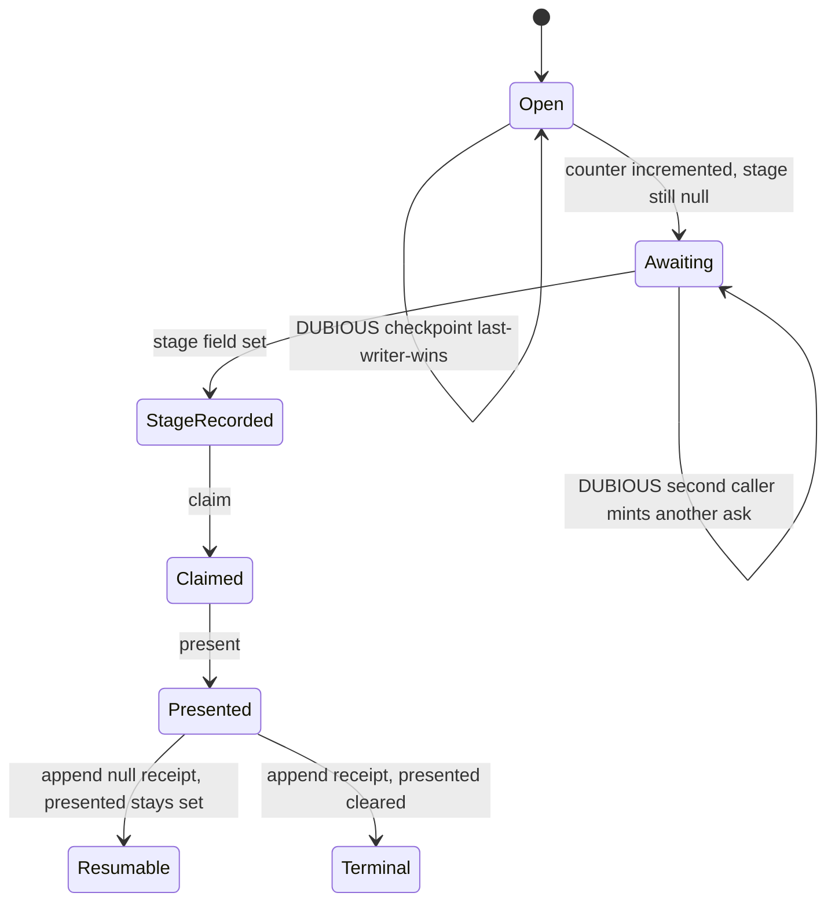

**Evidence.**

```359:369:packages/weave/src/dispatch.ts
export class MemoryDispatchJournal implements DispatchJournal {
  private readonly checkpoints = new Map<string, DispatchCheckpoint>();
  /** Claimed intents are monotonic: a later stage checkpoint never erases one. */
  private readonly intents = new Map<string, DispatchIntent>();
  /** The live attempt per decision. */
  private readonly attempts = new Map<string, string>();
  private readonly retired = new Set<string>();
  private readonly issued = new Map<string, number>();
  /** Presented intents awaiting a journaled receipt. */
  private readonly presented = new Set<string>();
  private entries: DispatchDecision[] = [];
```

```425:445:packages/weave/src/dispatch.ts
  present(decision_id: string, attempt: string): boolean {
    if (!this.live(decision_id, attempt)) return false;
    this.presented.add(decision_id);
    return true;
  }
  append(decision: DispatchDecision, attempt?: string): boolean {
    const id = decision.decision_id;
    if (this.terminal(id)) return false;
    if (attempt !== undefined && !this.live(id, attempt)) return false;
    const claimed = this.intents.get(id);
    if (claimed === undefined) {
      if (decision.intent !== null) throw new Error('appended decision names an intent that was never claimed');
    } else if (decision.intent === null || !sameRecord(decision.intent, claimed)) {
      return false;
    } else if (attempt === undefined && this.attempts.has(id)) {
      return false;
    }
    this.entries.push(clone(decision));
    if (decision.receipt !== null) this.presented.delete(id);
    this.retire(id);
    return true;
```

```2558:2564:packages/weave/src/dispatch.ts
      if (shouldAsk(checkpoint.route?.site.observation.reason ?? null, resume)) {
        const ask = checkpoint.asks.route + 1;
        checkpoint = makeCheckpoint(checkpoint, { asks: { ...checkpoint.asks, route: ask } });
        journal.checkpoint(checkpoint);
        if (signal?.aborted) return cancellation(captured, checkpoint, entry);
        const decision = await decideLoopRoute(loopAsk(captured, 'route', ask), ports, ports.now, signal);
        checkpoint = makeCheckpoint(checkpoint, { route: decision });
```

The same ask-then-await pattern is at `dispatch.ts:2519-2524` (intake), `2539-2544` (triage), and `2441-2446` (child D2). [Issue #397](https://github.com/CrowBe/weave/issues/397) says a durable journal must persist `present` / `presented` atomically with claim and append, or crash recovery loses a settled receipt. Only `MemoryDispatchJournal` implements the bit.

**After.** One value per decision id. Stage progress is a variant. Taking `awaiting` is the compare-and-set.

```ts
type Slot =
  | { readonly phase: 'open'; readonly checkpoint: Checkpoint }
  | { readonly phase: 'awaiting'; readonly stage: 'intake' | 'triage' | 'route'; readonly ask: number; readonly checkpoint: Checkpoint }
  | { readonly phase: 'claimed'; readonly intent: DispatchIntent; readonly attempt: null }
  | { readonly phase: 'presented'; readonly intent: DispatchIntent; readonly attempt: string }
  | { readonly phase: 'resumable'; readonly decision: DispatchDecision }
  | { readonly phase: 'terminal'; readonly decision: DispatchDecision };

function beginAsk(slot: Extract<Slot, { phase: 'open' }>, stage: 'intake' | 'triage' | 'route'): Slot {
  return { phase: 'awaiting', stage, ask: nextAsk(slot.checkpoint), checkpoint: slot.checkpoint };
}
```

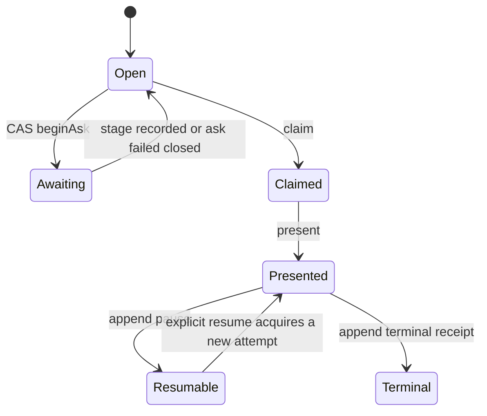

**Improvement.** `presented` without a claim, `terminal` and `presented` together, and a second in-flight ask for one stage cannot be represented. Crash recovery of a durable journal has one record to load, which is the gap [#397](https://github.com/CrowBe/weave/issues/397) names. Enforcement: a contract test any `DispatchJournal` must pass (the issue asks for this) covering present-then-crash, append-with-null-receipt, and two concurrent `beginAsk` calls with one winner. Exhaustive `switch (slot.phase)`.

**Cost and risk.** M, L if the durable adapter ships in the same change. `dispatch.ts` and a new journal test. Memory behavior can preserve ask numbers for journals that already checkpointed a half-open counter: resume of `awaiting` reuses that ask id instead of incrementing. Do this together with findings 1 and 2 so cancel and `observe` are methods on `Slot`.

**Fit.** Blocked on the decision to implement [#397](https://github.com/CrowBe/weave/issues/397) only for the durable adapter, not for the in-memory union. The union itself is standalone and should land before P5c2 so cancel has a phase to enter. P5c3 custody (finding 10) should reserve on `presented`, so it waits on this slot. [#405](https://github.com/CrowBe/weave/pull/405) does not need to be reopened.

## 6. A read join is `null`, `[]`, or an array that may still contain pending edges

**Location.** `DispatchChild.dependencies`, `witnessJoin`, `edgeStatus`, `joinOf`, `decideChild` in `packages/weave/src/dispatch.ts`. Spec in `sites/CONTRACT.md` and `GLOSSARY.md` (Read join).

**Before.** A read child stores `dependencies: []`, which `witnessJoin` classifies as satisfied because `every` on an empty array is true. A generate child stores `null` until the join is frozen, and `witnessJoin` maps `null` to `pending`. A frozen array is `satisfied` only when every receipt is a completed read; otherwise `unmet`. `edgeStatus` uses a different predicate: null or resumable decision means `pending`, `status === 'dispatched'` means `satisfied`, anything else `unmet`. `joinOf` lets `unmet` dominate `pending`.

`decideChild` leaves a `pending` join unappended. On `unmet` it freezes the edges and appends a terminal decision. An unmet edge plus a still-pending sibling is `unmet`, so the pending sibling is stored inside the terminal witness with a null receipt. `verifyWitness` accepts that, because both classifiers return `unmet`. The glossary says pending is an unappended transient. The edge is pending and it is journaled.

`dispatched` without a completed read is `satisfied` for `edgeStatus` and not for `witnessJoin`. Live entry throws in `verifyRead` before that disagreement is stored. A checkpoint that skipped that check can still hold it. Replay throws in `verifyWitness` when the two joins differ. The type does not.

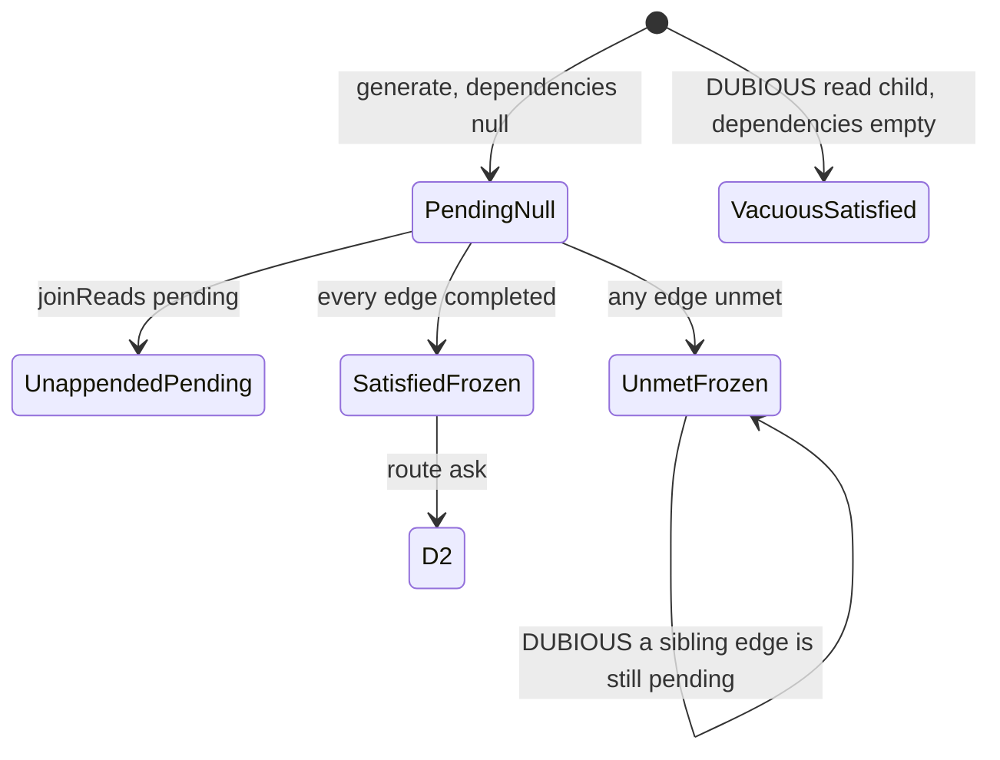

**Evidence.**

```111:113:packages/weave/src/dispatch.ts
  /** Reads: `[]`. A generator: null until its join is satisfied or terminally unmet. */
  readonly dependencies: readonly DispatchDependency[] | null;
  readonly dependencies_digest: string | null;
```

```1525:1551:packages/weave/src/dispatch.ts
function completedRead(receipt: unknown): receipt is Extract<DispatchReceipt, { readonly read: ReadResult }> {
  return isRecord(receipt) && receipt['status'] === 'dispatched' && isRecord(receipt['read']);
}

/** The join a frozen witness records; a generator without one is still pending. */
function witnessJoin(child: DispatchChild): 'pending' | 'satisfied' | 'unmet' {
  const dependencies = child.dependencies;
  if (dependencies === null) return 'pending';
  return dependencies.every((edge) => completedRead(edge.receipt)) ? 'satisfied' : 'unmet';
}

/** The safe sum of a satisfied generator's measured reads; otherwise null. */
function readBytes(child: DispatchChild): number | null {
  if (child.brief.kind !== 'generate' || witnessJoin(child) !== 'satisfied') return null;
  let sum = 0;
  for (const edge of child.dependencies!) sum += (edge.receipt as { readonly read: ReadResult }).read.bytes;
  return Number.isSafeInteger(sum) ? sum : null;
}

/** The same resumability that governs dispatch terminality governs an edge (D-P5c1-3). */
function edgeStatus(decision: DispatchDecision | null): 'pending' | 'satisfied' | 'unmet' {
  if (decision === null || isResumable(decision)) return 'pending';
  return decision.status === 'dispatched' ? 'satisfied' : 'unmet';
}
function joinOf(statuses: readonly ('pending' | 'satisfied' | 'unmet')[]): 'pending' | 'satisfied' | 'unmet' {
  if (statuses.includes('unmet')) return 'unmet';
  return statuses.includes('pending') ? 'pending' : 'satisfied';
```

```2422:2438:packages/weave/src/dispatch.ts
    if (checkpoint.child!.dependencies === null) {
      const join = joinReads(journal, verified);
      // Pending is an unappended transient: no checkpoint, D2, effect, append or emission.
      if (join.status === 'pending') {
        const plan = resolveChild(captured, checkpoint, evidence);
        if (plan.kind !== 'final' || plan.reason !== 'dependency_pending')
          throw new Error('decide1: pending join moved');
        return makeDecision(captured, checkpoint, entry, plan, null, null, plan.status, plan.reason);
      }
      const child = { ...checkpoint.child!, dependencies: join.edges, dependencies_digest: digest(join.edges) };
      checkpoint = makeCheckpoint(checkpoint, { child });
      evidence = { parent: evidence.parent, reads: join.reads };
      if (join.status === 'unmet') {
        // Frozen once: the terminal decision names this evidence, and later polls return it.
        journal.checkpoint(checkpoint);
        const plan = resolveChild(captured, checkpoint, evidence);
        return finishFinal(captured, checkpoint, entry, plan, ports, journal, fresh);
```

`sites/CONTRACT.md:516-519` specifies null until the join is satisfied or terminally unmet, and null receipt fields for a missing decision. `GLOSSARY.md:272-275` says any unmet edge makes the join unmet, and that pending is an unappended transient. `P5c1-5` in `dispatch-child.test.ts` covers out-of-order reads and resumable edges. It does not require an unmet freeze to wait out a still-pending sibling, because the glossary lets unmet win.

**After.** The witness is the phase. A pending edge inside a terminal join is an `abandoned` edge, not a null that `edgeStatus` would call pending. One function classifies an edge.

```ts
type Edge =
  | { readonly status: 'satisfied'; readonly read: ReadResult }
  | { readonly status: 'unmet'; readonly decision: DispatchDecision }
  | { readonly status: 'abandoned' }; // sibling still pending when another edge was unmet

type Join =
  | { readonly status: 'pending' }
  | { readonly status: 'satisfied'; readonly edges: readonly Extract<Edge, { status: 'satisfied' }>[] }
  | { readonly status: 'unmet'; readonly edges: readonly Exclude<Edge, { status: 'pending' }>[] };

function joinOf(edges: readonly Edge[]): Join['status'] {
  if (edges.some((e) => e.status === 'unmet' || e.status === 'abandoned')) return 'unmet';
  if (edges.every((e) => e.status === 'satisfied')) return 'satisfied';
  return 'pending';
}
```

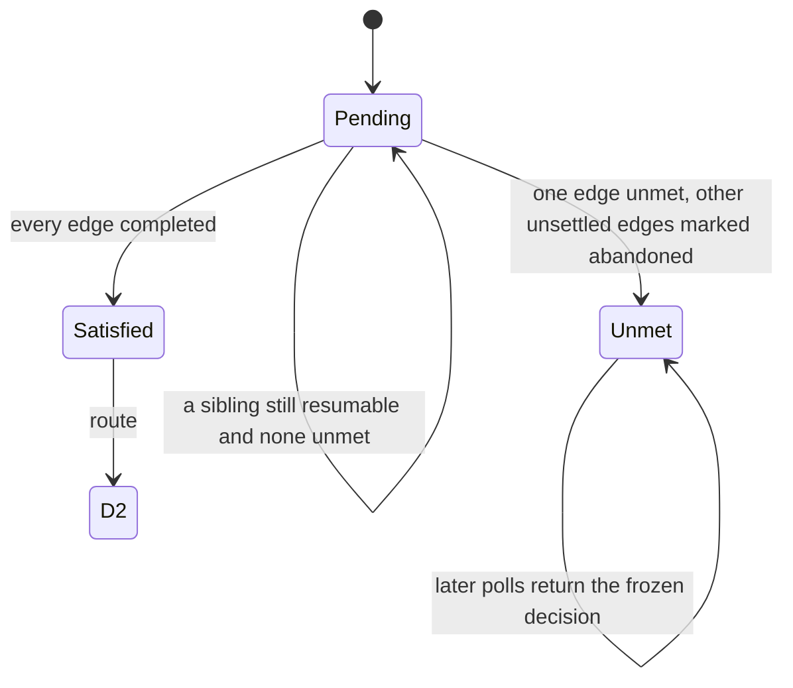

**Improvement.** `null` is no longer both "not joined" and "corrupt". A read child does not inhabit the generate join type, so vacuous `every` cannot mark it satisfied. Replay has one edge classifier. A terminal unmet witness cannot contain an edge that a later reader treats as still pending. Enforcement: a `dispatch-child` case whose dependencies are one unmet read and one missing read, asserting the frozen edge is `abandoned` and a pure replay will not poll it. Exhaustive switch on `Join['status']` in `decideChild`.

**Cost and risk.** M. `dispatch.ts`, `decide1.ts` fact `child.dependencies` (still the three strings), `sites/CONTRACT.md`, child tests. `dispatch.child@1` gains a tag on edges or a schema bump to `dispatch.child@2`. Old checkpoints with null receipts inside an unmet array need a replay adapter that tags them `abandoned`. Do not change the unmet-wins rule while doing the tagging; that rule is specified.

**Fit.** Standalone on the code [#405](https://github.com/CrowBe/weave/pull/405) merged. Not a budget-custody change. Finding 10 must not overload `dependencies` to track spend.

## 7. CLI preparation is three sets and a map whose value can be `undefined`

**Location.** `preparingCli`, `reservedCliIds`, `pendingCliCancel`, `invokeCliGeneration`, `requestCancel`, `prepare` in `packages/agentfabric/src/host.ts`. Behavioral pin in `packages/agentfabric/test/cli-pending-cancel.test.ts` and `cli-rerun.test.ts`. [#297](https://github.com/CrowBe/weave/pull/297) fixed consume order.

**Before.** An id can be reserved, present in `preparingCli` with value `undefined` (the placeholder), present with an `OpenInvocation`, or named by `pendingCliCancel`, in any combination the sets allow. `Map.get` returns `undefined` for both a missing id and the placeholder. `prepare` then does `open.get(id) ?? preparingCli.get(id)`. The placeholder reads as absent. The following guard treats the id as busy only when `reservedCliIds` has it and `reservedCliId !== invocation_id`. `invokeCliGeneration` passes `reservedCliId === invocation_id`, so that clause does not fire for the call that owns the placeholder. That is how the owner proceeds. A reader that trusts `inMemory` alone does not see the placeholder.

`requestCancel` uses `.has`, so it does see the placeholder, and otherwise adds `pendingCliCancel`. The `finally` of `invokeCliGeneration` deletes all three, including a cancel flag that was not copied onto a durable record if start never ran. [#297](https://github.com/CrowBe/weave/pull/297) pinned that a cancel-before-start still `markInvoked`s the grant after the pre-consumption gates. That order is a sequence of tests, not a phase.

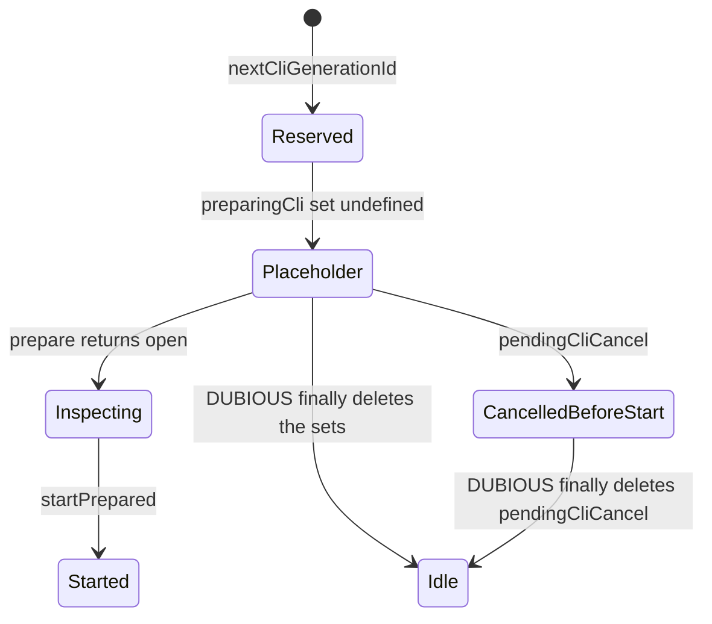

**Evidence.**

```286:289:packages/agentfabric/src/host.ts
    if (this.preparingCli.has(invocation_id)) return this.reject('DENIED', 'invocation is already active');
    // Caller-supplied identities also need protection before recovery can yield.
    this.preparingCli.set(invocation_id, undefined);
    this.reservedCliIds.add(invocation_id);
```

```1788:1788:packages/agentfabric/src/host.ts
    const inMemory = this.open.get(invocation_id) ?? this.preparingCli.get(invocation_id);
```

```1288:1299:packages/agentfabric/src/host.ts
    if (open) {
      open.cancel_requested = true;
      open.abort.abort();
    } else if (
      (record === undefined || rerun) &&
      (this.reservedCliIds.has(invocation_id) || this.preparingCli.has(invocation_id))
    ) {
      this.pendingCliCancel.add(invocation_id);
    }
    if (record && !record.reconciliation && !rerun) {
      this.store.writeInvocation({ ...record, cancel_requested: true });
    }
```

`cli-rerun.test.ts:407` records the [#297](https://github.com/CrowBe/weave/pull/297) pin: "consumed after the gates". `preparingCli`'s value type is `OpenInvocation | undefined` at `host.ts:197`. `reservedCliIds` and `pendingCliCancel` are the next two fields (`host.ts:198-199`).

**After.** The id has one preparation phase. Cancel is a transition, and `finally` is the transition to idle only from phases that have not started.

```ts
type Prep =
  | { readonly phase: 'reserved' }
  | { readonly phase: 'preparing' }
  | { readonly phase: 'inspecting'; readonly open: OpenInvocation }
  | { readonly phase: 'cancel_before_start' }
  | { readonly phase: 'started' };

function cancel(prep: Prep): Prep {
  switch (prep.phase) {
    case 'reserved':
    case 'preparing':
      return { phase: 'cancel_before_start' };
    case 'inspecting':
      prep.open.cancel_requested = true;
      prep.open.abort.abort();
      return prep;
    case 'cancel_before_start':
    case 'started':
      return prep;
  }
}
```

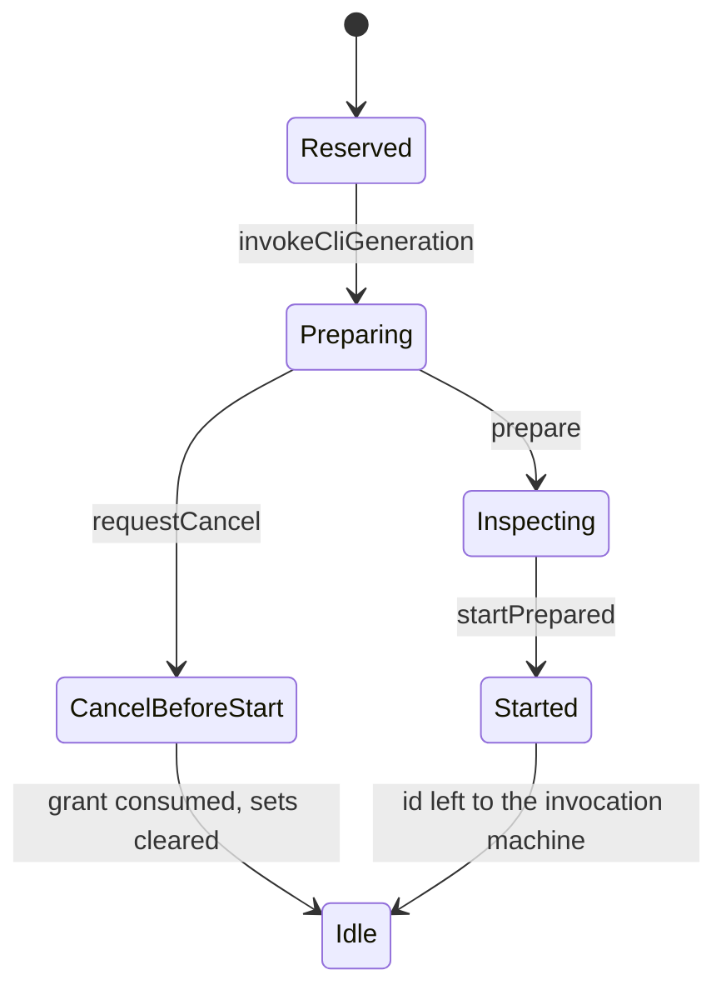

**Improvement.** `??` cannot erase the placeholder, because the placeholder is not `undefined`. A second `invokeCliGeneration` is rejected by the phase, not by a side set that the owner itself has to special-case. `finally` cannot drop a cancel that was never applied: the only exit from `cancel_before_start` is the consume path [#297](https://github.com/CrowBe/weave/pull/297) already tests. Enforcement: keep the `cli-pending-cancel` and `cli-rerun` cancellation cases, and add one where a re-entrant `prepare` during `preparing` is rejected without consulting `reservedCliIds`.

**Cost and risk.** M. `host.ts` and the CLI tests. No journal change. The phase is in-memory; durable state stays finding 4. Risk is merging the placeholder with "absent" during the edit. Land the tests before the switch.

**Fit.** Standalone. [#297](https://github.com/CrowBe/weave/pull/297) is merged and stays the behavioral oracle. Sequences with finding 4 only in the sense that `started` hands the id to the invocation machine. Independent of loom P5c and [#397](https://github.com/CrowBe/weave/issues/397).

## 8. Capability construction is a product of flags, and revoke does not move admission

**Location.** `FabricLifecycle` fields and `revoke` in `packages/agentfabric/src/lifecycle.ts`. The loom fold of the same facts is `implementation.revoked` in `packages/weave/src/state.ts`.

**Before.** Construction progress is `contract` null-or-set, `corpusValidated`, `red` null-or-set, `heldOutSpent`, `generationRefused`, a `green` map, `admission` with its own status, and `revoked`. Methods return early when a predecessor is missing. Those guards are the machine. The object can still hold combinations the methods just wrote.

`revoke` sets `revoked = true` and rewrites admission to `denied` only when `admission.implementation_id` equals the argument. Revoking any other id leaves `admission.status === 'admitted'` and `revoked === true`. `requestAdmission` then fails closed because `revoked` is set, so the stale `admitted` status is not used to admit again. The fields still hold both facts. `audit` (`lifecycle.ts:468-477`) returns counts only, so it does not correct them. The loom fold does not do this: `implementation.revoked` forces admission to `denied` whenever it is not already denied.

`proveGreen` sets `heldOutSpent = true` before isolation and scoring (`lifecycle.ts:311-314`). A failed prove spends the split. That one is a real transition, just ordered by assignment rather than a phase.

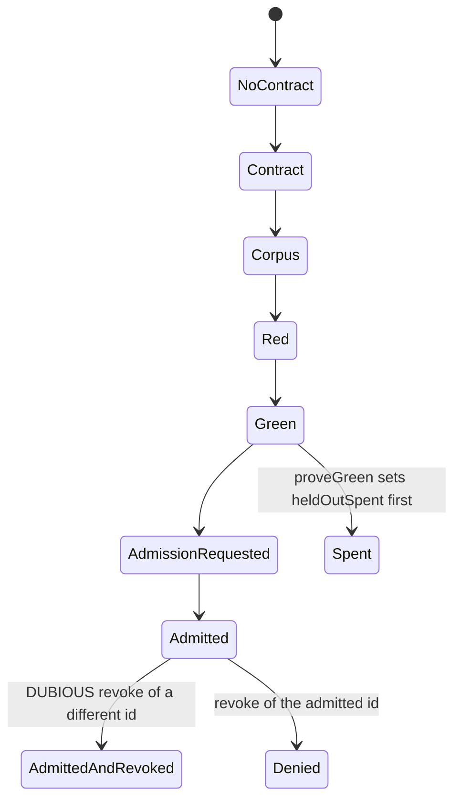

**Evidence.**

```65:71:packages/agentfabric/src/lifecycle.ts
  private admission: {
    request_id: string;
    implementation_id: string;
    evidence_digest: string;
    status: 'requested' | 'admitted' | 'denied';
  } | null = null;
  private revoked = false;
```

```439:447:packages/agentfabric/src/lifecycle.ts
  revoke(operation: string, implementationId: string, reason: string): LifecycleStep {
    if (!reason) {
      return fail('revocation requires a reason');
    }
    this.revoked = true;
    this.host.revoke(operation, reason);
    if (this.admission && this.admission.implementation_id === implementationId) {
      this.admission = { ...this.admission, status: 'denied' };
    }
```

```485:490:packages/weave/src/state.ts
    case 'implementation.revoked': {
      state.crystallization.revoked = true;
      const admission = state.crystallization.admission;
      if (admission && admission.status !== 'denied') {
        state.crystallization.admission = { ...admission, status: 'denied' };
      }
```

`requestAdmission` (`lifecycle.ts:383-390`) refuses when `revoked` is set, which is why the stale `admitted` status does not mint a second admission. `proveGreen`'s early `heldOutSpent = true` is `lifecycle.ts:311`.

**After.** One construction phase. Revoke from `admitted` is a transition to `revoked`, for every implementation id of this lifecycle. Loom's fold and Fabric's object agree.

```ts
type Construction =
  | { readonly phase: 'empty' }
  | { readonly phase: 'contract'; readonly contract: CapabilityContract }
  | { readonly phase: 'red'; readonly contract: CapabilityContract }
  | { readonly phase: 'green'; readonly id: string; readonly proven: boolean; readonly spent: boolean }
  | { readonly phase: 'requested'; readonly id: string }
  | { readonly phase: 'admitted'; readonly id: string }
  | { readonly phase: 'revoked'; readonly id: string | null };

function revoke(state: Construction, id: string): Construction {
  switch (state.phase) {
    case 'admitted':
    case 'requested':
    case 'green':
      return { phase: 'revoked', id };
    default:
      return { phase: 'revoked', id: state.phase === 'empty' ? null : id };
  }
}
```

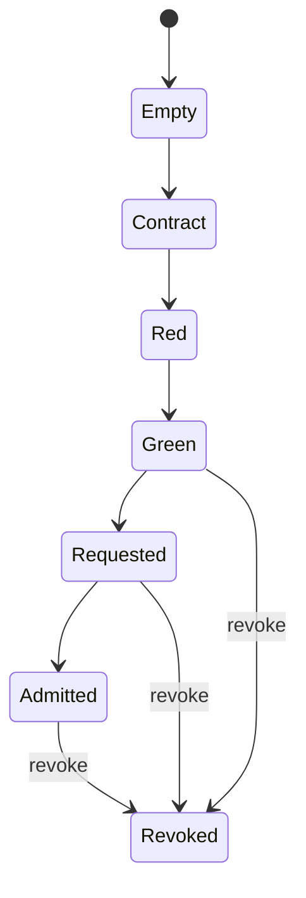

**Improvement.** `admitted && revoked` cannot be represented, so Fabric and the loom fold cannot disagree. A second `admit` has no `requested` phase to read. Enforcement: a lifecycle test that `revoke(otherId)` leaves a phase of `revoked` and `admit` fails; a fold test that the same revocation observation produces `admission.status === 'denied'` with no separate `revoked` bit required to interpret it. Exhaustive switch on `Construction['phase']` in `admit` and `requestAdmission`.

**Cost and risk.** S. `lifecycle.ts` and `lifecycle.test.ts`. `LifecycleStep` results can stay as they are. The loom `revoked` boolean (`types.ts:346`) can remain a derived view of the phase; deleting it is a separate fold change. Replay of `implementation.revoked` observations already forces `denied`; keep that. Do not weaken `proveGreen`'s spend-on-entry while collapsing the flags; encode it as `green.spent` set by the `prove` transition.

**Fit.** Standalone. The three gates in `VISION.md` (generation, admission, authority to execute) stay separate phases, not one boolean. No P5c dependency. Grant consumption is finding 9, not this phase: admission still must not issue a grant.

## 9. A single-use grant is three weak sets

**Location.** `createGrantAuthority` in `packages/agentsop/src/grants.ts`. Callers in `packages/agentfabric/src/host.ts` (`markInvoked` at prepare, `isValid` during CLI snapshot inspection). [#297](https://github.com/CrowBe/weave/pull/297) is the review that pinned when consume happens.

**Before.** Authority is object identity plus three `WeakSet`s: `issued`, `invoked`, `revoked`. They are independent. `revoke` adds to `revoked` without requiring `issued`, so a never-issued object can sit in `revoked` alone. `isValid` is issued and not revoked, including after `markInvoked`. That is load-bearing: `host.ts:347` calls `isValid` during workspace inspection after prepare has consumed the grant, to detect revoke without treating consume as revoke. `markInvoked` returns false when the object is missing, revoked, or already invoked. Nothing in the type says "valid for continuation" and "may start" are different. [#297](https://github.com/CrowBe/weave/pull/297) had to pin consume-after-gates in tests because a cancel-before-start could skip `markInvoked` and leave the grant startable.

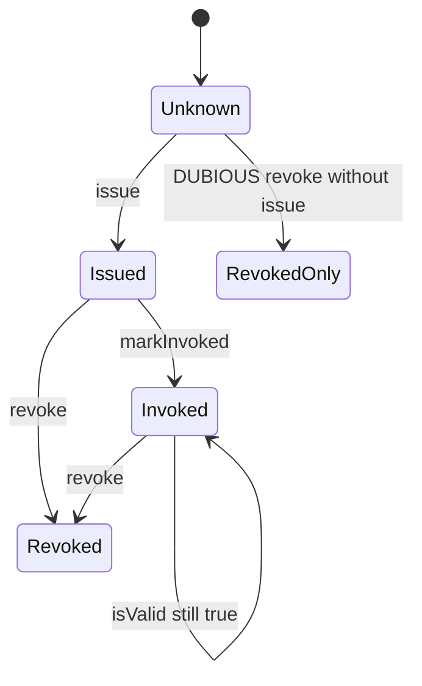

**Evidence.**

```122:138:packages/agentsop/src/grants.ts
    isIssued(grant) {
      return !!grant && issued.has(grant);
    },
    isValid(grant) {
      return !!grant && issued.has(grant) && !revoked.has(grant);
    },
    markInvoked(grant) {
      if (!issued.has(grant) || revoked.has(grant) || invoked.has(grant)) {
        return false;
      }
      invoked.add(grant);
      return true;
    },
    revoke(grant) {
      revoked.add(grant);
    },
  };
```

```316:322:packages/agentfabric/src/host.ts
        if (!this.authority.markInvoked(grant)) {
          return this.reject(
            'DENIED',
            this.invalidGrantReason(grant) ?? 'grant has already been used for an invocation',
          );
        }
        return this.resourceRejection(SHELL_RUN.id, checked.effects) ?? { kind: 'cancelled', invocation_id };
```

```347:349:packages/agentfabric/src/host.ts
      if (!this.authority.isValid(grant)) {
        return this.reject('DENIED', 'grant was revoked during workspace inspection');
      }
```

`isValid` is `grants.ts:125-127`: issued and not revoked, with no read of `invoked`. [#297](https://github.com/CrowBe/weave/pull/297) ("Pre-start CLI cancel consumes its single-use grant") is merged. The sets are unchanged.

**After.** One phase per grant object. Continuation and start are different questions on that phase. `revoke` of an unknown object fails.

```ts
type GrantPhase = 'issued' | 'invoked' | 'revoked';

function markInvoked(phase: GrantPhase): GrantPhase {
  switch (phase) {
    case 'issued':
      return 'invoked';
    case 'invoked':
    case 'revoked':
      throw new Error('grant cannot start');
  }
}

const validForContinuation = (phase: GrantPhase) => phase === 'issued' || phase === 'invoked';
const mayStart = (phase: GrantPhase) => phase === 'issued';
```

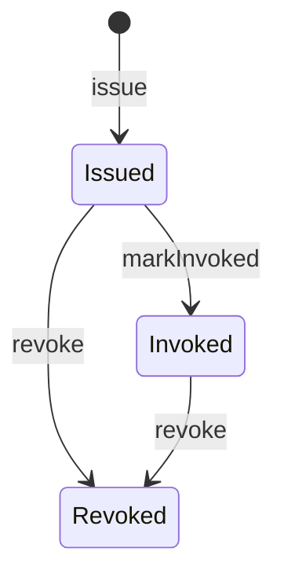

**Improvement.** A revoked-but-never-issued entry cannot exist. `mayStart` is false after consume, and `validForContinuation` stays true so the snapshot check at `host.ts:347` still detects only revoke. A second start is a failed transition, which is what `markInvoked` returns today as `false`, now exhaustive. Enforcement: the existing `p8` and `cli-pending-cancel` consume tests, plus one that `revoke` on a fresh object literal throws and `isValid` is false. Keep [#297](https://github.com/CrowBe/weave/pull/297)'s "consumed after the gates" assertion on the `preparing → cancel_before_start` path from finding 7.

**Cost and risk.** S. `grants.ts` and host tests. Object identity stays the authority boundary; a `WeakMap` to the phase replaces three sets. JSON copies remain unissued. Do not make `isValid` false after consume; that would fail the in-flight revoke check.

**Fit.** Standalone. Finding 7 should call `markInvoked` as the transition out of `cancel_before_start`, in the order [#297](https://github.com/CrowBe/weave/pull/297) fixed. Admission (finding 8) still does not call `issue`. No P5c or [#397](https://github.com/CrowBe/weave/issues/397) dependency.

## 10. A child share is a frozen number with no reserve, spend, or release

**Location.** `validatePlan` / child `share` in `packages/weave/src/spawn.ts`. `admitChildTerms` in `packages/weave/src/dispatch.ts`. Spec sentence in `packages/weave/src/sites/CONTRACT.md`. There is no budget port in loom.

**Before.** The generate child is given `share === plan.budget`, the whole preflight ceiling. Reads get `0`. `admitChildTerms` accepts the child when `cost_ceiling` is a natural number and `cost_ceiling <= share`. That check runs on entry and on replay. Nothing in the dispatch slot moves the number when the intent is presented, when a receipt returns, or when the attempt is released. `preflight_budget` is frozen beside `asks.preflight` and compared to `preflight_terms.cost_ceiling` for drift. It is not a balance.

A resume that re-presents an implement intent passes the same ceiling check as the first present. Idempotency of the port by `dispatch_id` is what prevents a second provider call, not a custody phase. Two facts are the same bits: "this share has been presented to a call that may spend" and "this share is still fully available". P5c1 records that on purpose. The contract says custody is later and there is no budget port.

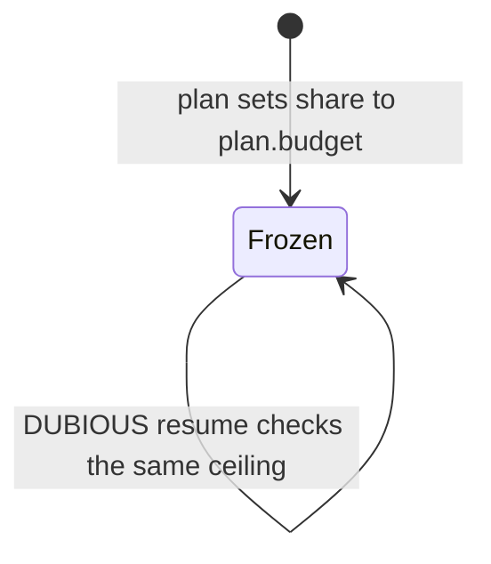

**Evidence.**

```188:193:packages/weave/src/spawn.ts
    if (generate) {
      requirePlan(
        ['flash', 'standard', 'strong'].includes(child.tier as string) &&
          child.share === plan.budget &&
          child.edit.length >= 1,
        'invalid generate child',
```

```1486:1492:packages/weave/src/dispatch.ts
function admitChildTerms(value: unknown, root: InferenceTerms, share: number): void {
  const refuse = (why: string) => new Error(`child terms ${why}`);
  if (!isRecord(value) || Object.keys(value).some((key) => !TERM_KEYS.includes(key)))
    throw refuse('carry an unknown field');
  const terms = value as Record<string, unknown>;
  const parent = root as unknown as Record<string, unknown>;
  if (!natural(terms['cost_ceiling']) || terms['cost_ceiling'] > share) throw refuse('exceed the sealed share');
```

```502:509:packages/weave/src/sites/CONTRACT.md
Child terms (`child_terms`) narrow the root's `preflight_terms`: a safe-natural
`cost_ceiling <= brief.share` (reads: `0`), destinations a subset, deadline/context/attempt
limits not raised, quality not weakened (`qualityClears`), `audit` only kept or strengthened,
`content_class`, `tier` and `max_attempts_per_route` retained exactly (absence included),
no unknown field. `prefix_digest`/`prefix_cache` are excluded but may never copy the parent's.
Re-entry with other terms than the retained child evidence throws; concurrent first callers
keep open-checkpoint semantics and the winning claim freezes its own terms. Allocation is
unchanged and nothing accounts spending (custody is P5c3; there is no budget port).
```

`preflight_budget` is paired with the ask at `dispatch.ts:2594-2596` and checked for drift in `dispatch-child.test.ts` `P5c1-9`. No symbol decrements it.

**After.** The share is a ledger phase updated by the slot transitions from finding 5. The ceiling check reads the available remainder.

```ts
type Share =
  | { readonly phase: 'available'; readonly micros: number }
  | { readonly phase: 'reserved'; readonly micros: number; readonly hold: string }
  | { readonly phase: 'spent'; readonly micros: number; readonly hold: string }
  | { readonly phase: 'released'; readonly micros: number; readonly hold: string };

function present(share: Share, hold: string, ceiling: number): Share {
  if (share.phase !== 'available' || ceiling > share.micros) throw new Error('share unavailable');
  return { phase: 'reserved', micros: ceiling, hold };
}
```

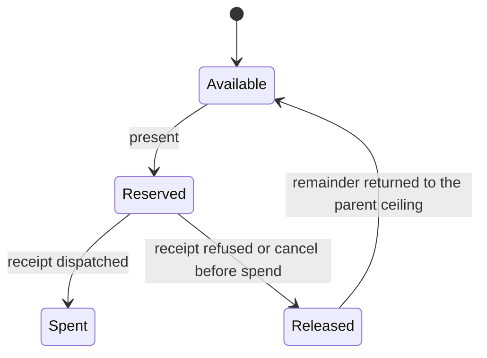

**Improvement.** A second in-flight present of the same ceiling fails while the first hold is `reserved`. A refused receipt releases. Replay of a checkpoint without a hold cannot reconstruct a spend, which matches today's "no budget port" rule until a journal records the hold. Enforcement: a test that two overlapping presents of one share throw on the second, and that a `budget` refusal returns the phase to `available`. That test cannot pass against the current scalar, which is the point of writing it before the port exists.

**Cost and risk.** L. New port, `spawn.ts`, `dispatch.ts`, `sites/CONTRACT.md`, child tests, and a checkpoint field for the hold. Do not infer spend from the gateway inside replay. Existing P5c1 journals have no hold; replay treats them as `available` and must not invent a charge. Monetary reservation in the context-budget contract stays a different ledger.

**Fit.** This is P5c3. It waits on finding 5: the reserve transition is `presented`, and the release transition is the cancel and receipt phases from findings 1 and 2. It must not be encoded as another null inside `DispatchChild.dependencies` (finding 6). [#405](https://github.com/CrowBe/weave/pull/405) explicitly left this out.

## Proposed terms

Do not edit `GLOSSARY.md` in this change. Candidates, using words the findings need:

- **Dispatch slot.** The single phase of one decision id: open, awaiting, claimed, presented, resumable, terminal, and the cancel phases in finding 1.
- **Presented-unsettled.** A presented intent whose attempt aborted before a receipt was appended. Recovery settlement-reads. It is not `paused` / `cancelled`.
- **Action phase.** The folded action lifecycle, including a reconciled outcome, replacing `ActionState` plus `reconciled` and `cancel_requested`.
- **Invocation phase.** The host store's legal status and outcome pairs, including publication repair and CLI supersede.
- **Preparation phase.** The in-memory CLI id before the invocation phase exists: reserved, preparing, inspecting, cancel-before-start, started.
- **Construction phase.** Fabric's capability lifecycle from empty through revoked, with admission status inside the phase.
- **Grant phase.** `issued`, `invoked`, or `revoked` on one issued object. `invoked` remains valid for continuation and is not valid to start.
- **Budget custody.** The share ledger `available`, `reserved`, `spent`, `released`. Distinct from `Budget gate` and from `preflight_budget`.

## Ranked summary

| Rank | Finding | Value | Size | depends_on |
| --- | --- | --- | --- | --- |
| 1 | Unjournaled dispatch cancellation | High | M | #397, finding 5 |
| 2 | `yielded` rewrites a claimed resumable receipt | High | S | none |
| 3 | Action `state` / `reconciled` / `cancel_requested` | High | M | none |
| 4 | Host invocation `result` / `start` unguarded | High | M | none |
| 5 | Dispatch slot collections and non-CAS stage ask | High | M | #397 for the durable adapter |
| 6 | Read join `null` / pending edge inside unmet | Medium | M | none (code is #405) |
| 7 | CLI preparation sets and `undefined` placeholder | Medium | M | none (#297 is the pin) |
| 8 | Construction flags; `admitted` and `revoked` | Medium | S | none |
| 9 | Grant authority as three weak sets | Medium | S | finding 7 for the cancel consume call |
| 10 | Child share with no custody phase | Medium | L | P5c3, findings 1, 2, 5 |

## Brief these first

1. **Cancellation (finding 1) with the slot (finding 5).** The abort return is not replayable, `cancelled` means two things, and [#397](https://github.com/CrowBe/weave/issues/397) already says `presented` has to be durable. One `Slot` type gives cancel, present, and the in-flight ask a compare-and-set. Do not start P5c2 as another boolean on `DispatchCheckpoint`.
2. **`yielded` (finding 2).** Smallest change that stops a loser from reporting `dispatch_unconfirmed` after the journal has stored `budget`. Fix it before the slot rewrite so the new `observe` is tested against the stored decision.
3. **Action phase (finding 3).** Reconciliation currently cannot tell success from failure on the action itself; `M1-T12` papers over that with `state.publication`. Cancel of a finished action is accepted and Weft records it as `cancelled`. This is the runtime log, separate from dispatch.
