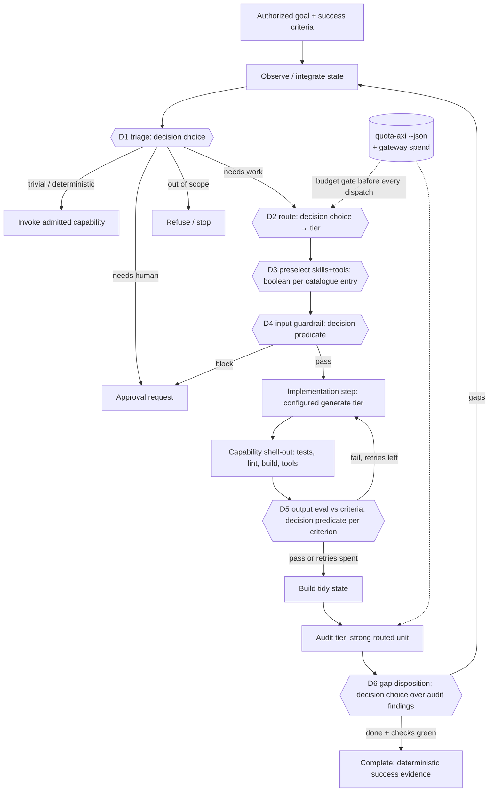

# M7 — Decision-model loop

This is the behavioral contract for the planned milestone in
[ARCHITECTURE.md §11](../ARCHITECTURE.md). It extends
[M6](m6-route-a-reconstructed-view.md). Terms follow
[GLOSSARY.md](../GLOSSARY.md). These requirements describe the target, not
implemented loop behavior. P0 establishes this contract; P1 supplies tier and
availability routing plus pure configuration validation. P2–P12 remain planned.
Demonstrate red before implementation, prove green with deterministic fixtures,
and retain M0–M6 checks. Live provider runs are non-gating evidence.

## 1. Outcome and scope

Advance an authorized goal through observe, triage, route, preselect, guard,
implement, check, evaluate, and audit. Typed evaluation answers return as
observations. Deterministic policy retains authority over every transition,
destination, budget, effect, and grant. Independent actions may proceed together;
dependencies and effect conflicts constrain the frontier. Fabric remains bounded
and does not import Loom's runtime or scheduling concerns.

The existing `frontier.weigh` site remains available through
`ScriptedDecisionLayer`. New sites retain their semantic operation and answer
shape. Provider outage cannot silently turn evaluation into prose generation.
Capability generation, admission, and authority to execute stay separate gates.

## 2. Target loop



Every `{{Dn}}` node is an `evaluate` request through the gateway, served by the configured **decision provider** (§4a): OpenAI Decisions or TypeSafe Jev. Its answer is recorded as an observation, and a deterministic rule then turns it into a transition. The decision model never dispatches anything itself. D7 guards proposed output effects before dispatch or publication; D8 checks progress after each round.

## 3. Tidy-state schema (audit-tier input)

The planned versioned view is `view.audit@1`, assembled in `views.ts` from authorized slices. It is deterministic and digested so it can be cached by prefix.

```text
interface AuditState {
  schema: 'audit-state@1';
  goal: { goal_id; statement; success_criteria: Criterion[]; authority_scope; revision };
  iteration: number;                         // loop-back count
  plan: { step_id; intent; tier; status: 'done'|'failed'|'skipped' }[];
  decisions: { site; question_id; choice; probabilities; confidence; fallback_used: boolean; obs_seq }[];
  artifacts: { artifact_id; kind: 'diff'|'file'|'report'; digest; summary; bytes; ref }[]; // ref, not raw body, above a size cap
  checks: { check_id; argv_digest; exit: number; passed: boolean; tail: string }[];  // deterministic evidence
  evals: { criterion_id; verdict_probability; confidence?; passed: boolean }[];       // D5 outputs
  open_issues: { issue_id; source: 'check'|'eval'|'audit'; text; severity }[];
  budget: { spent_micros; ceiling_micros; quota: { provider; window; percent_remaining; resets_at }[] };
  omissions: string[];                       // what the view left out and why (existing view rule)
  source_revisions: Record<string, number>;
}
```

The audit tier returns `AuditReport { findings: {criterion_id|null, kind:'gap'|'defect'|'regression'|'scope_creep', evidence_ref, proposed_fix}[], goal_met_claim: boolean }`. Its `goal_met_claim` is an observation only. Completion still requires deterministic success evidence (ARCH §3).

## 4. Decision-point catalogue

### 4a. Decision provider interface

Decision providers serve the existing
`EvaluationAdapter.evaluate(EvaluationCall)` interface. Configuration selects
OpenAI Decisions or TypeSafe Jev as primary, with an optional distinct fallback.
The loop names a judgment site and answer shape. It does not name a vendor.

The [OpenAI Decisions guide](https://developers.openai.com/api/docs/guides/decisions)
documents `POST /v1/decisions` with `gpt-6-luna`, shared input, named questions,
and typed answers. Gateway `boolean` maps to its `predicate`; gateway `choice`
and `score` map to choices and ordered levels. TypeSafe Jev uses
`/v1/systemone` with `noul`, `choice`, and `score`. Wire profiles translate these
protocols without changing the gateway's semantics. P3 will carry both profiles
through a shared HTTP transport and exercise one contract suite against each.
P12 will extend that arrangement to compatible endpoints, including local ones.

Refusal, malformed answers, and unavailable providers must lead to recorded
fallback or pause. Missing confidence triggers fallback only where the site's
provider-specific rule requires it. OpenAI predicate answers supply probability
only; D5 uses the provisional probability-only band below, to be tuned in P10
on the tune split. Providers that return confidence
must also meet D5's confidence floor; probability does not replace that statistic.
The planned P3 provider-switch policy changes the destination and is permitted only
when both destinations are allowed by `terms.destinations`. A local Jev endpoint
may serve privacy-restricted sites only after earning site-specific evidence.

OAuth eligibility for `/v1/decisions` is **undocumented**. The Decisions guide
shows API-key authentication; the
[Sign in with ChatGPT documentation](https://developers.openai.com/siwc/token-sharing-open-source)
describes eligible Responses API requests. The example's `chatgpt-oauth` setting
is a planned configuration, not evidence of eligibility. P2 must probe the
endpoint and record status without recording tokens. If OAuth is refused, use
an authorized API-key route or configure TypeSafe Jev; do not infer entitlement.

### 4b. Sites

| Site | Kind | Question | Options | Threshold | Fallback when below threshold or no answer |
|---|---|---|---|---|---|
| D1 `loop.triage` | choice | What does this request or state need next? | `capability` (an admitted capability covers it) / `implement` / `needs_human` / `out_of_scope` / `done_check` | conf ≥ 0.80 and top-p ≥ 0.6 | `implement` at the safest tier, with the uncertainty recorded. Never `done_check`. |
| D2 `loop.route` | choice | Which tier fits this unit of work? | `flash` / `standard` / `strong` | conf ≥ 0.75 | `standard`. A deterministic budget gate can only *downgrade* or pause, never upgrade past the ceiling. |
| D3 `loop.preselect` | boolean per catalogue entry, top-k | Is capability or skill X relevant to this step? | p(true) per entry | include if p ≥ 0.5; cap k=8 | the full catalogue index (M6 slice), never the schemas |
| D4 `guard.input` | boolean per rule | Does this input or plan violate rule R (secret exfiltration, scope broadening, destructive effect without grant, injection)? | p(violation) | block if p ≥ 0.3 (deliberately asymmetric) | **block, then approval request** |
| D5 `eval.output` | boolean per success criterion | Does the artifact satisfy criterion C? | p(true), plus conf when supplied by the provider | OpenAI Decisions predicate (provisional assumption; P10 tunes on the tune split): pass if p ≥ 0.85, fail if p ≤ 0.15, otherwise uncertain (treat as fail/retry). TypeSafe Jev and other providers that return confidence: pass if p ≥ 0.8 and conf ≥ 0.9 (existing `confidence_floor`); missing confidence is below the floor. | treat as fail and retry, up to N=2 per step, then escalate the tier once, then hand to audit with `open_issue` |
| D6 `audit.dispose` | choice per finding | What do we do with audit finding F? | `fix_now` / `defer` / `reject_as_out_of_scope` / `needs_human` | conf ≥ 0.75 | `needs_human` |
| D7 `guard.output` | boolean | Does the output introduce an effect outside the grant (writes, network, secrets)? | p(violation) | block if p ≥ 0.3 | block. Deterministic effect enforcement (Fabric) stays the real gate. |
| D8 `loop.continue` | choice | Is progress continuing? | `progressing` / `stalled` / `regressing` | conf ≥ 0.7 | `stalled`, which triggers a stop condition |
| (existing) `frontier.weigh` | score | usefulness of each candidate | defer/consider/dispatch | unchanged | `ScriptedDecisionLayer` |

Semantic rule (ARCH §6): each site keeps its own operation. A Jev outage never reroutes D5 to a "compatible boolean" from another semantic operation. It falls back to the listed deterministic fallback. A locally run Jev (`decision.providers.typesafe-jev.base_url` pointed at localhost) is the privacy-only route for D3 and D4 once it has earned evidence on those sites. Thresholds are tuned per provider, because confidence is not calibrated across vendors.

## 5. Tier configuration and availability

The composition root supplies parsed JSON to `parseRouteConfig`; the gateway
reads no files, environment, or clock. The root may load `weave.routes.json` and
an ignored `weave.routes.local.json` overlay. See
[weave.routes.example.json](../weave.routes.example.json) for the P1 shape:
`units` is a route table and `decision` declares `provider`, nullable `fallback`,
and named `providers` with `base_url`, `model`, optional `auth`, and `key_env`.
`auth: "chatgpt-oauth"` carries no `key_env`. `auth: "api-key"` requires one.
These are configuration names, never embedded credentials. The example declares
future adapters; parsing it does not install or execute them.

`tier` is optional on a routed unit. A requested tier in `InferenceTerms` or
`RouteTarget` filters mismatches with `tier_mismatch`; if both specify a tier,
a unit must satisfy both. Omitting tier preserves existing routing. Quality is
still `baseline` or `high`, independently checked. Prices are nonnegative finite
micros per million tokens; subscription examples declare zero token prices.
Quota accounting is a separate P4 gate, not an implication of zero cost.

`ProviderAvailability` is caller-supplied data keyed by exact routed-unit adapter
ids, not provider or destination ids. The composition root must map quota-provider
ids to adapters (for example, quota provider `claude` to adapter `claude-code`).
Only own entries are consulted; unmatched keys are ignored. Entries are `available`, `exhausted`, `auth_required`, or
`unavailable`, or `{ status, recheck_after? }`. Any explicit nonavailable adapter match
excludes a unit with `provider_unavailable`. Missing entries preserve existing
behavior. `recheck_after` is an injected timestamp for the root to act on;
routing never reads time or turns an expired entry into permission to dispatch.
Filtering and existing evidence ordering stay deterministic.

Validation rejects duplicate routed-unit ids, invalid operation/kind pairs,
unknown tiers, a `decision` tier on a generate unit, malformed route fields,
negative or nonnumeric prices, missing configured decision providers, identical
primary and fallback, a `key_env` on `chatgpt-oauth`, an `api-key` provider
without a `key_env`, and base URLs other than HTTPS or HTTP on loopback hosts
(`127.0.0.1`, `::1`, `localhost`) without userinfo, `?`, or `#`. Adapters remain
credential-injected.

P3 assumption: per-provider destinations will come from each provider's routed
unit or be added to its provider record in P3. Switching decision providers will
require both destinations in the request's terms. P1's `DecisionConfig.providers`
has no destination field and P1 does not enforce provider-switch destinations.
The example CLI units declare remote vendor destinations even when the CLI
process runs locally.

## 6. Loop-back and stop conditions

Loop back to Observe when audit findings dispose as `fix_now`. Each finding becomes an `open_issue`, then a candidate with the `criterion_id` attached.

Stop:

1. **Done**: every success criterion has deterministic evidence (checks green), D5 passes all criteria, and the audit has no `fix_now`.
2. **Budget**: the weekly quota gate trips (§8), or the gateway cost ceiling is reached. The loop pauses with state persisted. This is not a failure.
3. **Iteration cap**: `max_iterations` (default 4 audit rounds).
4. **No progress**: D8 says `stalled`/`regressing` twice in a row, or the same `issue_id` reappears after two fix attempts.
5. **Authority**: D4 or D7 block, or a needed approval, goes to `needs_human`.
6. **Decision outage**: both configured decision providers are unavailable. The loop drops to `ScriptedDecisionLayer` plus deterministic fallbacks for *read-only* steps, and pauses before any dispatch that needs D4.

## 7. Phased PR plan

Each PR is small. Each must pass `npm run verify`, adds tests to the existing `node --test` suites, and keeps `checks/` green. Live provider runs are non-gating benchmarks, as today.

| # | PR | Acceptance criteria | Tests |
|---|---|---|---|
| P0 | **Glossary + design doc**: add *tier*, *decision provider*, *wire profile*, *tidy state*, *audit tier* to GLOSSARY.md; write `docs/m7-decision-loop.md` | Terms used consistently; ARCH §11 updated | doc-only |
| P1 | **Tiered route table from config**: `tier` on `RoutedUnit`; pure config validator in gateway; file loading only in the composition root; `ProviderAvailability` port | Gateway still does no env/fs reads; an unavailable provider is excluded with reason `provider_unavailable`; deterministic order preserved | routing tests: exclusion, tie order, empty table gives a blocked outcome |
| P2 | **Sign in with ChatGPT** (early): `packages/auth-chatgpt` (PKCE, loopback, persisted host id and issued client_id, ID-token/JWKS validation, refresh) plus an `openai-chatgpt-plan` Responses generate adapter; **live probe of `/v1/decisions` with the OAuth token** | No client secret; token file 0600; token never on argv or in logs; unit is `auth_required` until signed in; probe result recorded in the doc | mocked auth server and fetch; nonce, aud and expiry failure cases; Responses stream parse |
| P3 | **Decision providers behind one interface**: refactor `typesafe-ai.ts` into wire profile plus transport with a configurable base URL; add `openai-decisions.ts` (predicate/choice/score/refusal); `decision.provider` and `fallback` config | Same `EvaluationAdapter` for both; provider chosen by config only; local TypeSafe base URL works; refusal leads to fallback; fallback only when both destinations are permitted | **shared contract suite run against both profiles**: every question type, refusal, missing confidence, 401/429/5xx, malformed body, key never in logs |
| P4 | **Budget gate**: `QuotaPort` (a `quota-axi --json` snapshot supplied as data) plus `budget.policy@1` | No dispatch once a provider's week is 80% used; pause until `resetsAt`; pace `ahead` downgrades the tier | fixtures at 79/80/95% used, unknown pace, stale, missing, or unknown snapshot fails closed for every quota-tracked tier |
| P5 | **Decision sites D1, D2, D8** (triage, route, progress) in `packages/weave/src/sites/` | Below-threshold answers take the recorded fallback; a stale answer is rejected; the scripted layer still passes M0–M6 | fake provider answers; replay determinism |
| P6 | **D3 preselect plus D4/D7 guardrails** | Preselect only narrows the disclosed catalogue slice; a block becomes an approval request | M6 slice tests; guard asymmetry tests |
| P7 | **`shell.run@1` plus `repo.test/lint/build`, and CLI backends** (`codex exec`, `claude -p`, `grok`) as generate adapters, prompt on stdin | Effects enforced by grant; env values never on argv or in logs; timeout and cancel honoured | Fabric host tests with the canary-env leak pattern; stub CLIs |
| P8 | **Implementation-tier step plus D5 output eval** | Retry ≤2, escalate a tier once, then raise an open_issue | toy-goal loop with fake providers |
| P9 | **`view.audit@1` tidy state, audit tier, D6, loop-back and stop** | An audit claim alone cannot complete a goal; iteration-cap and no-progress stops fire | end-to-end fixture: gap, loop, done; stall, stop |
| P10 | **Live benchmarks** (non-gating): per-site sets for each decision provider | Thresholds tuned per provider on the tune split; holdout reported | recorded results |
| P11 | **MVP test drive** (last MVP phase): Weave runs one real end-to-end task, e.g. a small real PR on weave itself | **Exit:** (a) ChatGPT sign-in works as an inference provider and serves real calls; (b) the configured decision provider makes the D1 triage and D2 routing decisions, recorded with confidence; (c) a light tier and a frontier tier both run inside the loop; (d) checks green, audit run, stop recorded; (e) the week stays under 80% | recorded trace and replay; quota-axi delta logged |
| P12 | **Post-MVP: generic decision-endpoint adapter.** A config-declared wire profile for any compatible decision endpoint, local providers included | No interface change; adding an endpoint is config plus a profile; the destination is declared | the shared contract suite runs against a local mock server |

Order: P0 → P1 → **P2 ChatGPT sign-in, early, because both the OpenAI decision provider and the test drive depend on it** → P3 decision providers. P4 (budget) and P7 (shell) can run alongside P2 and P3. P5 depends on P3. P6 depends on P5. P8 depends on P6 and P7. P9 depends on P8. **P11 MVP test drive is the last MVP phase** and depends on P2, P3, P5 and P9. P12 comes after the MVP.

## 8. Budget

**Hard policy: no dispatch may take a provider beyond 80% of its weekly budget.**

**Loop mechanism (P4).** The hard rule: the loop stops at 80% of weekly quota, checked with `quota-axi --json`.

- Before every routed dispatch, and at the start of every audit round, the composition root runs `quota-axi --json` with a ~60s cache. For each `quota_provider` it reads `windows[id=seven_day].percentRemaining`, `resetsAt`, `pace.status`, and `five_hour`.
- **Weekly gate:** if `percentRemaining ≤ 20` (80% used) for the provider a unit draws on, the unit is excluded (`weekly_budget_cap`). If no eligible unit remains for the step, the loop records `loop.paused{until: resetsAt}` and stops dispatching. It resumes at reset, through the injected clock and timer only. The cap is enforced against the whole week, including use outside Weave, because quota-axi reports the account total. That is stricter than "Weave's share", and safe.
- **Five-hour window:** if `≤ 10%`, prefer another provider; if none, wait until that reset (the gateway already waits on known delays).
- **Pace:** `ahead` downgrades `strong` to `standard` except for the audit step, which pauses instead. An audit should not be done by a weaker model.
- **Fail closed:** a stale, missing, or `unknown` snapshot is at the cap for every quota-tracked tier (`decision`, `flash`, `standard`, and `strong`). Each such unit is excluded (`weekly_budget_cap`) until a fresh snapshot shows its provider under the 80% weekly gate.
- **Metered providers:** the per-run `cost_ceiling` in micros. A weekly metered cap is configured in the same policy record.


## 9. Acceptance evidence and unresolved assumptions

Deterministic fixtures must prove threshold boundaries, recorded fallbacks,
stale-answer rejection, destination restrictions, retry and escalation bounds,
effect denial, cancellation, concurrent independent work, audit loop-back, and
every stop condition. Every consequential transition records the state revision,
site, answer, confidence, applied policy, and fallback. Generated artifacts and
tests remain untrusted until independently validated; checks cannot be weakened
by a decision answer or audit report.

P1 does not instantiate decision or CLI adapters, read quotas, authenticate,
assemble tidy state, or execute this loop. Configured model names, credentials,
CLI availability, and OAuth access are operator assumptions until subsequent
phases supply evidence. P4 must fix snapshot freshness, account/provider quota
mapping, and reservation bounds before implementing the weekly gate. A stale,
missing, or unknown snapshot is at the cap for every quota-tracked tier. The
repository cannot establish live provider entitlement or quota guarantees from
configuration alone.
