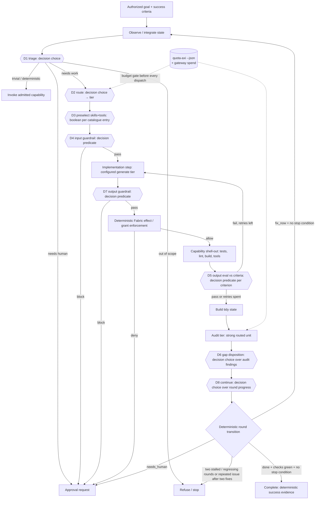

# M7 — Decision-model loop

This is the behavioral contract for the planned milestone in
[ARCHITECTURE.md §11](../ARCHITECTURE.md). It extends
[M6](m6-route-a-reconstructed-view.md). Terms follow
[GLOSSARY.md](../GLOSSARY.md). These requirements describe the target, not
implemented loop behavior. P0 establishes this contract; P1 supplies tier and
availability routing plus pure configuration validation. P2 supplies local ChatGPT authentication and a Responses adapter. P3 supplies the TypeSafe decision provider behind one evaluation interface. P4 supplies the budget gate; P5 supplies D1, D2, D8 and intake choice sites with pure transitions. P6 supplies D3 preselection and D4/D7 boolean guards. P7 supplies `shell.run@1`, the repo checks, and CLI generate backends. P8 supplies the implementation-tier step and D5. Full-loop integration and P9–P12 remain planned.
Demonstrate red before implementation, prove green with deterministic fixtures,
and retain M0–M6 checks. Live provider runs are non-gating evidence.

## 1. Outcome and scope

Advance an authorized goal through observe, triage, route, preselect, guard,
implement, check, evaluate, and audit. Typed evaluation answers return as
observations. Deterministic policy retains authority over every transition,
destination, budget, effect, and grant. Independent actions may proceed together;
dependencies and effect conflicts constrain the frontier. Fabric remains bounded
and does not import Loom's runtime or scheduling concerns.

The existing `frontier.weigh` site remains available through
`ScriptedDecisionLayer`. New sites retain their semantic operation and answer
shape. Provider outage cannot silently turn evaluation into prose generation.
Capability generation, admission, and authority to execute stay separate gates.

## 2. Target loop



Every `{{Dn}}` node is an `evaluate` request through the gateway, served by the configured **decision provider** (§4a): TypeSafe Jev is the sole default decision provider. OpenAI Decisions (401 under ChatGPT sign-in) and Cloudflare Workers AI fallbacks are deferred. Its answer is recorded as an observation, and a deterministic rule then turns it into a transition. The decision model never dispatches anything itself. D7 guards proposed output effects before dispatch or publication; D8 checks progress after each round.

D7's pass cannot override Fabric's deterministic effect and grant enforcement.
The round transition applies the stop conditions in §6 before another round or
completion; one `stalled` or `regressing` answer alone does not stop the loop.
P6 implements D3/D4/D7 as pure site transitions with an injected evaluate port; full-loop wiring remains planned.

## 3. Tidy-state schema (audit-tier input)

The planned versioned view is `view.audit@1`, assembled in `views.ts` from authorized slices. It is deterministic and digested so it can be cached by prefix.

```text
interface AuditState {
  schema: 'audit-state@1';
  goal: { goal_id; statement; success_criteria: Criterion[]; authority_scope; revision };
  iteration: number;                         // loop-back count
  plan: { step_id; intent; tier; status: 'done'|'failed'|'skipped' }[];
  decisions: { site; question_id; choice; probabilities; confidence; fallback_used: boolean; obs_seq }[];
  artifacts: { artifact_id; kind: 'diff'|'file'|'report'; digest; summary; bytes; ref }[]; // ref, not raw body, above a size cap
  checks: { check_id; argv_digest; exit: number; passed: boolean; tail: string }[];  // deterministic evidence
  evals: { criterion_id; verdict_probability; confidence?; passed: boolean }[];       // D5 outputs
  open_issues: { issue_id; source: 'check'|'eval'|'audit'; text; severity }[];
  budget: { spent_micros; ceiling_micros; quota: { provider; window; percent_remaining; resets_at }[] };
  omissions: string[];                       // what the view left out and why (existing view rule)
  source_revisions: Record<string, number>;
}
```

The audit tier returns `AuditReport { findings: {criterion_id|null, kind:'gap'|'defect'|'regression'|'scope_creep', evidence_ref, proposed_fix}[], goal_met_claim: boolean }`. Its `goal_met_claim` is an observation only. Completion still requires deterministic success evidence (ARCH §3).

## 4. Decision-point catalogue

### 4a. Decision provider interface

Decision providers serve the existing
`EvaluationAdapter.evaluate(EvaluationCall)` interface. Configuration selects
TypeSafe Jev as the sole default decision provider, with no provider fallback.
OpenAI Decisions (401 under ChatGPT sign-in) and Cloudflare Workers AI fallbacks
are deferred. The loop names a judgment site and answer shape. It does not name a vendor.

The [OpenAI Decisions guide](https://developers.openai.com/api/docs/guides/decisions)
documents `POST /v1/decisions` with `gpt-6-luna`, shared input, named questions,
and typed answers. Gateway `boolean` maps to its `predicate`; gateway `choice`
and `score` map to choices and ordered levels. TypeSafe Jev uses
`/v1/systemone` with `noul`, `choice`, and `score`. A wire profile translates
one protocol without changing the gateway's semantics. P3 carries the TypeSafe
profile on a provider-neutral HTTP transport and exercises the contract suite
against that profile. A second profile can use the same transport later.
OpenAI Decisions stays deferred after the 14 Oct 2026 probe. P12 will extend
that arrangement to other compatible endpoints, including local ones.

Refusal, malformed answers, and an unavailable provider lead to the site's
recorded deterministic fallback or to pause. They do not select another
decision provider. Missing confidence triggers that fallback only where the site's
provider-specific rule requires it. OpenAI predicate answers supply probability
only; D5 uses the provisional probability-only band below, to be tuned in P10
on the tune split. Providers that return confidence
must also meet D5's confidence floor; probability does not replace that statistic.
Provider switching is deferred with fallback routing. P3 does not change
destination because a provider failed. A local Jev endpoint
may serve privacy-restricted sites only after earning site-specific evidence.
Its base URL is `decision.providers.typesafe-jev.base_url`.

On 14 Oct 2026 the ChatGPT sign-in token worked for Responses calls.
`POST /v1/decisions` returned HTTP 401 `rejected_by_access_enforcement` /
`no_matching_rule`. The Decisions guide shows API-key authentication; the
[Sign in with ChatGPT documentation](https://developers.openai.com/siwc/token-sharing-open-source)
describes eligible Responses API requests. TypeSafe Jev is the sole default
decision provider. OpenAI Decisions and Cloudflare Workers AI fallbacks are
deferred; the example's `chatgpt-oauth` provider definition does not establish
eligibility or enable a fallback. Record probe status without recording tokens.

### 4b. Sites

| Site | Kind | Question | Options | Threshold | Fallback when below threshold or no answer |
|---|---|---|---|---|---|
| D1 `loop.triage` | choice | What does this request or state need next? | `capability` (an admitted capability covers it) / `implement` / `needs_human` / `out_of_scope` / `done_check` | conf ≥ 0.80 and top-p ≥ 0.6 | `implement` at the safest tier, with the uncertainty recorded. Never `done_check`. |
| D2 `loop.route` | choice | Which tier fits this unit of work? | `flash` / `standard` / `strong` | conf ≥ 0.75 | `standard`. A deterministic budget gate can only *downgrade* or pause, never upgrade past the ceiling. |
| D3 `loop.preselect` | boolean per catalogue entry, top-k | Is capability or skill X relevant to this step? | p(true) per entry | keep top-k (default 3), optional floor, guardrail-required always kept; cap 8 | the full catalogue index (M6 slice), never the schemas |
| D4 `guard.input` | boolean per rule | Does this input or plan violate rule R (secret exfiltration, scope broadening, destructive effect without grant, injection)? | p(violation) | block if p ≥ 0.3 (deliberately asymmetric) | **block, then approval request** |
| D5 `eval.output` | boolean per success criterion | Does the artifact satisfy criterion C? | p(true), plus conf when supplied by the provider | OpenAI Decisions predicate (provisional assumption; P10 tunes on the tune split): pass if p ≥ 0.85, fail if p ≤ 0.15, otherwise uncertain (treat as fail/retry). TypeSafe Jev and other providers that return confidence: pass if p ≥ 0.8 and conf ≥ 0.9 (existing `confidence_floor`); missing confidence is below the floor. | treat as fail and retry, up to N=2 per step, then escalate the tier once, then hand to audit with `open_issue` |
| D6 `audit.dispose` | choice per finding | What do we do with audit finding F? | `fix_now` / `defer` / `reject_as_out_of_scope` / `needs_human` | conf ≥ 0.75 | `needs_human` |
| D7 `guard.output` | boolean | Does the output introduce an effect outside the grant (writes, network, secrets)? | p(violation) | block if p ≥ 0.3 | block, then approval request. Deterministic effect enforcement (Fabric) stays the real gate. |
| D8 `loop.continue` | choice | Is progress continuing? | `progressing` / `stalled` / `regressing` | conf ≥ 0.7 | `stalled`, counted toward the two-in-a-row stop condition |
| `intake.classify` | choice | How should this inbound message relate to the running threads? | `new_thread` / `continue_thread` / `queue` / `steer` / `interrupt` / `stop` | conf ≥ 0.80 (provisional until P10) | `ask_user` (`needs_human`), never an inferred classification |
| (existing) `frontier.weigh` | score | usefulness of each candidate | defer/consider/dispatch | unchanged | `ScriptedDecisionLayer` |

Semantic rule (ARCH §6): each site keeps its own operation. A Jev outage never reroutes D5 to a "compatible boolean" from another semantic operation. It falls back to the listed deterministic fallback. A locally run Jev (`decision.providers.typesafe-jev.base_url` pointed at localhost) is the privacy-only route for D3 and D4 once it has earned evidence on those sites. Thresholds are tuned per provider, because confidence is not calibrated across vendors.

### 4c. P5 transition and observation contract

The sites in `packages/weave/src/sites/` use one injected gateway `evaluate`
port and pure `transitionSite` replay. Intake accepts disclosed inbound content
and running-thread summaries; it contains no channel transport. Classification
is a proposed transition and grants no authority to dispatch, interrupt or stop
work. `done_check` requests a deterministic completion check, never completion.

Each `decision-site@1` observation records fixed-order keys: schema, site,
question, request_id, state_revision, answer, confidence, top_p, accepted,
fallback_used, reason, provider_request_id. The last field names the gateway's
provider_response_id. Unavailable statistics and unsafe correlation ids are
null. Raw state, provider diagnostics and unknown answer values are excluded.
This is the P5 decision payload; the full-loop JSONL tree envelope and transport
remain later work. Deterministic tests validate the payload and field order.

Requests bind to an injected state revision and update timestamp. A response
for a different revision, a changed state timestamp, or observed before that
state's update is stale and takes the fallback. Receipt time and current state
are injected after the await; no site reads an ambient clock. Replay uses the
recorded gateway outcome and the same state readings without a provider call.
D1 also validates a normalized distribution and that its selected option is
at the top with probability at least 0.6.

Two explicit provisional assumptions need calibration: intake confidence is
0.80, and D1's safest fallback tier is `strong` for quality, subject to all
budget and authority gates. D2's accepted/fallback tier is the ceiling for P4;
the budget gate can downgrade or pause and cannot choose a higher tier.
An unavailable evaluate port (including a thrown exception) uses deterministic
fallbacks for read-only work and returns paused for dispatch-dependent work.
Cancellation always pauses. ScriptedDecisionLayer and the M0–M6 runtime path
are unchanged; wiring the full M7 loop is outside P5.

## 5. Tier configuration and availability

The composition root supplies parsed JSON to `parseRouteConfig`; the gateway
reads no files, environment, or clock. The root may load `weave.routes.json` and
an ignored `weave.routes.local.json` overlay. See
[weave.routes.example.json](../weave.routes.example.json) for the P1 shape:
`units` is a route table and `decision` declares `provider`, nullable `fallback`,
and named `providers` with `base_url`, `model`, optional `auth`, and optional
`key_env`. `key_env` requires `auth: "api-key"`. `auth: "chatgpt-oauth"` carries
no `key_env`. `auth: "api-key"` requires one. A non-loopback provider requires
`auth` or `key_env`; a loopback provider may omit both. These are configuration
names, never embedded credentials. The example declares
future adapters; parsing it does not install or execute them.

`tier` is optional on a routed unit. A requested tier in `InferenceTerms` or
`RouteTarget` filters mismatches with `tier_mismatch`; if both specify a tier,
a unit must satisfy both. Omitting tier preserves existing routing. Quality is
still `baseline` or `high`, independently checked. Prices are nonnegative finite
micros per million tokens; subscription examples declare zero token prices.
Quota accounting is a separate P4 gate, not an implication of zero cost.

`ProviderAvailability` is caller-supplied data keyed by exact routed-unit adapter
ids, not provider or destination ids. The composition root must map quota-provider
ids to adapters (for example, quota provider `claude` to adapter `claude-code`).
Only own entries are consulted; unmatched keys are ignored. Entries are `available`, `exhausted`, `auth_required`, or
`unavailable`, or `{ status, recheck_after? }`. Any explicit nonavailable adapter match
excludes a unit with `provider_unavailable`. Missing entries preserve existing
behavior. `recheck_after` is an injected timestamp for the root to act on;
routing never reads time or turns an expired entry into permission to dispatch.
Filtering and existing evidence ordering stay deterministic.

Validation rejects duplicate routed-unit ids, invalid operation/kind pairs,
unknown tiers, a `decision` tier on a generate unit, malformed route fields,
whitespace-padded models, context profiles, and prompt templates, negative or
nonnumeric prices, missing configured decision providers, a `decision.provider`
other than `typesafe-jev`, a `typesafe-jev` provider with no evaluate unit whose
adapter is `typesafe-ai` and whose model equals that provider's model, identical
primary and fallback, a `key_env` without `auth: "api-key"`, a non-loopback provider with
neither `auth` nor `key_env`, a `key_env` on `chatgpt-oauth`, an `api-key`
provider without a `key_env`, and base URLs other than HTTPS or HTTP on loopback hosts
(`127.0.0.1`, `::1`, `localhost`) without userinfo, `?`, or `#`. Adapters remain
credential-injected. `decision.sites` accepts `amos` or `typesafe-jev` for
`intake.classify` and `loop.preselect` only. Amos on intake requires a matching
choice unit; Amos on preselect requires a matching boolean unit.
`decision.preselect`, when present, is keyed by a configured provider id and
may set `k` (an integer from 1 to 8) and `floor` (a number in [0, 1)). Unknown
keys, unknown provider ids, and out-of-range values are errors.
`resolvePreselectPolicy` fills the defaults k = 3, floor = 0, and cap = 8.

P3 does not switch decision providers. OpenAI Decisions remains deferred after
the 14 Oct 2026 probe, and `decision.fallback` is not routed. The configured
provider's destination is the destination on its evaluate unit. P1's
`DecisionConfig.providers` has no destination field.
The example CLI units declare remote vendor destinations even when the CLI
process runs locally.

## 6. Loop-back and stop conditions

Loop back to Observe when audit findings dispose as `fix_now`. Each finding becomes an `open_issue`, then a candidate with the `criterion_id` attached.

Stop:

1. **Done**: every success criterion has deterministic evidence (checks green), D5 passes all criteria, and the audit has no `fix_now`.
2. **Budget**: the weekly quota gate trips (§8), or the gateway cost ceiling is reached. The loop pauses with state persisted. This is not a failure.
3. **Iteration cap**: `max_iterations` (default 4 audit rounds).
4. **No progress**: D8 says `stalled`/`regressing` twice in a row, or the same `issue_id` reappears after two fix attempts.
5. **Authority**: D4 or D7 block, or a needed approval, goes to `needs_human`.
6. **Decision outage**: the configured decision provider is unavailable. The loop drops to `ScriptedDecisionLayer` plus deterministic fallbacks for *read-only* steps, and requests approval before any dispatch that needs D4 or D7.

## 7. Phased PR plan

Each PR is small. Each must pass `npm run verify`, adds tests to the existing `node --test` suites, and keeps `checks/` green. Live provider runs are non-gating benchmarks, as today.

| # | PR | Acceptance criteria | Tests |
|---|---|---|---|
| P0 | **Glossary + design doc**: add *tier*, *decision provider*, *wire profile*, *tidy state*, *audit tier* to GLOSSARY.md; write `docs/m7-decision-loop.md` | Terms used consistently; ARCH §11 updated | doc-only |
| P1 | **Tiered route table from config**: `tier` on `RoutedUnit`; pure config validator in gateway; file loading only in the composition root; `ProviderAvailability` port | Gateway still does no env/fs reads; an unavailable provider is excluded with reason `provider_unavailable`; deterministic order preserved | routing tests: exclusion, tie order, empty table gives a blocked outcome |
| P2 | **Sign in with ChatGPT** (early): `packages/auth-chatgpt` (PKCE, loopback, persisted host id and issued client_id, ID-token/JWKS validation, refresh) plus an `openai-chatgpt-plan` Responses generate adapter; **live probe of `/v1/decisions` with the OAuth token** | No client secret; token file 0600; token never on argv or in logs; unit is `auth_required` until signed in; probe result recorded in the doc | mocked auth server and fetch; nonce, aud and expiry failure cases; Responses stream parse |
| P3 | **TypeSafe decision provider behind one interface**: split `typesafe-ai.ts` into a wire profile plus HTTP transport; configurable base URL; `decision.provider` is `typesafe-jev` only | One `EvaluationAdapter`; provider and base URL come from config; a provider with no matching evaluate unit is rejected; the credential never appears in errors or logs. OpenAI Decisions, Cloudflare, and Vercel decision fallbacks stay deferred | Contract suite with a fake fetch: noul, choice, score, missing confidence, 400/401/422/429/529/5xx, malformed body, documented request shape, credential redaction. Config tests for provider selection, local base URL, and the missing evaluate unit |
| P4 | **Budget gate**: `QuotaPort` (a `quota-axi --json` snapshot supplied as data) plus `budget.policy@1` | No dispatch once a provider's week is 80% used; pause until `resetsAt`; pace `ahead` downgrades the tier | fixtures at 79/80/95% used, unknown pace, stale, missing, or unknown snapshot fails closed for strong |
| P5 | **Decision sites D1, D2, D8** (triage, route, progress) in `packages/weave/src/sites/` | Below-threshold answers take the recorded fallback; a stale answer is rejected; the scripted layer still passes M0–M6 | fake provider answers; replay determinism |
| P6 | **D3 preselect plus D4/D7 guardrails** | Preselect only narrows the disclosed catalogue slice; a block becomes an approval request | M6 slice tests; guard asymmetry tests |
| P7 | **`shell.run@1` plus `repo.test/lint/build`, and CLI backends** (`codex exec`, `claude -p`, `grok`) as generate adapters, prompt on stdin | Effects enforced by grant; env values never on argv or in logs; timeout and cancel honoured | Fabric host tests with the canary-env leak pattern; stub CLIs |
| P8 | **Implementation-tier step plus D5 output eval** | Retry ≤2, escalate a tier once, then raise an open_issue | toy-goal loop with fake providers |
| P9 | **`view.audit@1` tidy state, audit tier, D6, loop-back and stop** | An audit claim alone cannot complete a goal; iteration-cap and no-progress stops fire | end-to-end fixture: gap, loop, done; stall, stop |
| P10 | **Live benchmarks** (non-gating): per-site sets for each decision provider | Thresholds tuned per provider on the tune split; holdout reported | recorded results |
| P11 | **MVP test drive** (last MVP phase): Weave runs one real end-to-end task, e.g. a small real PR on weave itself | **Exit:** (a) ChatGPT sign-in works as an inference provider and serves real calls; (b) the configured decision provider makes the D1 triage and D2 routing decisions, recorded with confidence; (c) a light tier and a frontier tier both run inside the loop; (d) checks green, audit run, stop recorded; (e) the week stays under 80% | recorded trace and replay; quota-axi delta logged |
| P12 | **Post-MVP: generic decision-endpoint adapter.** A config-declared wire profile for any compatible decision endpoint, local providers included | No interface change; adding an endpoint is config plus a profile; the destination is declared | the shared contract suite runs against a local mock server |

Order: P0 → P1 → P2 ChatGPT sign-in → P3 TypeSafe decision provider. OpenAI Decisions is deferred after the 14 Oct 2026 probe, so P3 does not add it. P4 (budget) and P7 (shell) can run alongside P2 and P3. P5 depends on P3. P6 depends on P5. P8 depends on P6 and P7. P9 depends on P8. **P11 MVP test drive is the last MVP phase** and depends on P2, P3, P5 and P9. P12 comes after the MVP.

## 8. Budget

**Hard policy: no dispatch once the injected account snapshot shows a provider at ≥80% weekly usage.**

**Loop mechanism (P4).** The hard rule: the loop stops at 80% of weekly quota, checked with `quota-axi --json`.

- Before every routed dispatch, and at the start of every audit round, the composition root runs `quota-axi --json` with a ~60s cache. For each `quota_provider` it reads `windows[id=seven_day].percentRemaining`, `resetsAt`, `pace.status`, and `five_hour`.
- **Weekly gate:** if `percentRemaining ≤ 20` (80% used) for the provider a unit draws on, the unit is excluded (`weekly_budget_cap`). If no eligible unit remains for the step, the loop records `loop.paused{until: resetsAt}` and stops dispatching. It resumes at reset, through the injected clock and timer only. The cap is enforced against the whole week, including use outside Weave, because quota-axi reports the account total. That is stricter than "Weave's share", and safe.
- **Five-hour window:** if `≤ 10%`, prefer another provider; if none, wait until that reset (the gateway already waits on known delays).
- **Pace:** `ahead` downgrades `strong` to `standard` except for the audit step, which pauses instead. An audit should not be done by a weaker model.
- **Fail closed:** stale, missing, or unknown quota excludes `strong` and quota-tracked `standard` units (`quota_unknown`). `decision` and `flash` may proceed under the gateway cost ceiling, as requested for P4. A known weekly cap remains a veto for every tier, including stale observations.
- **Metered providers:** the existing per-run `cost_ceiling` in micros remains enforced. Weekly dollar accounting is not supplied by quota-axi window percentages and remains deferred.


## 9. Acceptance evidence and unresolved assumptions

Deterministic fixtures must prove threshold boundaries, recorded fallbacks,
stale-answer rejection, destination restrictions, retry and escalation bounds,
effect denial, cancellation, concurrent independent work, audit loop-back, and
every stop condition. Every consequential transition records the state revision,
site, answer, confidence, applied policy, and fallback. Generated artifacts and
tests remain untrusted until independently validated; checks cannot be weakened
by a decision answer or audit report.

P1 does not instantiate decision or CLI adapters, read quotas, authenticate,
assemble tidy state, or execute this loop. Configured model names, credentials,
CLI availability, and OAuth access are operator assumptions until subsequent
phases supply evidence. P4 fixes snapshot freshness and account/provider quota mapping. The snapshot
gate uses observed account totals; it does not estimate or reserve a future
provider quota delta. A cached observation cannot establish usage incurred
after it was collected, including concurrent calls or use outside Weave. The
repository cannot establish live provider entitlement or quota guarantees from
configuration alone.


## P2 — Sign in with ChatGPT and Responses

Landed `@weave/auth-chatgpt`, an independent stdlib-only package with injected
fetch, clock readings, and a credential-store port. It persists a UUID URI host
ID before authorization, uses PKCE S256, state and nonce, validates RS256 ID
signatures and issuer/audience/expiry/nonce, and checks the token response's
plan-usage scope. Returning sign-in reuses the selected issued client ID and
checks the validated subject before replacing credentials. The filesystem
implementation writes atomically with file mode 0600 and directory mode 0700.
No runtime or Fabric package imports authentication.

`@weave/gateway/openai-chatgpt-plan` sends credential-injected Responses calls to
`openai.chatgpt-plan`. Its SSE parser accepts success only at
`response.completed`. Usage limits become `quota_exhausted` without an inferred
reset; temporary usage unavailability and interrupted streams become
`unavailable`; incomplete output becomes `malformed_response`. HTTP diagnostics
retain status, body, structured error code/param and request ID with the access
token redacted. The gateway's existing closed failure vocabulary is unchanged.

Run the composition roots locally on the browser's machine:

```sh
npm run example:chatgpt-signin
mkdir -p .local
npm run example:chatgpt-probe -- --out .local/chatgpt-probe.json
```

Sign-in accepts `--port` (default 1455), `--timeout-ms` (default 600000), and
`--credentials` (default `~/.config/weave/chatgpt.json`). Probe accepts
`--credentials` and requires `--out`. The listener binds only 127.0.0.1 before
printing the authorize URL. Neither script accepts credentials on argv or logs
tokens. A lock file excludes concurrent sign-in/refresh commands; a stale lock
fails closed and requires operator removal after confirming the old process
stopped. Temporary refresh failures preserve the saved credentials; documented
terminal refresh errors discard unusable tokens while retaining host and issued
registration identity for reauthorization. Until credentials exist and plan
usage is granted, the composition must supply `auth_required` availability for
the `openai-chatgpt-plan` adapter; configuration alone establishes no entitlement.

The probe records the actual HTTP status, request ID and raw body (including SSE)
for models, Responses, and Decisions, redacting credential values. It preserves
server model order and selects the first `visibility: "list"` slug. If models
cannot be listed it records a skipped Responses call rather than guessing a
model; the Decisions probe still runs. The Decisions body follows the official
[choice example](https://developers.openai.com/api/docs/guides/decisions), using
`gpt-6-luna` and the duplicate-charge input. On 14 Oct 2026 the ChatGPT sign-in
token worked for Responses calls. `POST /v1/decisions` returned HTTP 401
`rejected_by_access_enforcement` / `no_matching_rule`. OpenAI Decisions is
therefore deferred, and TypeSafe is the sole decision provider. This record
does not include the token.

Conservative choices and limits:

- Optional returning `id_token_hint` and `login_hint` are omitted so the printed
  authorize URL contains no retained token. Returning users may see the account
  selector. No forced consent parameters are sent.
- The published JWKS URL is `https://auth.openai.com/.well-known/jwks.json`,
  confirmed by [OpenAI's identity validation guide](https://developers.openai.com/siwc/website).
  Keys are fetched for validation rather than introducing a cache. Expiration
  has zero clock-skew tolerance. Refresh ID tokens, when supplied, are signature,
  issuer, audience, expiry and subject checked; there is no authorization nonce
  in a refresh grant. A refresh omitting an ID token retains the validated identity.
- Each credential file selects one registration. There is no account-switching
  UI or automatic multi-account merge. The command never replaces a returning
  registration with a different client ID or subject.
- Preview restrictions forbid `max_output_tokens` and `temperature`, so the
  Responses adapter omits both. Caller cancellation still bounds execution;
  the provider's actual usage is reported, and unknown usage remains unknown.
- Identity-only credentials remain signed in but cannot invoke plan inference.
  No automatic billing fallback, retries, or guessed quota-reset times are added.

P2 deterministic evidence: missing-module red preceded implementation; 11 auth
cases, 15 Responses adapter cases, and two CLI lock/redaction cases pass on
Node 22. Build, structural checks, web build/typecheck, example and benchmark
typechecks, Jev tests, Python contract suites and the standalone offline
acceptance command pass. The exact requested `npm exec --yes --package=node@22
-- npm run verify` was attempted: its existing task-acceptance command tests
fail because this sandbox's `spawnSync` returns `EPERM` and empty stdout, which
those tests attempt to parse as JSON. No tests or permissions were weakened.

## P3 — TypeSafe decision provider

`typesafe-ai` is a wire profile for `POST /v1/systemone`. A boolean question is
a `noul`. Choice and score keep `criteria` (`choices` and `levels` are not sent).
The body is `state`, `model`, and a non-empty `questions` map. A provider-neutral
transport carries that body. It maps 400 and 422 to `invalid_request` (not
retryable), 401 to `unauthorized`, 429 to `rate_limited`, and 529 and other 5xx
to retryable `unavailable`. It records `x-typesafe-request-id`. It redacts the
credential from failure messages and does not log. Missing confidence is left
missing; policy still treats that as below the floor.

`decision.provider` must be `typesafe-jev`. `parseRouteConfig` rejects any other
provider id, and rejects a table whose configured provider has no evaluate unit
with adapter `typesafe-ai` and the provider's model. The composition root passes
that provider's `base_url` into the adapter. The default is `https://api.typesafe.ai`.
Loopback HTTP is the local TypeSafe or Jev route. `decision.fallback` stays in
the configuration and is not routed. OpenAI Decisions, Cloudflare Workers AI,
and a Vercel decision route are deferred. There is no second decision adapter.


## P4 — Budget gate contract and evidence

`budget.policy@1` applies after routing's operation, kind, tier, destination,
quality, context and cost constraints, before each generation or evaluation
attempt, including retries, waits and fallbacks. `quota_provider` is an optional
routed-unit attribute naming the whole-account quota-axi provider, independent
of its adapter and destination. A strong unit without that mapping fails closed.
The example subscription units name `codex`, `claude` and `grok`; Grok quota
support is an operator assumption until quota-axi supplies that provider.

`QuotaPort.read()` returns normalized snapshot data (`observed_at`, provider
status, weekly/five-hour windows, numeric reset times and pace). Only the local
composition-root helper runs `quota-axi --json`, with a 60s cache and concurrent
refresh deduplication. It converts ISO timestamps and strips CLI diagnostics.
Freshness requires a `fresh` provider, observation age ≤60s, and a future weekly
reset. Missing, duplicate, malformed or expired windows cannot clear strong work.
Unknown pace also fails closed; `ahead` permits a standard route only when no
eligible strong route remains and quality and authority still hold.

When no budget-eligible unit remains, the outcome carries `paused` with shape
`{type:'loop.paused', policy:'budget.policy@1', request_id, site, reason, until}`.
An injected `persist_pause` port is awaited; local roots append the record to
`~/.local/state/weave/loop-paused.jsonl`. `until` is the earliest known reset, or
null when a fresh observation is needed. This records the pause but adds no
scheduler or resume consumer. A reset is permission to recheck, never permission
to dispatch from the old snapshot. Five-hour pressure excludes the provider in
favor of another eligible provider; when none remains, it records a pause until
the five-hour reset. The future audit tier must request `tier:'strong', audit:true`
and use this same gate at every audit-round dispatch; pace pressure pauses audit.

All providers unavailable has its own blocked reason `provider_unavailable`
(issue #44); an empty or otherwise incompatible table remains `no_route`.
Offline fixtures cover 79/80/95% usage, stale/missing quota, unknown pace,
downgrade constraints, audit pause, five-hour preference, retry rechecks,
cancellation, deadlines, snapshot cache concurrency and durable pause records.

### P6 site contract

D3 only narrows the disclosed M6 catalogue index, with ordinal question ids.
The preselect policy keeps the top k entries by p(true), default k = 3, then
applies an optional floor (default 0, off). k is an integer from 1 to 8. The
cap of 8 bounds k and does not drop guardrail-required entries. Ties stay in
disclosed order. Required entries that are in the index are always kept, in
addition to the top k of the remaining entries. A required id that is not in
the index is ignored and counted. It evaluates an explicitly disclosed step
string plus id/purpose entries; schemas and general state are excluded. Any
required-answer admission failure returns the full index. Unknown answers are
ignored and recorded with fixed text, without names. The D3 transition records
`preselect-selection@1`: k, floor, cap, provider, outcome (`narrowed`,
`fallback`, or `empty_index`), and one score per disclosed entry (`entry`
ordinal, `p`, `rank`, `kept`, `required`). `p` and `rank` are null when the
answer is missing. The record uses ordinals, never catalogue ids, purposes, or
required names. `decision.preselect` sets k and floor per provider.
`loop.preselect` may be served by `typesafe-jev` or `amos`; Amos requires a
matching boolean evaluate unit. The default provider remains `typesafe-jev`.
D4 evaluates four fixed rules through the same decision gateway: secret
exfiltration, scope broadening, destructive effect without grant, and prompt
injection. Injection criteria provisionally interpret fx's injection/malicious
behavior review as policy override, authority impersonation, secret disclosure,
or expanded tool/scope access; there is no second model gate.
D7 evaluates out-of-grant output effects. Both guards request approval at
p >= .3 or on any uncertainty, missing/malformed/stale answer or outage.
A pass supplies no grant and cannot override Fabric's deterministic enforcement.

Provisional confidence floors are .75 (D3) and .90 (D4/D7), pending P10
calibration. Shape/gate/decide uses one fixed-question round: P5 metadata
admission plus per-answer shape/confidence gates precede deterministic thresholds.
No outage retries another semantic operation. Boolean observations preserve
`decision-site@1` key order, with closed answer words and top_p = p(true);
fixed question text identifies guard rules. Raw input and rule payloads are never
recorded. Full-loop transport/persistence remain outside these pure sites;
ScriptedDecisionLayer and M0–M6 behavior are unchanged.

Why k = 3. The D3 fine-tune experiment used 24 entries per step, synthetic items, and labels from jev-1.13.0. Recall of needed entries on the Claude test set (72 steps) and the Codex test set (84 steps) for the old rule p ≥ .5, cap 8 was .82 / .73 for the fine-tuned Amos mini and .97 / .98 for TypeSafe 1.13. Top-1 was .87 / .88 and .94 / .93. Top-2 was .94 / .96 and .99 / .98. Top-3 was .98 / .98 for the fine-tuned mini, .92 / .97 for the base mini, and 1.00 / 1.00 for TypeSafe. Top-4 was .98 / .99 for the fine-tuned mini, top-5 was .99 / 1.00, and top-8 was 1.00 / 1.00. A floor of 0.02 changes nothing. A floor of 0.05 costs about one point at k ≥ 5. A floor of 0.10 drops recall to about .95 at every k, because the mini scored some needed entries from .04 to .10. The floor therefore defaults to 0 (off). Most steps have one needed entry (mean 1.04–1.12, maximum 3), so k = 3 is the smallest k where TypeSafe hits 100% and the fine-tuned mini hits 98%. k = 5 is the next jump for the mini, at the cost of a five-entry slice.

## P8 — Implementation-tier step and D5

P8 runs one implementation step for a unit that already has a D2 tier, has passed the P4 budget gate, and has passed D3/D4. It does not wire audit, D6, loop-back, or goal completion. `goal_done` on the step result is always false.

The step calls `generate` once at the routed tier, then each configured check (`repo.test`, `repo.lint`, `repo.build`) through `host.invoke`. Each check carries a held grant the composition root already issued. That grant is single-use, so the step does not invoke it on the next attempt. Before every check on every attempt, including a retry and the escalation, the step calls an injected issuer. The composition root supplies that issuer, outside the decision path. `createEqualGrantIssuer` binds a `GrantAuthority` to those held grant objects and copies scope at bind time. Each call returns a new grant with the same operation, contract revision, permissions, effects, and process effects, and returns null for any other object, so the fresh grant is equally scoped and never wider. The step invokes a result only when its scope still equals the held grant. The held grant is not consumed. A decision answer cannot mint a grant. Check argv stays in host configuration. The step digests configured argv for evidence and does not put it on the invocation. Env names may be passed; env values are not. Process output stays redacted by the host. A credential-shaped stdout tail is dropped rather than copied. Check artifact refs are kept only when they are `ref_` or `gen_` handles.

D5 (`eval.output`) asks one boolean question per success criterion. The observation reuses `decision-site@1` key order, with site `eval.output` and answer `pass`, `fail`, or null. The question text is fixed: "Does the artifact satisfy this success criterion?" Criterion statements are disclosed to the evaluator and are not copied into the observation, the attempt journal, or the step result. Question ids are ordinal (`criterion_N`). A criterion passes only when its answer clears shape admission, `p >= 0.8`, and `confidence >= 0.9` (the existing `confidence_floor`). Missing, non-numeric, low-confidence, stale, unparseable, or unknown-site answers fail that criterion. A provider outage, a thrown evaluate port, or a null outcome uses D5's deterministic fallback: every criterion fails with `decision_unavailable`. D5 does not read another site's answer. The OpenAI probability-only band in §4b stays deferred with that provider. P5 `admissionReason` is unchanged, including `provider_failed` classification.

A red check fails the attempt even when every D5 criterion passes. On failure the step retries the same routed tier up to N times (`retries`, default 2), and the next prompt lists the failing criterion ids and check ids. It then escalates exactly one tier (`flash` to `standard`, or `standard` to `strong`) once. Escalation cannot pass the D2 ceiling. The budget port can downgrade a same-tier attempt or pause it. A downgrade is not escalation and cannot raise the tier. If the ceiling or the budget port blocks the escalated tier, the step does not generate again. It appends `impl.stop@1` and raises one `open_issue@1` for the audit tier. The issue carries the failing `criterion_id`s and check ids. Its source is `check` when a check failed, otherwise `eval`.

Crash safety uses one `execution_id` for every attempt and the escalation. Each finished attempt is appended to the attempt journal before the next attempt starts. A restart loads that journal, skips finished attempts, and continues. On load and on append, a torn final JSONL line is repaired: an unparseable tail is truncated to the last complete record, and a complete record missing its newline is terminated. Finished attempts stay in the journal, later appends remain loadable, and a restart does not repeat a finished attempt. Replay of a finished journal calls no provider and no host.

Each accepted generation run gets a fresh opaque check-run identity, combined with the full generated-text digest in every check invocation id. Recovery may regenerate an unfinished attempt, but its checks must execute again: neither a different output nor identical text from a workspace-editing backend may reuse committed checks from a prior generation run. The execution id and attempt number remain stable; finished attempts are still skipped. Check evidence belongs to that generation run and its recorded `gen_` artifact. Generate backends are responsible for applying workspace edits; the step does not apply generated text. This assumes a single writer controls the workspace during generation and checks.

```text
impl.step@1 {
  schema, execution_id, status: 'passed'|'failed'|'paused', goal_done: false,
  reason: 'invalid_input'|null, tier, ceiling, effective_tier, escalated,
  attempts, artifact_refs, checks, evals, observations, open_issue
}
impl.attempt@1 {
  schema, id, parentId, execution_id, attempt, requested_tier, effective_tier,
  escalated, status, generate_request_id, artifact_refs, checks, evals,
  observations, failing_criterion_ids, failing_check_ids, pause
}
checks: { check_id, argv_digest, exit, passed, tail, artifacts }
evals: { criterion_id, verdict_probability, confidence, passed }
open_issue@1 {
  schema, issue_id, execution_id, source: 'check'|'eval', criterion_ids, check_ids,
  text, severity: 'blocker', blocked_by: 'ceiling'|'budget'|null
}
```

Generate text is digested to a `gen_` ref for the step record. The text is disclosed only on the in-memory D5 request. Pausing for budget or cancellation does not raise an open issue and does not complete the goal.
