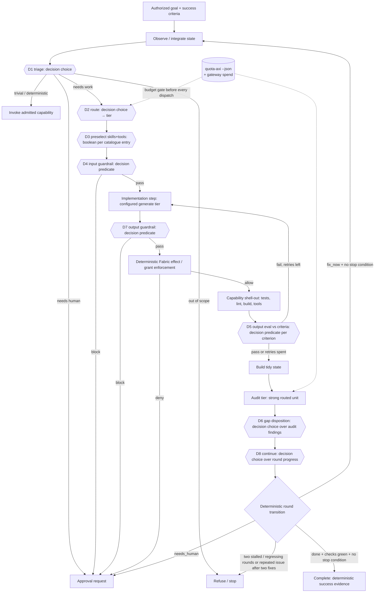

# M7 — Decision-model loop

This is the behavioral contract for the planned milestone in
[ARCHITECTURE.md §11](../ARCHITECTURE.md). It extends
[M6](m6-route-a-reconstructed-view.md). Terms follow
[GLOSSARY.md](../GLOSSARY.md). These requirements describe the target, not
implemented loop behavior. P0 establishes this contract; P1 supplies tier and
availability routing plus pure configuration validation. P2 supplies local ChatGPT authentication and a Responses adapter. P3 supplies the TypeSafe decision provider behind one evaluation interface. P4 supplies the budget gate; P5 supplies D1, D2, D8 and intake choice sites with pure transitions. P6 supplies D3 preselection and D4/D7 boolean guards. P7 supplies `shell.run@1`, the repo checks, and CLI generate backends. P8 supplies the implementation-tier step and D5. P9 supplies the audit view, strong audit call, D6, and the injected audit loop with deterministic stop rules. P10 supplies the non-gating decision-site benchmark with [recorded live results](../benchmarks/decision-sites/results/live-20261015/REPORT.md): `jev-1.14.0` and `amos-1-2b` served; OpenAI Decisions skipped `no_credential`; pi/fx skipped `auth_required`. Live application composition and P11–P12 remain planned.
Demonstrate red before implementation, prove green with deterministic fixtures,
and retain M0–M6 checks. Live provider runs are non-gating evidence.

## 1. Outcome and scope

Advance an authorized goal through observe, triage, route, preselect, guard,
implement, check, evaluate, and audit. Typed evaluation answers return as
observations. Deterministic policy retains authority over every transition,
destination, budget, effect, and grant. Independent actions may proceed together;
dependencies and effect conflicts constrain the frontier. Fabric remains bounded
and does not import Loom's runtime or scheduling concerns.

The existing `frontier.weigh` site remains available through
`ScriptedDecisionLayer`. New sites retain their semantic operation and answer
shape. Provider outage cannot silently turn evaluation into prose generation.
Capability generation, admission, and authority to execute stay separate gates.

## 2. Target loop



Every `{{Dn}}` node is an `evaluate` request through the gateway, served by the configured **decision provider** (§4a): TypeSafe Jev is the sole default decision provider. OpenAI Decisions (401 under ChatGPT sign-in) and Cloudflare Workers AI fallbacks are deferred. The provider's answer is recorded as an observation, and a deterministic rule then turns it into a transition. The decision model never dispatches anything itself. D7 guards proposed output effects before dispatch or publication; D8 checks progress after each round.

D7's pass cannot override Fabric's deterministic effect and grant enforcement.
The round transition applies the stop conditions in §6 before another round or
completion; one `stalled` or `regressing` answer alone does not stop the loop.
P6 implements D3/D4/D7 as pure site transitions with an injected evaluate port; full-loop wiring remains planned.

## 3. Tidy-state schema (audit-tier input)

The versioned view is `view.audit@1`, assembled by `assembleAuditState` from explicitly authorized named slices. Its contract is [AUDIT-CONTRACT.md](../packages/weave/src/AUDIT-CONTRACT.md). Assembly performs no inference or IO; policy supplies already disclosed, secret-free slices. Goal and iteration are required. Unauthorized slices record `slice:authority`, use empty values, and exclude their source revisions. Artifact references must also occur in the goal authority scope. Canonical JSON and a SHA-256 digest make the disclosed state suitable for prefix caching.

```text
interface AuditState {
  schema: 'audit-state@1';
  view: 'view.audit@1';
  goal: { goal_id; statement; success_criteria: { criterion_id; statement; check_ids: string[]; proof?: 'check'|'judgment' }[]; authority_scope; revision };
  iteration: number;                         // loop-back count
  plan: { step_id; intent; tier; status: 'done'|'failed'|'skipped' }[];
  decisions: { site; question_id; choice; probabilities; confidence; fallback_used: boolean; obs_seq }[];
  artifacts: { artifact_id; kind: 'diff'|'file'|'report'; digest; summary; bytes; ref }[]; // ref, not raw body, above a size cap
  checks: { check_id; iteration?: number|null; argv_digest; exit: number|null; passed: boolean; tail: string }[];  // deterministic evidence with producing audit iteration
  evals: { criterion_id; iteration?: number|null; verdict_probability; confidence: number|null; passed: boolean }[]; // D5 outputs with producing audit iteration
  open_issues: { issue_id; source: 'check'|'eval'|'audit'; text; severity }[];
  budget: { spent_micros; ceiling_micros; quota: { provider; window; percent_remaining; resets_at }[] };
  omissions: string[];                       // what the view left out and why (existing view rule)
  source_revisions: Record<string, number>;
  digest: string;
}
```

Artifacts carry ref, digest and size; optional bodies over the configured UTF-8 cap (default 4096 bytes) are excluded with `artifact:<id>:size_cap`. Summaries are bounded to 240 UTF-8 bytes and check tails to 240 characters with recorded omissions. Omitted budget is null.

The audit tier returns `AuditReport { findings: {criterion_id|null, kind:'gap'|'defect'|'regression'|'scope_creep', evidence_ref, proposed_fix}[], goal_met_claim: boolean }`. Its `goal_met_claim` is an observation only. Completion still requires deterministic success evidence (ARCH §3).

## 4. Decision-point catalogue

### 4a. Decision provider interface

Decision providers serve the existing
`EvaluationAdapter.evaluate(EvaluationCall)` interface. Configuration selects
TypeSafe Jev as the sole default decision provider, with no provider fallback.
OpenAI Decisions (401 under ChatGPT sign-in) and Cloudflare Workers AI fallbacks
are deferred. The loop names a judgment site and answer shape. It does not name a vendor.

The [OpenAI Decisions guide](https://developers.openai.com/api/docs/guides/decisions)
documents `POST /v1/decisions` with `gpt-6-luna`, shared input, named questions,
and typed answers. Gateway `boolean` maps to its `predicate`; gateway `choice`
and `score` map to choices and ordered levels. TypeSafe Jev uses
`/v1/systemone` with `noul`, `choice`, and `score`. A wire profile translates
one protocol without changing the gateway's semantics. P3 carries the TypeSafe
profile on a provider-neutral HTTP transport and exercises the contract suite
against that profile. A second profile can use the same transport later.
OpenAI Decisions stays deferred after the 14 Oct 2026 probe. P12 will extend
that arrangement to other compatible endpoints, including local ones.

Refusal, malformed answers, and an unavailable provider lead to the site's
recorded deterministic fallback or to pause. They do not select another
decision provider. Missing confidence triggers that fallback only where the site's
provider-specific rule requires it. OpenAI predicate answers supply probability
only; D5 uses the provisional probability-only band below, to be tuned in P10
on the tune split. Providers that return confidence
must also meet D5's confidence floor; probability does not replace that statistic.
Provider switching is deferred with fallback routing. P3 does not change
destination because a provider failed. A local Jev endpoint
may serve privacy-restricted sites only after earning site-specific evidence.
Its base URL is `decision.providers.typesafe-jev.base_url`.

On 14 Oct 2026 the ChatGPT sign-in token worked for Responses calls.
`POST /v1/decisions` returned HTTP 401 `rejected_by_access_enforcement` /
`no_matching_rule`. The Decisions guide shows API-key authentication; the
[Sign in with ChatGPT documentation](https://developers.openai.com/siwc/token-sharing-open-source)
describes eligible Responses API requests. TypeSafe Jev is the sole default
decision provider. OpenAI Decisions and Cloudflare Workers AI fallbacks are
deferred; the example's `chatgpt-oauth` provider definition does not establish
eligibility or enable a fallback. Record probe status without recording tokens.

### 4b. Sites

| Site                        | Kind                               | Question                                                                                                                     | Options                                                                                                       | Threshold                                                                                                                                                                                                                                                                                                                                                                    | Fallback when below threshold or no answer                                                                     |
| --------------------------- | ---------------------------------- | ---------------------------------------------------------------------------------------------------------------------------- | ------------------------------------------------------------------------------------------------------------- | ---------------------------------------------------------------------------------------------------------------------------------------------------------------------------------------------------------------------------------------------------------------------------------------------------------------------------------------------------------------------------- | -------------------------------------------------------------------------------------------------------------- |
| D1 `loop.triage`            | choice                             | What does this request or state need next?                                                                                   | `capability` (an admitted capability covers it) / `implement` / `needs_human` / `out_of_scope` / `done_check` | conf ≥ 0.80 and top-p ≥ 0.6                                                                                                                                                                                                                                                                                                                                                  | `implement` at the safest tier, with the uncertainty recorded. Never `done_check`.                             |
| D2 `loop.route`             | choice                             | Which tier fits this unit of work?                                                                                           | `flash` / `standard` / `strong`                                                                               | conf ≥ 0.75                                                                                                                                                                                                                                                                                                                                                                  | `standard`. A deterministic budget gate can only _downgrade_ or pause, never upgrade past the ceiling.         |
| D3 `loop.preselect`         | boolean per catalogue entry, top-k | Is capability or skill X relevant to this step?                                                                              | p(true) per entry                                                                                             | keep top-k (default 3) when the kept slice clears max_excluded .4 and min_margin .3; optional floor; guardrail-required always kept; cap 8. A missing confidence is unknown. A published confidence below .75 blocks only on that slice's boundary. A published confidence outside [0, 1] returns the full index. A floor that keeps no non-required entry is `no_candidate` | the full catalogue index (M6 slice), never the schemas                                                         |
| D4 `guard.input`            | boolean per rule                   | Does this input or plan violate rule R (secret exfiltration, scope broadening, destructive effect without grant, injection)? | p(violation)                                                                                                  | block if p ≥ 0.3 (deliberately asymmetric)                                                                                                                                                                                                                                                                                                                                   | **block, then approval request**                                                                               |
| D5 `eval.output`            | boolean per success criterion      | Does the artifact satisfy criterion C?                                                                                       | p(true), plus conf when supplied by the provider                                                              | OpenAI Decisions predicate (provisional assumption; P10 tunes on the tune split): pass if p ≥ 0.85, fail if p ≤ 0.15, otherwise uncertain (treat as fail/retry). TypeSafe Jev and other providers that return confidence: pass if p ≥ 0.8 and conf ≥ 0.9 (existing `confidence_floor`); missing confidence is below the floor.                                               | treat as fail and retry, up to N=2 per step, then escalate the tier once, then hand to audit with `open_issue` |
| D6 `audit.dispose`          | choice per finding                 | What do we do with audit finding F?                                                                                          | `fix_now` / `defer` / `reject_as_out_of_scope` / `needs_human`                                                | conf ≥ 0.75                                                                                                                                                                                                                                                                                                                                                                  | `needs_human`                                                                                                  |
| D7 `guard.output`           | boolean                            | Does the output introduce an effect outside the grant (writes, network, secrets)?                                            | p(violation)                                                                                                  | block if p ≥ 0.3                                                                                                                                                                                                                                                                                                                                                             | block, then approval request. Deterministic effect enforcement (Fabric) stays the real gate.                   |
| D8 `loop.continue`          | choice                             | Is progress continuing?                                                                                                      | `progressing` / `stalled` / `regressing`                                                                      | conf ≥ 0.7                                                                                                                                                                                                                                                                                                                                                                   | `stalled`, counted toward the two-in-a-row stop condition                                                      |
| `intake.classify`           | choice                             | How should this inbound message relate to the running threads?                                                               | `new_thread` / `continue_thread` / `queue` / `steer` / `interrupt` / `stop`                                   | conf ≥ 0.80 (provisional until P10)                                                                                                                                                                                                                                                                                                                                          | `ask_user` (`needs_human`), never an inferred classification                                                   |
| (existing) `frontier.weigh` | score                              | usefulness of each candidate                                                                                                 | defer/consider/dispatch                                                                                       | unchanged                                                                                                                                                                                                                                                                                                                                                                    | `ScriptedDecisionLayer`                                                                                        |

Semantic rule (ARCH §6): each site keeps its own operation. A Jev outage never reroutes D5 to a "compatible boolean" from another semantic operation. It falls back to the listed deterministic fallback. A locally run Jev (`decision.providers.typesafe-jev.base_url` pointed at localhost) is the privacy-only route for D3 and D4 once it has earned evidence on those sites. Thresholds are tuned per provider, because confidence is not calibrated across vendors.

### 4c. P5 transition and observation contract

The sites in `packages/weave/src/sites/` use one injected gateway `evaluate`
port and pure `transitionSite` replay. Intake's input type is `IntakeState`: one
disclosed inbound message and running-thread summaries (#90); it contains no
channel transport. Classification
is a proposed transition and grants no authority to dispatch, interrupt or stop
work. `done_check` requests a deterministic completion check, never completion.

Each `decision-site@1` observation records fixed-order keys: schema, site,
question, request_id, state_revision, answer, confidence, top_p, accepted,
fallback_used, reason, provider_request_id. The last field names the gateway's
provider_response_id. Unavailable statistics and unsafe correlation ids are
null. Raw state, provider diagnostics and unknown answer values are excluded.
This is the P5 decision payload. P9 adds a separate versioned JSONL tree ingestion port (§10); migration of every existing record to that envelope remains a follow-up. Deterministic tests validate the payload and field order.

Requests bind to an injected state revision and update timestamp. A response
for a different revision, a changed state timestamp, or observed before that
state's update is stale and takes the fallback. Receipt time and current state
are injected after the await; no site reads an ambient clock. Replay uses the
recorded gateway outcome and the same state readings without a provider call.
D1 also validates a normalized distribution and that its selected option is
at the top with probability at least 0.6.

Two explicit provisional assumptions need calibration: intake confidence is
0.80, and D1's safest fallback tier is `strong` for quality, subject to all
budget and authority gates. D2's accepted/fallback tier is the ceiling for P4;
the budget gate can downgrade or pause and cannot choose a higher tier.
An unavailable evaluate port (including a thrown exception) uses deterministic
fallbacks for read-only work and returns paused for dispatch-dependent work.
Unavailability is read from the attempts' failure codes, so a refusal
(`invalid_request`) or a malformed response alone is `no_answer` whether the
gateway reports it as `attempts_exhausted` or `provider_failed` (#91).
Cancellation always pauses. ScriptedDecisionLayer and the M0–M6 runtime path
are unchanged; wiring the full M7 loop is outside P5.

## 5. Tier configuration and availability

The composition root supplies parsed JSON to `parseRouteConfig`; the gateway
reads no files, environment, or clock. The root may load `weave.routes.json` and
an ignored `weave.routes.local.json` overlay. `applyRouteOverlay` keeps an
overlay `__proto__` key as an ordinary key, which validation rejects as unknown;
it never sets the merged object's prototype. See
[weave.routes.example.json](../weave.routes.example.json) for the P1 shape:
`units` is a route table and `decision` declares `provider`, nullable `fallback`,
and named `providers` with `base_url`, `model`, optional `auth`, and optional
`key_env`. `key_env` requires `auth: "api-key"`. `auth: "chatgpt-oauth"` carries
no `key_env`. `auth: "api-key"` requires one. A non-loopback provider requires
`auth` or `key_env`; a loopback provider may omit both. These are configuration
names, never embedded credentials. The example declares
future adapters; parsing it does not install or execute them.

`tier` is optional on a routed unit. A requested tier in `InferenceTerms` or
`RouteTarget` filters mismatches with `tier_mismatch`. If both specify a tier,
they must agree: a conflict is an invalid request, so `route` and `budgetRoute`
return no order with `invalid` set rather than excluding every unit (#43).
Gateway requests carry a tier only in their terms. Omitting tier preserves existing routing. Quality is
still `baseline` or `high`, independently checked. Prices are nonnegative finite
micros per million tokens; subscription examples declare zero token prices.
Quota accounting is a separate P4 gate, not an implication of zero cost.

`ProviderAvailability` is caller-supplied data keyed by exact routed-unit adapter
ids, not provider or destination ids. The composition root must map quota-provider
ids to adapters (for example, quota provider `claude` to adapter `claude-code`).
Only own entries are consulted; unmatched keys are ignored. Entries are `available`, `exhausted`, `auth_required`, or
`unavailable`, or `{ status, recheck_after? }`. Any explicit nonavailable adapter match
excludes a unit with `provider_unavailable`. Missing entries preserve existing
behavior. `recheck_after` is an injected timestamp for the root to act on;
routing never reads time or turns an expired entry into permission to dispatch.
Filtering and existing evidence ordering stay deterministic.

Validation rejects duplicate routed-unit ids, invalid operation/kind pairs,
unknown tiers, a `decision` tier on a generate unit, malformed route fields,
whitespace-padded models, context profiles, and prompt templates, negative or
nonnumeric prices, missing configured decision providers, a `decision.provider`
other than `typesafe-jev`, a `typesafe-jev` provider with no evaluate unit whose
adapter is `typesafe-ai` and whose model equals that provider's model, identical
primary and fallback, a `key_env` without `auth: "api-key"`, a non-loopback provider with
neither `auth` nor `key_env`, a `key_env` on `chatgpt-oauth`, an `api-key`
provider without a `key_env`, and base URLs other than HTTPS or HTTP on loopback hosts
(any `127.0.0.0/8` address, `::1`, `localhost`) without userinfo, `?`, or `#`.
The loopback test runs on the parsed URL host, which canonicalizes IPv4 forms,
so a domain such as `127.0.0.1.evil.com` is not loopback (#46). The Amos adapter
still applies its own narrower host check (`127.0.0.1`, `::1`, `localhost`) when
it is constructed. Adapters remain
credential-injected. `decision.sites` accepts `amos` or `typesafe-jev` for
`intake.classify` and `loop.preselect` only. Amos on intake requires a matching
choice unit; Amos on preselect requires a matching boolean unit.
`decision.preselect`, when present, is keyed only by a configured `typesafe-jev`
or `amos` provider id. Other ids, including `openai-decisions`, are rejected
even when the entry is empty. Each entry
may set `k` (an integer from 1 to 8), `floor` (a number in [0, 1)),
`max_excluded` (a number in [0, 1]), and `min_margin` (a number in [0, 1]).
Unknown keys, unknown provider ids, and out-of-range values are errors.
The per-field defaults describe `resolvePreselectPolicy` only. It fills each
missing or out-of-range field with its own default and keeps the other fields:
k = 3, floor = 0, cap = 8, max_excluded = .4, and min_margin = .3. A caller
that skips the parser still gets a defined policy, one field at a time. The
pure D3 transition does not fill fields. An invalid or incomplete policy
(a missing field, an out-of-range field, an unknown key, or a bad provider)
is replaced wholesale with those same defaults and a null provider, and
selection still narrows. That replacement is not an admission fallback.

P3 does not switch decision providers. OpenAI Decisions remains deferred after
the 14 Oct 2026 probe, and `decision.fallback` is not routed. The configured
provider's destination is the destination on its evaluate unit. P1's
`DecisionConfig.providers` has no destination field.
The example CLI units declare remote vendor destinations even when the CLI
process runs locally.

## 6. Loop-back and stop conditions

Loop back to Observe when audit findings dispose as `fix_now`. Each finding becomes an `open_issue`, then a candidate with the `criterion_id` attached.

Stop:

1. **Done**: every success criterion has deterministic evidence (checks green), D5 passes every criterion whose criterion proof is `judgment`, and the audit has no `fix_now`.
2. **Budget**: the weekly quota gate trips (§8), or the gateway cost ceiling is reached. The loop pauses with state persisted. This is not a failure.
3. **Iteration cap**: `max_iterations` (default 4 audit rounds).
4. **No progress**: the round's progress choice is `stalled`/`regressing` twice in a row, or the same `issue_id` reappears after two fix attempts. Each choice comes first from a deterministic rule over `progress.delta@1` (unchanged evidence is `stalled`, criteria only gained is `progressing`, criteria only lost is `regressing`), and D8 answers only when that rule does not decide ([#202](https://github.com/CrowBe/weave/issues/202)).
5. **Authority**: D4 or D7 block, or a needed approval, goes to `needs_human`.
6. **Decision outage**: the configured decision provider is unavailable. The loop drops to `ScriptedDecisionLayer` plus deterministic fallbacks for _read-only_ steps, and requests approval before any dispatch that needs D4 or D7. The outcomes differ by site on purpose ([#100](https://github.com/CrowBe/weave/issues/100)). D1, D2, D8 and intake pause dispatch-dependent steps, because their outage is a missing observation and the pause is resumable. D4 and D7 return approval requests with reason `decision_unavailable` (`needs_human`), because their outage leaves an authority question open. The [sites contract](../packages/weave/src/sites/CONTRACT.md) records the rationale.

## 7. Phased PR plan

Each PR is small. Each must pass `npm run verify`, adds tests to the existing `node --test` suites, and keeps `checks/` green. Live provider runs are non-gating benchmarks, as today.

| #   | PR                                                                                                                                                                                                                                                                             | Acceptance criteria                                                                                                                                                                                                                                                                                                                      | Tests                                                                                                                                                                                                                                                  |
| --- | ------------------------------------------------------------------------------------------------------------------------------------------------------------------------------------------------------------------------------------------------------------------------------ | ---------------------------------------------------------------------------------------------------------------------------------------------------------------------------------------------------------------------------------------------------------------------------------------------------------------------------------------- | ------------------------------------------------------------------------------------------------------------------------------------------------------------------------------------------------------------------------------------------------------ |
| P0  | **Glossary + design doc**: add _tier_, _decision provider_, _wire profile_, _tidy state_, _audit tier_ to GLOSSARY.md; write `docs/m7-decision-loop.md`                                                                                                                        | Terms used consistently; ARCH §11 updated                                                                                                                                                                                                                                                                                                | doc-only                                                                                                                                                                                                                                               |
| P1  | **Tiered route table from config**: `tier` on `RoutedUnit`; pure config validator in gateway; file loading only in the composition root; `ProviderAvailability` port                                                                                                           | Gateway still does no env/fs reads; an unavailable provider is excluded with reason `provider_unavailable`; deterministic order preserved                                                                                                                                                                                                | routing tests: exclusion, tie order, empty table gives a blocked outcome                                                                                                                                                                               |
| P2  | **Sign in with ChatGPT** (early): `packages/auth-chatgpt` (PKCE, loopback, persisted host id and issued client_id, ID-token/JWKS validation, refresh) plus an `openai-chatgpt-plan` Responses generate adapter; **live probe of `/v1/decisions` with the OAuth token**         | No client secret; token file 0600; token never on argv or in logs; unit is `auth_required` until signed in; probe result recorded in the doc                                                                                                                                                                                             | mocked auth server and fetch; nonce, aud and expiry failure cases; Responses stream parse                                                                                                                                                              |
| P3  | **TypeSafe decision provider behind one interface**: split `typesafe-ai.ts` into a wire profile plus HTTP transport; configurable base URL; `decision.provider` is `typesafe-jev` only                                                                                         | One `EvaluationAdapter`; provider and base URL come from config; a provider with no matching evaluate unit is rejected; the credential never appears in errors or logs. OpenAI Decisions, Cloudflare, and Vercel decision fallbacks stay deferred                                                                                        | Contract suite with a fake fetch: noul, choice, score, missing confidence, 400/401/422/429/529/5xx, malformed body, documented request shape, credential redaction. Config tests for provider selection, local base URL, and the missing evaluate unit |
| P4  | **Budget gate**: `QuotaPort` (a `quota-axi --json` snapshot supplied as data) plus `budget.policy@1`                                                                                                                                                                           | No dispatch once a provider's week is 80% used; pause until `resetsAt`; pace `ahead` downgrades the tier                                                                                                                                                                                                                                 | fixtures at 79/80/95% used, unknown pace, stale, missing, or unknown snapshot fails closed for strong                                                                                                                                                  |
| P5  | **Decision sites D1, D2, D8** (triage, route, progress) in `packages/weave/src/sites/`                                                                                                                                                                                         | Below-threshold answers take the recorded fallback; a stale answer is rejected; the scripted layer still passes M0–M6                                                                                                                                                                                                                    | fake provider answers; replay determinism                                                                                                                                                                                                              |
| P6  | **D3 preselect plus D4/D7 guardrails**                                                                                                                                                                                                                                         | Preselect only narrows the disclosed catalogue slice; a block becomes an approval request                                                                                                                                                                                                                                                | M6 slice tests; guard asymmetry tests                                                                                                                                                                                                                  |
| P7  | **`shell.run@1` plus `repo.test/lint/build`, and CLI backends** (`codex exec`, `claude -p`, `grok`) as generate adapters, prompt on stdin                                                                                                                                      | Effects enforced by grant; env values never on argv or in logs; timeout and cancel honoured                                                                                                                                                                                                                                              | Fabric host tests with the canary-env leak pattern; stub CLIs                                                                                                                                                                                          |
| P8  | **Implementation-tier step plus D5 output eval**                                                                                                                                                                                                                               | Retry ≤2, escalate a tier once, then raise an open_issue                                                                                                                                                                                                                                                                                 | toy-goal loop with fake providers                                                                                                                                                                                                                      |
| P9  | **`view.audit@1` tidy state, audit tier, D6, loop-back and stop**                                                                                                                                                                                                              | Implemented through injected ports; an audit claim alone cannot complete a goal; deterministic evidence, D5, authority, budget and progress gates govern transitions                                                                                                                                                                     | fake-provider fixtures: gap → loop → done, red check, iteration cap, stalled/repeated issue, budget, D6 fallback, oversized artifact, replay                                                                                                           |
| P10 | **Implemented; [live results recorded](../benchmarks/decision-sites/results/live-20261015/REPORT.md).** [Non-gating decision-site benchmark](../benchmarks/decision-sites/README.md): frozen scenario splits, pinned Jev 1.14, provider-specific tune/holdout, pi/fx harnesses | USD 2.00 default metered ceiling; durable resume; no runtime/guard changes; looser settings need captain (#142)                                                                                                                                                                                                                          | Offline fake fetch/CLI and full verification; `jev-1.14.0` and `amos-1-2b` served; OpenAI Decisions skipped `no_credential`; pi/fx skipped `auth_required`                                                                                             |
| P11 | **MVP test drive** (last MVP phase): Weave runs one real end-to-end task, e.g. a small real PR on weave itself                                                                                                                                                                 | **Exit:** (a) ChatGPT sign-in works as an inference provider and serves real calls; (b) the configured decision provider makes the D1 triage and D2 routing decisions, recorded with confidence; (c) a light tier and a frontier tier both run inside the loop; (d) checks green, audit run, stop recorded; (e) the week stays under 80% | recorded trace and replay; quota-axi delta logged                                                                                                                                                                                                      |
| P12 | **Post-MVP: generic decision-endpoint adapter.** A config-declared wire profile for any compatible decision endpoint, local providers included                                                                                                                                 | No interface change; adding an endpoint is config plus a profile; the destination is declared                                                                                                                                                                                                                                            | the shared contract suite runs against a local mock server                                                                                                                                                                                             |

Order: P0 → P1 → P2 ChatGPT sign-in → P3 TypeSafe decision provider. OpenAI Decisions is deferred after the 14 Oct 2026 probe, so P3 does not add it. P4 (budget) and P7 (shell) can run alongside P2 and P3. P5 depends on P3. P6 depends on P5. P8 depends on P6 and P7. P9 depends on P8. **P11 MVP test drive is the last MVP phase** and depends on P2, P3, P5 and P9. P12 comes after the MVP.

## 8. Budget

**Hard policy: no dispatch once the injected account snapshot shows a provider at ≥80% weekly usage.**

**Loop mechanism (P4).** The hard rule: the loop stops at 80% of weekly quota, checked with `quota-axi --json`.

- Before every routed dispatch, and at the start of every audit round, the composition root runs `quota-axi --json` with a ~60s cache. For each `quota_provider` it reads `windows[id=seven_day].percentRemaining`, `resetsAt`, `pace.status`, and `five_hour`. Codex reports its weekly window as `weekly`; the root's normalizer maps it to `seven_day`.
- **Weekly gate:** if `percentRemaining ≤ 20` (80% used) for the provider a unit draws on, the unit is excluded (`weekly_budget_cap`). If no eligible unit remains for the step, the loop records `loop.paused{until: resetsAt}` and stops dispatching. It resumes at reset, through the injected clock and timer only. The cap is enforced against the whole week, including use outside Weave, because quota-axi reports the account total. That is stricter than "Weave's share", and safe.
- **Five-hour window:** if `≤ 10%`, prefer another provider; if none, wait until that reset (the gateway already waits on known delays).
- **Pace:** `ahead` downgrades `strong` to `standard` except for the audit step, which pauses instead. An audit should not be done by a weaker model.
- **Fail closed:** stale, missing, or unknown quota excludes `strong` and quota-tracked `standard` units (`quota_unknown`). `decision` and `flash` may proceed under the gateway cost ceiling, as requested for P4. A known weekly cap remains a veto for every tier, including stale observations.
- **Metered providers:** the existing per-run `cost_ceiling` in micros remains enforced. Weekly dollar accounting is not supplied by quota-axi window percentages and remains deferred.

## 9. Acceptance evidence and unresolved assumptions

Deterministic fixtures must prove threshold boundaries, recorded fallbacks,
stale-answer rejection, destination restrictions, retry and escalation bounds,
effect denial, cancellation, concurrent independent work, audit loop-back, and
every stop condition. Every consequential transition records the state revision,
site, answer, confidence, applied policy, and fallback. Generated artifacts and
tests remain untrusted until independently validated; checks cannot be weakened
by a decision answer or audit report.

P1 does not instantiate decision or CLI adapters, read quotas, authenticate,
assemble tidy state, or execute this loop. Configured model names, credentials,
CLI availability, and OAuth access are operator assumptions until subsequent
phases supply evidence. P4 fixes snapshot freshness and account/provider quota mapping. The snapshot
gate uses observed account totals; it does not estimate or reserve a future
provider quota delta. A cached observation cannot establish usage incurred
after it was collected, including concurrent calls or use outside Weave. The
repository cannot establish live provider entitlement or quota guarantees from
configuration alone.

## P2 — Sign in with ChatGPT and Responses

Landed `@weave/auth-chatgpt`, an independent stdlib-only package with injected
fetch, clock readings, and a credential-store port. It persists a UUID URI host
ID before authorization, uses PKCE S256, state and nonce, validates RS256 ID
signatures and issuer/audience/expiry/nonce, requires a present `azp` to name
the client (and requires `azp` for multiple audiences), and checks the token response's
plan-usage scope. Returning sign-in reuses the selected issued client ID and
checks the validated subject before replacing credentials. The filesystem
implementation writes atomically with file mode 0600. It creates a missing
directory with mode 0700. It never changes the mode of an existing directory
and refuses to write into one that grants group or other access
(`credential store directory not private`). The check reads POSIX mode bits.
The repository does not verify Windows, where those bits do not describe ACLs.
No runtime or Fabric package imports authentication.

`@weave/gateway/openai-chatgpt-plan` sends credential-injected Responses calls to
`openai.chatgpt-plan`. Its SSE parser accepts success only at
`response.completed`. Usage limits become `quota_exhausted` without an inferred
reset; temporary usage unavailability and interrupted streams become
`unavailable`; incomplete output becomes `malformed_response`. HTTP diagnostics
retain status, body, structured error code/param and request ID with the access
token redacted. The gateway's existing closed failure vocabulary is unchanged.

Run the composition roots locally on the browser's machine:

```sh
npm run example:chatgpt-signin
mkdir -p .local
npm run example:chatgpt-probe -- --out .local/chatgpt-probe.json
```

Sign-in accepts `--port` (default 1455), `--timeout-ms` (default 600000), and
`--credentials` (default `~/.config/weave/chatgpt.json`). Probe accepts
`--credentials` and requires `--out`. The listener binds only 127.0.0.1 before
printing the authorize URL. Neither script accepts credentials on argv or logs
tokens. A lock file excludes concurrent sign-in/refresh commands; a stale lock
fails closed and requires operator removal after confirming the old process
stopped. Temporary refresh failures preserve the saved credentials; documented
terminal refresh errors discard unusable tokens while retaining host and issued
registration identity for reauthorization. During sign-in, a token-endpoint
`invalid_client` or `registration_required` means the issued registration is
unusable: sign-in clears it and the credentials bound to it, keeps the host ID,
and tells the operator to sign in again, which registers a new client without
the previous subject binding. Other token errors keep the registration. A
rejected callback reports its fixed code (`state mismatch`, `access_denied`,
`authorization rejected`, ...), never callback text. Until credentials exist and plan
usage is granted, the composition must supply `auth_required` availability for
the `openai-chatgpt-plan` adapter; configuration alone establishes no entitlement.

The probe records the actual HTTP status, request ID and raw body (including SSE)
for models, Responses, and Decisions, redacting credential values. It preserves
server model order and selects the first `visibility: "list"` slug. If models
cannot be listed it records a skipped Responses call rather than guessing a
model; the Decisions probe still runs. The Decisions body follows the official
[choice example](https://developers.openai.com/api/docs/guides/decisions), using
`gpt-6-luna` and the duplicate-charge input. On 14 Oct 2026 the ChatGPT sign-in
token worked for Responses calls. `POST /v1/decisions` returned HTTP 401
`rejected_by_access_enforcement` / `no_matching_rule`. OpenAI Decisions is
therefore deferred, and TypeSafe is the sole decision provider. This record
does not include the token.

Conservative choices and limits:

- Optional returning `id_token_hint` and `login_hint` are omitted so the printed
  authorize URL contains no retained token. Returning users may see the account
  selector. No forced consent parameters are sent.
- The published JWKS URL is `https://auth.openai.com/.well-known/jwks.json`,
  confirmed by [OpenAI's identity validation guide](https://developers.openai.com/siwc/website).
  Keys are fetched for validation rather than introducing a cache. Expiration
  has zero clock-skew tolerance. Refresh ID tokens, when supplied, are signature,
  issuer, audience, expiry and subject checked; there is no authorization nonce
  in a refresh grant. A refresh omitting an ID token retains the validated identity.
- Each credential file selects one registration. There is no account-switching
  UI or automatic multi-account merge. The command never replaces a returning
  registration with a different client ID or subject.
- Preview restrictions forbid `max_output_tokens` and `temperature`, so the
  Responses adapter omits both. Caller cancellation still bounds execution;
  the provider's actual usage is reported, and unknown usage remains unknown.
- Identity-only credentials remain signed in but cannot invoke plan inference.
  No automatic billing fallback, retries, or guessed quota-reset times are added.

P2 deterministic evidence: missing-module red preceded implementation; 11 auth
cases, 15 Responses adapter cases, and two CLI lock/redaction cases pass on
Node 22. Build, structural checks, web build/typecheck, example and benchmark
typechecks, Jev tests, Python contract suites and the standalone offline
acceptance command pass. The full `npm run verify`, including the
task-acceptance command tests, passes on Node 22 locally and in CI. An earlier
`spawnSync` `EPERM` failure came from the writer's sandbox, not from the code.
No tests or permissions were weakened.

## P3 — TypeSafe decision provider

`typesafe-ai` is a wire profile for `POST /v1/systemone`. A boolean question is
a `noul`. Choice and score keep `criteria` (`choices` and `levels` are not sent).
The body is `state`, `model`, and a non-empty `questions` map. A provider-neutral
transport carries that body. It maps 400 and 422 to `invalid_request` (not
retryable), 401 to `unauthorized`, 429 to `rate_limited`, and 529 and other 5xx
to retryable `unavailable`. It records `x-typesafe-request-id`. It redacts the
credential from failure messages and does not log. Missing confidence is left
missing; policy still treats that as below the floor.

`decision.provider` must be `typesafe-jev`. `parseRouteConfig` rejects any other
provider id, and rejects a table whose configured provider has no evaluate unit
with adapter `typesafe-ai` and the provider's model. The composition root passes
that provider's `base_url` into the adapter. The default is `https://api.typesafe.ai`.
Loopback HTTP is the local TypeSafe or Jev route. `decision.fallback` stays in
the configuration and is not routed. OpenAI Decisions, Cloudflare Workers AI,
and a Vercel decision route are deferred. There is no second decision adapter.

## P4 — Budget gate contract and evidence

`budget.policy@1` applies after routing's operation, kind, tier, destination,
quality, context and cost constraints, before each generation or evaluation
attempt, including retries, waits and fallbacks. `quota_provider` is an optional
routed-unit attribute naming the whole-account quota-axi provider, independent
of its adapter and destination. A strong unit without that mapping fails closed.
The weekly cap reaches only units that declare it, and a standard unit without
it does not fail closed, so every unit that draws on a subscription account
must declare its `quota_provider`. `parseRouteConfig` cannot enforce this: a
route table records no billing, and a zero token price also describes local
units and unpriced placeholders such as the Muse Spark entries. Requiring the
mapping needs a billing declaration on routed units, which is not decided yet
(#77); a test pins the current gap.
The example subscription units name `codex`, `claude` and `grok`. quota-axi
0.1.64 lists all three provider ids. Its Grok reading reports the allowance as
window `credits` (kind `weekly` or `monthly` by plan period), and no Grok
capture is recorded, so the normalizer does not map it: Grok strong and
quota-tracked standard units fail closed with `quota_unknown`, and Grok flash
units carry no weekly cap.

`QuotaPort.read()` returns normalized snapshot data (`observed_at`, provider
status, weekly/five-hour windows, numeric reset times and pace). Only the local
composition-root helper runs `quota-axi --json`, with a 60s cache and concurrent
refresh deduplication. It converts ISO timestamps and strips CLI diagnostics.
Freshness requires a `fresh` provider, observation age ≤60s, and a future weekly
reset. Age counts from when the provider's reading was taken: a reading quota-axi
reuses from its cache (`state.reused`, opt-in through `--max-age` or
`QUOTA_AXI_MAX_AGE`) was taken at `state.refreshedAt`, which the normalizer
passes on as that provider's `observed_at`; the report's `generatedAt` is the
default. The root's own 60s cache therefore cannot make an older reading pass
(#76). Missing, duplicate, malformed or expired windows cannot clear strong work.

The normalizer reads quota-axi `--json` schemaVersion 5. A provider's status is
`state.status`, and `state.stale: true` is never fresh. Only the windows the
policy reads (`seven_day` or Codex `weekly`, and `five_hour`) must carry a
percentage and a reset. Other windows (model, credit, code-review and used-share
windows) may omit those optional fields without making the provider unknown, but
a value that contradicts the published schema anywhere in the row does. A status
quota-axi itself reports as not fresh is kept rather than replaced by `unknown`,
and a reused reading keeps its observation time, so stale evidence survives a
malformed row (#92). A recorded-fixture contract test checks these field names
against a redacted verbatim Codex capture from the P10 live run (15 Oct 2026)
and the documented Claude example in the quota-axi 0.1.64 README (#78).
Unknown pace also fails closed; `ahead` permits a standard route only when no
eligible strong route remains and quality and authority still hold.

When no budget-eligible unit remains, the outcome carries `paused` with shape
`{type:'loop.paused', policy:'budget.policy@1', request_id, site, reason, until}`.
An injected `persist_pause` port is awaited; local roots append the record to
`~/.local/state/weave/loop-paused.jsonl`. `until` is the earliest known reset, or
null when a fresh observation is needed. This records the pause but adds no
scheduler or resume consumer. If `persist_pause` rejects, `generate` or
`evaluate` rejects with that port's error instead of returning a paused outcome,
and nothing further is dispatched for that request (#74); every other budget,
routing and deadline condition still resolves with an outcome. A reset is
permission to recheck, never permission to dispatch from the old snapshot. Five-hour pressure excludes the provider in
favor of another eligible provider; when none remains, it records a pause until
the five-hour reset. The P9 audit tier requests `tier:'strong', audit:true`
and uses this same gate at every audit-round dispatch; pace pressure pauses audit.

All providers unavailable has its own blocked reason `provider_unavailable`
(issue #44); an empty or otherwise incompatible table remains `no_route`.

The gate reads quota before every attempt, and the gateway checks the deadline
again after each read. A deadline that passes before the first attempt,
including during that read, gives `blocked: deadline_passed` with no attempts,
the same outcome as a deadline already past on arrival. Once an attempt has
been made it gives `unaccepted: deadline_reached` (#79). The gateway does not
wait out a slow `QuotaPort.read()`: cancellation, or the deadline when a timer
is configured, ends the wait, and the pending read counts as no observation.
The same rechecks then decide the outcome, so nothing dispatches (#75). Without
a timer the deadline is checked only once the read settles.

A `blocked` outcome does not mean nothing was spent. The gate rechecks quota
before a retry, so a pause after a failed attempt is `blocked` with that attempt
and its spend; an Amos-bound evaluation whose every attempt was unavailable is
also `blocked` with attempts. Callers account `attempts` and `spent` for every
status (#73). The Weave runtime, the frontier weigh decision provider and the
Fabric host already record both for every status.

Offline fixtures cover 79/80/95% usage, stale/missing quota, unknown pace,
downgrade constraints, audit pause, five-hour preference, retry rechecks,
cancellation, deadlines, snapshot cache concurrency and durable pause records.

### P6 site contract

D3 only narrows the disclosed M6 catalogue index, with ordinal question ids.
The preselect policy keeps the top k entries by p(true), default k = 3, then
applies an optional floor (default 0, off). k is an integer from 1 to 8. The
cap of 8 bounds k and does not drop guardrail-required entries. Ties stay in
disclosed order. Required entries that are in the index are always kept, in
addition to the top k of the remaining entries. A required id that is not in
the index is ignored and counted. A `required_entry_ids` value that is not an
array, and any non-string item, is not a required id; valid strings in a mixed
array are kept, and the record flags the invalid value. A low p(true) alone
never drops an entry: a nonempty index never yields an empty slice, even when
every confident answer is below .5 (#96). It evaluates an
explicitly disclosed step string plus id/purpose entries; schemas and general
state are excluded. Any missing or malformed probability, a wrong kind, a
stale revision, an outage, or cancellation returns the full index. Unknown
answers are ignored and recorded with fixed text, without names.

When every entry has a probability and admission succeeds, the candidate slice
narrows only if nothing is excluded, or if `best_excluded_p <= max_excluded`
and `top_p - best_excluded_p >= min_margin`. `top_p` is the highest p(true)
among kept non-required entries. `best_excluded_p` is the highest p(true)
among excluded entries. Nothing excluded means there is nothing to gate for
the margin or for a low confidence. The defaults are max_excluded = .4 and
min_margin = .3. Both bounds are inclusive and accept exactly 0 and exactly 1.
A computed miss, where `top_p` is present, returns the full index with reason
`weak_margin`. When the floor removes every non-required entry, `top_p` is
null and something was excluded. That returns the full index with reason
`no_candidate`, with or without required entries. `margin` is null.
`best_excluded_p` is still recorded. `top_p`, `best_excluded_p`, `margin`, and
each `scores[].p` record `-0` as `0`. A missing confidence is unknown: the map
is absent or omits that key. A published value that is not a finite number in
[0, 1] is not unknown. Any such value, on any entry, returns the full index
with reason `invalid_confidence`, including off the boundary and when nothing
is excluded. D4 and D7 still treat a non-unit confidence as missing. After the
margin passes, a published confidence below .75 on a kept non-required entry
or on the single best excluded entry returns the full index with reason
`low_confidence`. The same statistic elsewhere does not block. Admission wins
over an invalid confidence. An invalid confidence wins over `no_candidate`,
`weak_margin`, and `low_confidence`. `no_candidate` wins over `weak_margin`,
and a weak margin wins over low confidence. On any of those fallbacks, a
per-entry observation can still say `accepted` with `fallback_used` false.
The fallback is visible on `preselect.outcome` and `preselect.reason`. The D3
transition records `preselect-selection@2`: k, floor, cap, max_excluded,
min_margin, policy_provider, routed_unit_id, outcome (`narrowed`, `fallback`,
or `empty_index`), reason (`weak_margin`, `no_candidate`, `low_confidence`,
`invalid_confidence`, `admission`, or null), the margin statistics, and one
score per disclosed entry (`entry` ordinal, `p`, `rank`, `kept`, `required`).
`policy_provider` is the caller-supplied provider. `routed_unit_id` is the
accepted outcome's routed unit when that id is a bounded identifier, and null
when no outcome was accepted. `p` and `rank` are null when the answer is
missing. The record uses ordinals, never catalogue ids, purposes, or required
names. `decision.preselect`'s per-field defaults are `resolvePreselectPolicy`.
The pure transition replaces an invalid or incomplete policy wholesale.
`decision.preselect` sets k, floor, max_excluded, and min_margin only for
configured `typesafe-jev` and `amos` providers.
`loop.preselect` may be served by `typesafe-jev` or `amos`; Amos requires a
matching boolean evaluate unit. The default provider remains `typesafe-jev`.
D4 evaluates four fixed rules through the same decision gateway: secret
exfiltration, scope broadening, destructive effect without grant, and prompt
injection. Injection criteria provisionally interpret fx's injection/malicious
behavior review as policy override, authority impersonation, secret disclosure,
or expanded tool/scope access; there is no second model gate.
D7 evaluates out-of-grant output effects. Both guards request approval at
p >= .3 or on any uncertainty, missing/malformed/stale answer or outage.
A pass supplies no grant and cannot override Fabric's deterministic enforcement.
Approval requests name the rule; D7's is `out_of_grant_effect` (#98). The
guards judge only the caller's disclosed state and inject no grant or scope,
so the caller must disclose the effective grant and authorized scope (#99).

Provisional confidence floors are .75 for a published D3 boundary confidence
and .90 for D4/D7, pending P10 calibration. A missing D3 confidence is
unknown. D4 and D7 still treat a missing confidence as below the floor.
Shape/gate/decide uses one fixed-question round: P5 metadata admission plus
per-answer shape gates precede the D3 margin gate and the deterministic
thresholds.
No outage retries another semantic operation. Boolean observations preserve
`decision-site@1` key order, with closed answer words and top_p = p(true);
fixed question text identifies guard rules. Raw input and rule payloads are never
recorded. Full-loop transport/persistence remain outside these pure sites;
ScriptedDecisionLayer and M0–M6 behavior are unchanged.

Live, D4 and D7 never pass automatically ([#142](https://github.com/CrowBe/weave/issues/142)).
In `live-20261015`, neither jev-1.14.0 nor amos-1-2b published a confidence for
any guard question. Every live guard evaluation, clean or violating, is
therefore an approval request with reason `missing_confidence`. The floor stays
at .90. A probability-only guard rule would need a tune-split fit per provider,
one holdout scoring, and the captain's approval. The descriptive holdout
diagnostic alone does not support one: `guard.input` false-block rates are
34.6% / 28.8% (jev / amos), and amos misses one violation in four. The
[sites contract](../packages/weave/src/sites/CONTRACT.md) records the decision.

Why k = 3. The D3 fine-tune experiment used 24 entries per step, synthetic items, and labels from jev-1.13.0. Recall of needed entries on the Claude test set (72 steps) and the Codex test set (84 steps) for the old rule p ≥ .5, cap 8 was .82 / .73 for the fine-tuned Amos mini and .97 / .98 for TypeSafe 1.13. Top-1 was .87 / .88 and .94 / .93. Top-2 was .94 / .96 and .99 / .98. Top-3 was .98 / .98 for the fine-tuned mini, .92 / .97 for the base mini, and 1.00 / 1.00 for TypeSafe. Top-4 was .98 / .99 for the fine-tuned mini, top-5 was .99 / 1.00, and top-8 was 1.00 / 1.00. A floor of 0.02 changes nothing. A floor of 0.05 costs about one point at k ≥ 5. A floor of 0.10 drops recall to about .95 at every k, because the mini scored some needed entries from .04 to .10. The floor therefore defaults to 0 (off). Most steps have one needed entry (mean 1.04–1.12, maximum 3), so k = 3 is the smallest k where TypeSafe hits 100% and the fine-tuned mini hits 98%. k = 5 is the next jump for the mini, at the cost of a five-entry slice.

Why these margins. The same sets, still at k = 3, were scored with a ceiling on the best excluded probability and a minimum gap from the highest kept non-required probability. TypeSafe 1.13 narrows 78% of the Claude steps and 80% of the Codex steps at ceiling .4 and margin .3, and drops no needed entry when it narrows. The fine-tuned Amos mini narrows 86% and 81%, and drops none; with no margin gate it drops 2 and 2. The base Amos mini narrows 83% and 71%, and drops 2 and 1; with no gate it drops 6 and 3. A looser margin of .2 lets one needed entry through on the fine-tuned mini's Codex set. A ceiling of .5 lets one through on that set and one or two through on the base mini. The defaults are therefore max_excluded = .4 and min_margin = .3.

## P8 — Implementation-tier step and D5

P8 runs one implementation step for a unit that already has a D2 tier, has passed the P4 budget gate, and has passed D3/D4. It does not wire audit, D6, loop-back, or goal completion. `goal_done` on the step result is always false.

The step calls `generate` once at the routed tier, then each configured check (`repo.test`, `repo.lint`, `repo.build`) through `host.invoke`. Each check carries a held grant the composition root already issued. That grant is single-use, so the step does not invoke it on the next attempt. Before every check on every attempt, including a retry and the escalation, the step calls an injected issuer. The composition root supplies that issuer, outside the decision path. `createEqualGrantIssuer` binds a `GrantAuthority` to those held grant objects and copies scope at bind time. Each call returns a new grant with the same operation, contract revision, permissions, effects, and process effects, and returns null for any other object, so the fresh grant is equally scoped and never wider. Each fresh grant has its own action id, `<held action_id>:g<n>`, so `release` or `proceed` by action id cannot match another open invocation from the same issuer ([#125](https://github.com/CrowBe/weave/issues/125)). The issuer mints at most `limit` fresh grants per held grant, by default `retries + 2` for the default retries: one per generation run of a step ([#124](https://github.com/CrowBe/weave/issues/124)). The composition root binds one issuer per step run and passes `retries + 2` when it configures more retries; past the limit the issuer returns null and the check is denied. The step invokes a result only when its scope still equals the held grant. The held grant is not consumed. A decision answer cannot mint a grant. Check argv stays in host configuration. The step digests configured argv for evidence and does not put it on the invocation. Env names may be passed; env values are not. Process output stays redacted by the host. A credential-shaped stdout tail is dropped rather than copied. Check artifact refs are kept only when they are `ref_` or `gen_` handles.

D5 (`eval.output`) asks one boolean question per success criterion. The observation reuses `decision-site@1` key order, with site `eval.output` and answer `pass`, `fail`, or null. The question text is fixed: "Does the artifact satisfy this success criterion?" Criterion statements are disclosed to the evaluator and are not copied into the observation, the attempt journal, or the step result. Question ids are ordinal (`criterion_N`). A criterion passes only when its answer clears shape admission, `p >= 0.8`, and `confidence >= 0.9` (the existing `confidence_floor`). Missing, non-numeric, low-confidence, stale, unparseable, or unknown-site answers fail that criterion. A provider outage, a thrown evaluate port, or a null outcome uses D5's deterministic fallback: every criterion fails with `decision_unavailable`. The implementation step treats that outage as a pause, not a failure ([#129](https://github.com/CrowBe/weave/issues/129)): the attempt is recorded `paused` with reason `decision_unavailable` and its fallback observations, raises no open issue, and spends neither a retry nor the escalation. A later run regenerates on the same tier, because the generated text is not stored for a second D5 request. A skipped D5 has no evaluations and is never an outage. D5 does not read another site's answer. The OpenAI probability-only band in §4b stays deferred with that provider. D5 shares P5 `admissionReason`, which classifies an outage on the attempts' failure codes rather than on `provider_failed` ([#91](https://github.com/CrowBe/weave/issues/91)): a refusal alone is `no_answer`, not `decision_unavailable`, at every `max_attempts`.

A red check fails the attempt whatever D5 would answer, so the step does not ask D5 on that attempt ([#200](https://github.com/CrowBe/weave/issues/200)). It records no D5 observations or evals for it, never fabricates one, and marks the attempt `eval_skipped: 'check_failed'`. A skipped D5 is not an outage. An attempt with green checks asks D5 as before. On failure the step retries the same routed tier up to N times (`retries`, default 2), and the next prompt lists the failing criterion ids and check ids. After a red check those are the failing check ids plus any check-proven criterion the red check fails. Judgment criteria were not evaluated, so they are not listed. It then escalates exactly one tier (`flash` to `standard`, or `standard` to `strong`) once. Escalation cannot pass the D2 ceiling. The budget port can downgrade a same-tier attempt or pause it. A downgrade is not escalation and cannot raise the tier. Escalation is one tier above the D2-routed tier (the step's input tier), not above a tier the budget port lowered an attempt to ([#130](https://github.com/CrowBe/weave/issues/130)). This is intended: the routed tier is D2's judgment of what the work needs, and a downgrade is a cost constraint on one attempt that does not change that judgment. The budget port re-checks the escalated request and must allow exactly that tier; while budget pressure persists it lowers or pauses the escalation instead of letting it run. So after budget-lowered attempts fail, the escalation may run two tiers above the last effective tier, but never above the D2 ceiling and never without the budget port's allowance. If the ceiling blocks the escalated tier, or the budget port allows only a lower tier for it, the step does not generate again. It appends `impl.stop@1` and raises one `open_issue@1` for the audit tier. A budget pause at escalation is a pause like a same-tier one ([#128](https://github.com/CrowBe/weave/issues/128)): the attempt is recorded `paused` with `escalated: true`, no open issue is raised, and a later run escalates once the budget allows exactly that tier. The issue carries the failing `criterion_id`s and check ids. Its source is `check` when a check failed, otherwise `eval`.

**Criterion proof ([#199](https://github.com/CrowBe/weave/issues/199)).** A criterion may carry `proof` (`check` or `judgment`; absent means `judgment`) and `check_ids`. Before the first attempt the step admits each proposal with the pure `admitCriterionProof`. It admits `check` only when every bound id names a configured check, the input declares `generation_writes` (the resources the generate backend may write, taken from that backend's grant), the composition root supplies the host's `canonical` resource identity, and each bound check declares `oracle_refs` that its held grant may `read` and that share no canonical id with `generation_writes`. Otherwise the criterion stays `judgment` with reason `unbound_check`, `write_scope_unknown`, `no_oracle`, `oracle_not_granted` or `oracle_writable`. The step asks D5 only about `judgment` criteria and discloses only their statements. When none remain it sends no D5 request. A `check` criterion fails when any bound check is red; that failure comes from check evidence and is not recorded as a D5 eval. Every attempt records the admissions as `proofs`, and replay reads them.

The oracle is what decides a check's verdict (held-out tests, fixtures), not the subject under test, which generation is expected to write. With today's CLI wiring the generate backend writes the workspace its checks run in, so a check whose oracle is that workspace stays `judgment`: tests generated in a step never prove a criterion for that step. Canonical identity is atomic, as it is for effect locks; nested resources would need containment before this rule could admit them. That the configured argv actually takes its verdict from the declared oracle is operator configuration, like the argv itself, and the repository cannot verify it.

**Live confidence ([#198](https://github.com/CrowBe/weave/issues/198)).** No configured provider publishes a D5 confidence. In `live-20261015`, all 12 holdout `eval.output` answers from jev-1.14.0 and from amos-1-2b were probability-only, so every judgment criterion fails D5 as `missing_confidence`, and no goal with a judgment criterion can reach `done` live. This fails safe, and the thresholds do not change. Of the three options, settling check-provable criteria without D5 (criterion proof, #199) applies, because it rests on structure rather than a statistic. A probability-only band does not apply. Its only evidence is a descriptive holdout diagnostic (83.3% violation recall, so about one unsatisfied criterion in six would pass), and a holdout figure cannot fit a threshold. Per-provider calibration is deferred until a tune split has enough judgment criteria. The [sites contract](../packages/weave/src/sites/CONTRACT.md) records the evidence, and `live-confidence.test.ts` pins the outcomes of a live-shaped answer.

Crash safety uses one `execution_id` for every attempt and the escalation. Each finished attempt is appended to the attempt journal before the next attempt starts. A restart loads that journal, skips finished attempts, and continues. When a journal instance first loads or appends, a torn final JSONL line is repaired: an unparseable tail is truncated to the last complete record, and a complete record missing its newline is terminated. Finished attempts stay in the journal, later appends remain loadable, and a restart does not repeat a finished attempt. `FileAttemptJournal` fsyncs each append before it returns, and syncs a new file with its directory ([#131](https://github.com/CrowBe/weave/issues/131)). It reads and repairs the file once per instance and then appends without rereading. It assumes one writer per journal file: an instance remembers the file's size and inode after its own read or write and fails closed if another writer changed the file, instead of repairing or appending over that writer's records. That detects a second writer but is not a lock; the composition root still owns exclusive access, as it does for the audit journal. Replay of a finished journal calls no provider and no host. Replay of a journal the step has not finished (a crash between attempts, or no attempt yet) reports `unfinished` with no open issue, never a terminal `failed` ([#126](https://github.com/CrowBe/weave/issues/126)); running the step continues it. The step itself never returns `unfinished`.

Each generation run takes a fresh opaque value from the injected `runId` port, as time comes from `now` ([#120](https://github.com/CrowBe/weave/issues/120)); Loom draws no ambient entropy (`checks/no-ambient-entropy.mjs`). A 128-bit digest over that value and the full generated-text digest is the check-run identity in every check invocation id, `<execution>:a<N>:<check-run>:<check_id>`. Each check record keeps the host's `invocation_id` from the returned handle, so the attempt journal traces to the host's invocation record ([#121](https://github.com/CrowBe/weave/issues/121)); it is null when the host rejected the check or reported an id that is not a bounded identifier, and absent on older records. Every id the step builds (attempt `:aN`, `:aN:gen`, `:aN:eval`, check invocation, `:stop`, `:open`) keeps its readable `<execution><suffix>` form while it fits the 128-character correlation limit; a longer one keeps a bounded execution prefix plus the full execution digest and the readable suffix, as audit request ids do ([#122](https://github.com/CrowBe/weave/issues/122)). So the D5 observation's `request_id` is never dropped for a long execution id. The port must not repeat a value for one execution, including across restarts, and an invalid value stops the step before generation. Recovery may regenerate an unfinished attempt, but its checks must execute again: neither a different output nor identical text from a workspace-editing backend may reuse committed checks from a prior generation run. The execution id and attempt number remain stable; finished attempts are still skipped. Check evidence belongs to that generation run and its recorded `gen_` artifact. Generate backends are responsible for applying workspace edits; the step does not apply generated text. This assumes a single writer controls the workspace during generation and checks.

```text
impl.step@1 {
  schema, execution_id, status: 'passed'|'failed'|'paused'|'unfinished', goal_done: false,
  reason: 'invalid_input'|null, tier, ceiling, effective_tier, escalated,
  attempts, artifact_refs, checks, evals, observations, open_issue, proofs
}
impl.attempt@1 {
  schema, id, parentId, execution_id, attempt, requested_tier, effective_tier,
  escalated, status, generate_request_id, artifact_refs, checks, evals,
  observations, failing_criterion_ids, failing_check_ids, pause,
  eval_skipped?: 'check_failed', proofs?
}
proofs: { criterion_id, proposed: 'check'|'judgment', proof: 'check'|'judgment', reason }
checks: { check_id, argv_digest, exit, passed, tail, artifacts, invocation_id? }
evals: { criterion_id, verdict_probability, confidence, passed }
open_issue@1 {
  schema, issue_id, execution_id, source: 'check'|'eval', criterion_ids, check_ids,
  text, severity: 'blocker', blocked_by: 'ceiling'|'budget'|null
}
```

Generate text is digested to a `gen_` ref for the step record. The text is disclosed only on the in-memory D5 request. Pausing for budget or cancellation does not raise an open issue and does not complete the goal. Cancelling the step while a check runs calls that check's `requestCancel` ([#123](https://github.com/CrowBe/weave/issues/123)); the step still waits for the host to settle the result, records the check's evidence, and pauses the attempt as `cancelled` without asking D5.

## P9 — Audit round and loop contract

`runAuditLoop` observes tidy state, requests one `tier:'strong', audit:true`
generation at `audit.generate` (pace pressure ends the round as a resumable
`budget` pause, never a standard-tier downgrade), validates the bounded JSON `AuditReport`, and asks D6
`audit.dispose` for one choice per finding. The view digest is the prefix-cache
identity. The composition root supplies the gateway, observation, revision,
budget and journal ports; no model or provider owns the loop. D6 reuses
`decision-site@1`, ordinal finding questions and stale-answer admission.
D6 strips the generation-only `audit` purpose flag and overrides the tier to
`decision`, preserving all other caller terms.
Confidence below .75, malformed/missing answers and outage use the recorded
`needs_human` fallback. Findings and decisions grant no execution authority.

A `fix_now` finding produces a stable `open_issue@1` identity and returns to
Observe through the injected port. Identity hashes `(criterion_id, kind,
evidence_ref)`, excluding `proposed_fix`; duplicate keys keep the first finding.
Historical full-finding ids remain unchanged on replay and serve as attempt
aliases during recovery (maximum count, never a sum). Completion requires nonempty criteria,
green deterministic checks bound to every criterion, passing D5 evidence for
every `judgment` criterion in the captured state's current iteration, and no `fix_now` or `needs_human` disposition. A red check
vetoes completion even when the audit claims success. The claim itself is
never a completion predicate. A final state-revision check after D6 rejects
a disposition computed against changed state before loop-back or completion.
Listed open issues are not completion predicates either, by design
([#151](https://github.com/CrowBe/weave/issues/151)): a P8 `check` or `eval`
blocker holds the goal open through the red check or failing current D5
evidence it summarizes, which the observer projects into `checks` and `evals`.

A criterion whose goal-slice `proof` is `check` completes without a D5 pass
when every bound check has a run in the current iteration and every such run is
green. Each check record carries its producing audit iteration, attached by the
observer exactly as for evals. Checks retained from an earlier iteration did not
see the implementation now under audit, so they cannot settle the criterion. A
current failing D5 eval for it still vetoes.
Absent or `judgment` keeps the D5 requirement. The audit trusts the goal
slice's `proof` as it trusts `check_ids`: the observation owner copies the
implementation step's admitted `proofs`, never a proposal. The audit view still
lists every criterion, so the audit can report a gap or regression against a
check-proven one.

Per DEC-005, `complete()` filters the `evals` slice to nonnegative safe-integer
iterations equal to `AuditState.iteration`. Each criterion requires a pass with
`verdict_probability >= .8` and `confidence >= .9`; any failing eval for that
criterion in the current iteration vetoes completion, even if a pass also
exists. Historical failures do not veto a current pass, and historical passes
cannot fill missing current evidence (`evidence_missing`). Absent, null or
invalid iteration fields never count as current evidence; older states and
checkpoints remain readable and cannot complete from untagged passes.

The Observe port attaches each eval's producing audit iteration from recorded
implementation evidence when assembling the slice. P8's `flatEval` does not
know the audit iteration, and its retry attempt number must not be used as one.
The observer must retain the original iteration when carrying evals forward.
Assembly preserves historical and unknown evals and canonically digests the
optional field. Recovery keeps iteration and evals together in the checkpointed
observation; explicit pause resumption refreshes both. The audit round number
does not determine which evals are current, and revision guards still reject
stale observations.

Each `audit.round@1` records its id/parentId, execution id, round, state digest,
report, D6 disposal, open issues, outcome and `goal_done`. Outcomes distinguish
`observe`, `done`, `budget`, `iteration_cap`, `no_progress`, `repeated_issue`,
`authority`, `needs_human`, `cancelled`, `decision_unavailable`, `audit_unavailable`,
`audit_unconfirmed` and `evidence_missing`; only `done` sets `goal_done`. The cap defaults to four audit
rounds. Two consecutive stalled/regressing progress choices stop progress; a
finding recurring after two fix attempts stops as `repeated_issue`. Each choice
is a `progress.record@1`: the pure `progress.delta@1` rule decides when the
evidence of two consecutive tidy states does, and D8 is asked otherwise. The
record says which path decided, and replay rebuilds it without a provider call
(#202). A decision outage cannot stop a rule decision, so repeated outages alone
end the loop only when the evidence does not decide progress. The
Observe port supplies `issue_fix_attempts` attestations; merely seeing the
same finding again does not count as a fix attempt. Authority
blocks stop for human review. Unavailable decisions before guarded dispatch
record a resumable `decision_unavailable` pause, without pinning the unavailable
observation. Explicit resumption observes availability again.
Budget pauses before another audit dispatch; the gateway retains its per-call
budget enforcement. After generation, cancellation wins first, then gateway or
live budget pause, then the revision guard. Coincident state changes therefore
preserve a budget pause for fresh observation on resume; changes without a
pause remain terminal `needs_human`. No fallback can bypass D4 or D7.

Journal append and phase checkpoints must persist before returning, with one
writer per execution. The composition root must serialize racing resumes
before they enter the loop; there is no journal lock or compare-and-swap port.
The loop checkpoints disclosed input before generation, a dispatch intent
(the generation request id) immediately before the strong call, the accepted
report before D6, and D6 disposal before round append, so recovery reuses
completed inference. Recovery that finds a dispatch intent without a report
records a resumable `audit_unconfirmed` pause instead of calling the strong
tier again ([#165](https://github.com/CrowBe/weave/issues/165)): that call may
have been paid, and only an explicit resume authorizes another. Recovering the
lost outcome itself would need request-id reconciliation by the inference port,
which the gateway does not implement. Observation owners reconcile
fix effects without reusing single-use grants; the audit loop holds no grants. `MemoryAuditJournal` supports deterministic fixtures; production
durability is the composition root's responsibility. Replay returns the recorded
round without calling a provider. By default an already stopped execution
remains stopped. An explicit `resume: true` may resume a `budget`, `decision_unavailable`,
`audit_unconfirmed` or `cancelled` pause; other stops remain terminal. Pauses retain pending open issues, and
resumption re-observes live state, revision and budget in the same round.
A checkpoint's optional `resume_from` identifies that resumption's pause entry;
crash recovery within the resumption reuses its fresh input, accepted report and
D6 disposal. Reports carry forward only when digest and revision both match.
Changed input gets a distinct inference request id, stable across recovery.
Legacy checkpoints refresh on resume. Over-budget observations are not pinned. Pause records have unique entry ids and do not consume another audit
round from the cap.
Failed generation does not fabricate D5 observations for evaluations never requested.

Generation and D6 request ids retain the readable execution/round/purpose form
when it fits the 128-character correlation limit; longer ids use a bounded
execution prefix and full SHA-256 execution digest with the same round/purpose
suffix. Both ids are validated before dispatch. They are correlation labels:
the gateway does not deduplicate or cache outcomes by request id. Repeated ids
with changed prefix digests or findings execute fresh requests. The checkpoint
pins the report to its disclosed observation; recovery after its durable write
does not pay for generation again, and D6 runs afresh against those findings.
A changed live revision is rejected before D6. A crash after provider completion
but before its report checkpoint loses that outcome, but recovery stops as
`audit_unconfirmed` rather than paying again; the explicit resume that follows
captures fresh input under a new request id and pays once more.

Signal abort returns `cancelled` without any further journal writes, including
round appends. Recovery uses the last checkpoint committed before abort; the
returned cancellation itself is not persisted. An abort after the strong call
was dispatched therefore recovers as `audit_unconfirmed`. Gateway-reported cancellation
without an aborted signal retains the recorded explicit-resume pause behavior.

## 10. P9 ports and labelled follow-ups

The [trace contract](../packages/weft/src/WEFT-CONTRACT.md#weavetrace1)
defines `weave.trace@1` (moved from AgentSOP into Weft by W3,
[#185](https://github.com/CrowBe/weave/issues/185)) with deterministic
envelope order, id/parentId, run identity, kind, sequence and closed scalar
payloads. Serialization requires an injected
secret redactor and validates the resulting schema. Importers upsert by
(run_id, id) for idempotence. No provider content, environment values, raw
operator text or raw errors belong in this port.

**Follow-up before P10 ([#132](https://github.com/CrowBe/weave/issues/132)):** implement the SQLite default adapter and normalized
run/thread/decision/model/tool/budget tables, migrate existing decision,
implementation, audit and shell traces into the envelope, and add an OTLP
receiver. The importer port does not claim a running database or collector.

**Follow-up:** wire `compactContext` into application composition using the
P9 policy port: trigger at 80% context occupancy, preserve the final 5% word for
word, and cap the summary at 10%. The policy port does not generate or accept
an unvalidated summary. P10 live benchmarks, P11 test drive and P12 generic
endpoint work remain outside P9.
